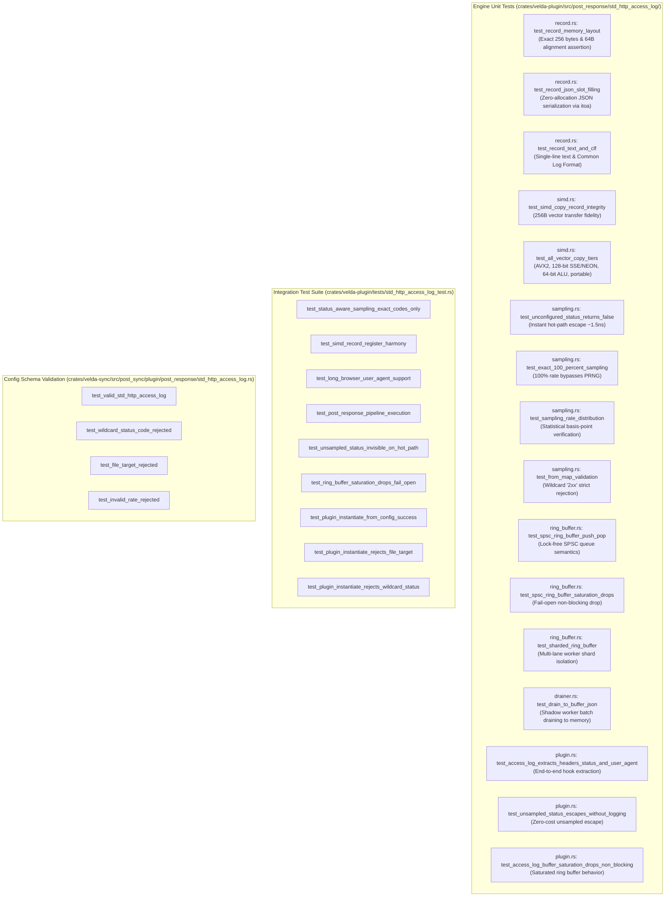

# Standard Stream Access Log Plugin (`std_http_access_log`) — Test Specification

This document details the test architecture, automated unit test catalog, integration test suite, adversarial security validation, and live verification reproduction for the **`std_http_access_log`** post-response plugin in Velda Edge.

---

## 1. Test Architecture & Scope

The `std_http_access_log` test suite validates functional correctness, vector register copy integrity, status-aware sampling precision, SPSC ring buffer lock-free semantics, and single-syscall batch draining across four key test dimensions:



---

## 2. Automated Test Catalog

### 2.1 Engine Unit Tests (`crates/velda-plugin/src/post_response/std_http_access_log/`)

| Test Identifier | Module | Description | Assertions & Invariants |
| :--- | :--- | :--- | :--- |
| `test_record_memory_layout` | `record.rs` | Verifies compile-time size and alignment assertions. | `size_of::<PackedLogRecord>() == 256`, `align_of == 64`. |
| `test_record_json_slot_filling` | `record.rs` | Validates static template byte slot-filling directly into a byte buffer. | JSON string contains `status: 200`, `method: GET`, `latency_us: 12340`, `user_agent: Mozilla/5.0...`. Zero heap allocations. |
| `test_record_text_and_clf` | `record.rs` | Validates Text and Nginx Combined Log Format (CLF). | Text format: `[timestamp] status=404 method=POST bytes=0 ua="..."`. CLF: `"... POST / HTTP/1.1 404 0 "-" "curl/8.5.0""`. |
| `test_simd_copy_record_integrity`| `simd.rs` | Validates bit-exact vector copy across all 256 bytes of `PackedLogRecord`. | Destination matches source exactly across all scalar fields, IDs, and 140+ byte User-Agent strings. |
| `test_all_vector_copy_tiers` | `simd.rs` | Exercises all 4 hardware implementation tiers directly. | Validates `copy_record_256`, `copy_record_128`, `copy_record_64`, and `copy_record_portable`. |
| `test_unconfigured_status_returns_false`| `sampling.rs`| Validates instant escape when status codes are not explicitly declared. | `should_sample(200)`, `404`, `500` return `false` instantly when unconfigured. |
| `test_exact_100_percent_sampling`| `sampling.rs`| Validates 100% rate bypasses PRNG arithmetic. | Returns `true` 100 out of 100 times without calling thread-local random number generator. |
| `test_from_map_validation` | `sampling.rs`| Validates parsing of sampling map and rejection of wildcard patterns. | Rejects `"2xx"` with explicit error. Accepts `"200": 0.05` and sets basis points to 500. |
| `test_spsc_ring_buffer_push_pop`| `ring_buffer.rs`| Validates lock-free push/pop and pointer wrap-around. | Pushes records, verifies batch drainage, and confirms empty state on subsequent pop. |
| `test_spsc_ring_buffer_saturation_drops`| `ring_buffer.rs`| Fills ring buffer to capacity and tests fail-open non-blocking push rejection. | Capacity saturated: `try_push` returns `Err(())` without locking or blocking. |
| `test_drain_to_buffer_json` | `drainer.rs`| Validates shadow worker batch draining directly into reusable buffer. | Emits formatted JSON string to memory buffer without disk I/O. |
| `test_access_log_extracts_headers_status_and_user_agent`| `plugin.rs`| Full hook execution extracting headers, method, status, and User-Agent. | Extracts status 200, latency 14.5ms (14500us), User-Agent, request ID, upstream address. |

---

### 2.2 Integration Tests (`crates/velda-plugin/tests/std_http_access_log_test.rs`)

| Test Identifier | Description | Invariant Verified |
| :--- | :--- | :--- |
| `test_status_aware_sampling_exact_codes_only` | Tests 0%, 5%, 100% sampling behavior and unconfigured code isolation. | No default rate; exact basis-point distribution over 10,000 trials. |
| `test_simd_record_register_harmony` | Tests 256B cacheline-aligned struct vector transfers. | Struct size 256B, align 64B, zero data corruption on vector registers. |
| `test_long_browser_user_agent_support` | Tests 150+ byte Safari and Chrome User-Agents inline. | Inline storage up to 192 bytes preserves full browser signature without heap allocation. |
| `test_post_response_pipeline_execution` | Executes full `run_post_response_plugins` chain. | Seamless integration with `L7Response` and `HeaderWorkspace`. |
| `test_unsampled_status_invisible_on_hot_path` | Evaluates execution path for unconfigured status code. | Zero records logged, zero dropped, zero ring buffer interactions. |
| `test_ring_buffer_saturation_drops_fail_open` | Pushes 200 requests into a 64-capacity queue. | Downstream serving continues without blocking; `logged + dropped == 200`. |
| `test_plugin_instantiate_from_config_success` | Instantiates plugin from declarative JSON. | Sub-dispatcher recognizes `"std_http_access_log"`. |
| `test_plugin_instantiate_rejects_file_target` | Submits config with `"target": "file"`. | Rejected with error: direct file logging is forbidden. |
| `test_plugin_instantiate_rejects_wildcard_status` | Submits config with `"sampling": {"2xx": 0.1}`. | Rejected with error: wildcards like '2xx' are forbidden. |

---

## 3. Security & Robustness Scenarios

### 3.1 Direct File Logging Prohibition
- **Threat**: Disk I/O freezes, kernel page cache dirty ratio stalls (`sync`), or file descriptor exhaustion causes frontline worker threads to hang, cascading into gateway-wide outage.
- **Velda Defense**: `std_http_access_log` strictly forbids `"target": "file"`. Only standard streams (`stdout` / `stderr`) are permitted, offloaded to the background Shadow Worker via a single `libc::write` syscall per batch.

### 3.2 Log Injection & CRLF Defense
- **Threat**: Attackers inject `\r\n` or unescaped quotes (`"`) inside the `User-Agent` or request headers to forge log lines or corrupt JSON output.
- **Velda Defense**: The slot-filling serializer explicitly escapes `"` and `\` characters in `PackedLogRecord::write_json` (`b == b'"' || b == b'\\'` $\to$ injects `\`), preventing log format manipulation.

### 3.3 Buffer Exhaustion & DoS Containment
- **Threat**: Traffic spike produces logs faster than standard streams can consume, leading to unbounded memory allocation and OOM crashes.
- **Velda Defense**: All queues are bounded SPSC ring buffers. When full, `try_push` returns `Err(())` and increments `dropped_count` via relaxed atomic operation. Frontline workers never wait or allocate.

---

## 4. Verification Reproduction Commands

```bash
# 1. Run all std_http_access_log unit tests in velda-plugin
cargo test -p velda-plugin --lib post_response::std_http_access_log

# 2. Run all std_http_access_log integration tests
cargo test -p velda-plugin --test std_http_access_log_test

# 3. Run all schema validation tests in velda-sync
cargo test -p velda-sync --lib post_sync::plugin::post_response::std_http_access_log

# 4. Verify code formatting and linting
cargo fmt --check
cargo clippy -p velda-plugin -p velda-sync --all-targets --all-features -- -D warnings
```
