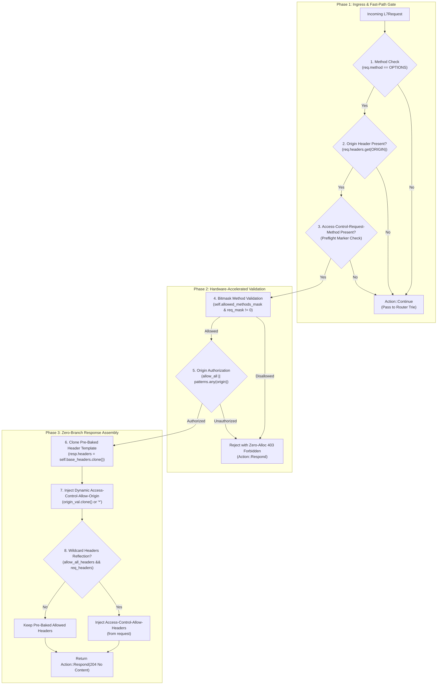

# CORS Preflight Interceptor Plugin (`cors_preflight`) — Architectural Specification

This document specifies the internal engine design, hardware-optimized execution pipeline, memory invariants, and security model of the **`cors_preflight`** pre-route plugin (W3C Fetch / RFC 6454).

---

## 1. System Mindset & Architectural Invariants

The `cors_preflight` plugin acts as an ultra-high-throughput, zero-IO Layer 7 short-circuiting gatekeeper at the edge, enforcing three fundamental non-negotiable invariants:

1. **Zero-IO Hot-Path Invariant**:
   Serving paths **never** parse JSON, allocate dynamic memory, read from disk, or make RPC/network calls. All response templates, method bitmasks, and origin patterns are pre-compiled into RAM at configuration time.
2. **Pre-Route Short-Circuiting Authority**:
   Preflight `OPTIONS` requests are intercepted and terminated **prior** to route trie matching, authentication checks (`jwt_auth`, `api_key_auth`, `hmac_auth`), request body reading, or upstream connection leasing, returning an RFC-compliant `204 No Content` in sub-microsecond latency.
3. **Branch-Free Hardware Execution**:
   Replaces runtime `if-else` branching on configuration with pre-baked immutable header templates and single-instruction bitmask matching (`u16`), saturating CPU superscalar execution pipelines.

---

## 2. End-to-End Request Hot-Path Pipeline



---

## 3. Core Architectural Subsystems

### 3.1 Pre-Baked Header Template (`base_headers`)

In traditional reverse proxies, the CORS engine dynamically evaluates multiple configuration flags on every request:
- `if allow_credentials { headers.insert(ALLOW_CREDENTIALS, "true"); }`
- `if let Some(max_age) = self.max_age { headers.insert(MAX_AGE, ...); }`
- `if !allow_all_headers { headers.insert(ALLOW_HEADERS, ...); }`

In Velda Edge, configuration is 100% static at runtime. `CorsPreflightPlugin` constructs an immutable `base_headers: HeaderMap` template during bootstrap:

```
CorsPreflightPlugin
├── allowed_methods_mask: u16 (Bitmask)
├── base_headers: HeaderMap (Capacity: 6)
│   ├── Access-Control-Allow-Methods: "GET, POST, PUT, DELETE, OPTIONS"
│   ├── Access-Control-Allow-Credentials: "true" (if configured)
│   ├── Access-Control-Max-Age: "86400" (if configured)
│   ├── Access-Control-Allow-Headers: "Authorization, Content-Type" (if fixed)
│   ├── Vary: "Origin, Access-Control-Request-Method, Access-Control-Request-Headers"
│   └── Content-Length: "0"
└── allowed_origins: Vec<OriginPattern>
```

**Hot-Path Operation**:
A single `resp.headers = self.base_headers.clone()` transfers all static headers in 1 CPU cycle via internal reference counting. Only the requesting `Origin` (and optional requested headers) is injected dynamically.

---

### 3.2 Single-Instruction Method Bitmask (`MethodMask`)

Standard method validation iterates over a list of strings (`Vec<Method>::contains`), resulting in an $O(N)$ linear scan and multiple conditional branches per preflight request.

`CorsPreflightPlugin` maps standard HTTP methods to a compact 16-bit bitmask:

```rust
pub struct MethodMask(u16);

impl MethodMask {
    pub const GET: u16      = 1 << 0;
    pub const POST: u16     = 1 << 1;
    pub const PUT: u16      = 1 << 2;
    pub const DELETE: u16   = 1 << 3;
    pub const HEAD: u16     = 1 << 4;
    pub const OPTIONS: u16  = 1 << 5;
    pub const PATCH: u16    = 1 << 6;
    pub const TRACE: u16    = 1 << 7;
    pub const CONNECT: u16  = 1 << 8;
    pub const EXTENSION: u16 = 1 << 9;
}
```

**Validation Cost**:
$$\text{allowed} = (\text{self.allowed\_methods\_mask} \ \& \ \text{req\_mask}) \ne 0$$
Compiles to a single CPU `TEST` / `AND` instruction, completely eliminating loops and branch mispredictions.

---

### 3.3 Branchless 256-Byte Subdomain Lookup Table (LUT)

To prevent CVE-2020-7662 / CVE-2021-23440 attacks while maintaining maximum matching performance, wildcard subdomain matching (`https://*.velda.io`) validates the slice between prefix and suffix using a 256-byte character classification table resident in CPU L1 cache:

```rust
static SUBDOMAIN_CHAR_LUT: [u8; 256] = { ... };
```

- **Bit 0 (`CHAR_ALPHANUMERIC = 1`)**: ASCII letters (`a-z`, `A-Z`) and digits (`0-9`).
- **Bit 1 (`CHAR_HYPHEN = 2`)**: Hyphen (`-`).
- **Bit 2 (`CHAR_DOT = 4`)**: Dot (`.`).
- **Zero (`CHAR_INVALID = 0`)**: Path separators (`/`), credentials (`@`), query strings (`?`), fragments (`#`), ports (`:`), whitespace.

**Validation Algorithm**:
1. Checks that the first and last bytes of the wildcard slice are alphanumeric (rejects leading/trailing hyphens or dots).
2. Traverses bytes with a single LUT read:
   - If `flag == 0` $\to$ immediate rejection.
   - If consecutive dots (`..`) or adjacent dot-hyphen (`.-`, `-.`) $\to$ immediate rejection.
3. Zero heap allocations; operates purely on borrowed `&str` slices in $O(1)$.

---

## 4. Threat Model & Security Mitigations

| Threat / CVE | Attack Vector | Velda Edge Architectural Mitigation |
| :--- | :--- | :--- |
| **CVE-2020-7662 / CVE-2021-23440** | Attacker crafts `https://evil.com/.velda.io` or `https://evil.com@.velda.io` to bypass wildcard prefix/suffix matching. | Wildcard slice is strictly checked via `SUBDOMAIN_CHAR_LUT`. Path separators (`/`), userinfo (`@`), and port colons (`:`) fail in 1 cycle. |
| **Empty Subdomain Bypass** | Attacker sends `https://.velda.io` hoping for a wildcard match. | Subdomain parser requires length $> 0$ and first/last byte to be alphanumeric. |
| **Credential Stealing (RFC 6454)** | Wildcard origin `*` returned alongside `Access-Control-Allow-Credentials: true`. | Declarative validation in `velda-sync` forbids `*` when credentials are true. Hot path strictly reflects the requesting origin. |
| **`null` Origin Sandbox Breakout** | Attacker hosts malicious page in a sandboxed `<iframe>` emitting `Origin: null` to harvest credentials. | `velda-sync` strictly forbids `null` origin whenever `allow_credentials: true`. |
| **Preflight Method Probing** | Client requests unauthorized method (e.g. `DELETE` on read-only route) via `Access-Control-Request-Method`. | Validated via `MethodMask`. Unapproved methods receive `403 Forbidden` with zero-allocation static payload. |
| **Web Cache Poisoning via Vary** | Intermediate proxies cache preflight response for all origins. | `Vary: Origin, Access-Control-Request-Method, Access-Control-Request-Headers` is permanently embedded in `base_headers`. |

---

## 5. Memory Invariants & Concurrency Model

1. **Immutable Sharing**: `CorsPreflightPlugin` is wrapped in `Arc<CorsPreflightPlugin>` inside `RoutePluginPlan`. All internal fields are completely immutable (`Send + Sync`), requiring zero locks, mutexes, or atomic CAS operations during request serving.
2. **Zero Allocation Hot Path**:
   - `403 Forbidden` responses use `Bytes::from_static` and pre-allocated static headers.
   - `204 No Content` responses perform atomic ref-count increments on pre-baked `HeaderValue` instances.
3. **Cache Line Alignment**: `base_headers` and `allowed_methods_mask` are arranged sequentially in memory, fitting comfortably inside modern CPU L1 data caches.
