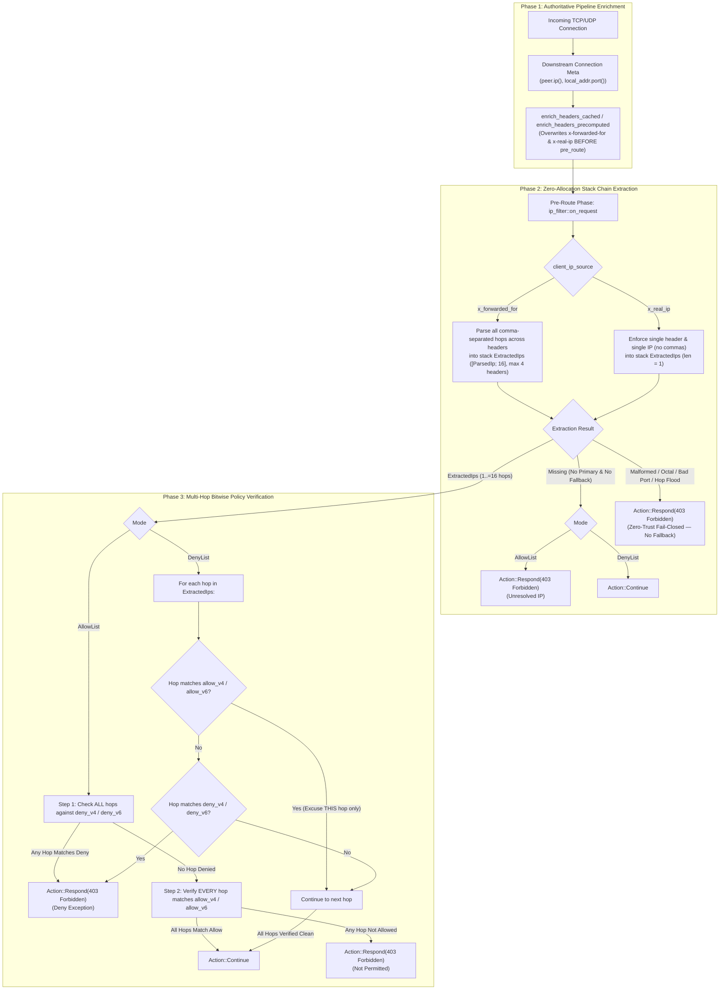

# IP / CIDR Subnet Access Filter Plugin (`ip_filter`) — Architectural Specification

This document specifies the internal engine design, bitwise CIDR prefix matching mechanics, zero-trust multi-hop anti-spoofing pipeline integration, IPv6-to-IPv4 transition canonicalization, and zero-allocation memory invariants of the **`ip_filter`** pre-route perimeter gatekeeper plugin.

---

## 1. System Mindset & Architectural Invariants

The `ip_filter` plugin operates at the ingress pre-route phase of Velda Edge, enforcing high-throughput Layer 7 access control at the edge perimeter before downstream route matching or upstream connection leasing. It adheres strictly to seven core architectural invariants:

1. **Pre-Route Ingress Isolation & Authoritative Transport Enrichment**:
   Evaluates incoming requests **prior** to router trie resolution, authentication plugins (`jwt_auth`, `oauth2_introspection`), payload streaming, or upstream pool connection leasing. Both HTTP/1.1 (`enrich_headers_cached`) and HTTP/2 (`enrich_headers_precomputed`) downstream pipelines execute authoritative transport peer IP enrichment **before** route matching and pre-route plugins, neutralizing direct client header spoofing.
2. **Deterministic Bitwise Matching with Zero Heap Allocation**:
   Evaluates CIDR subnets using pure bitwise arithmetic: `(ip_bits & mask) == net_bits`. IPv4 evaluates in 1 CPU cycle on `u32`, and IPv6 evaluates on native `u128`. Once initialized, request evaluation incurs **0 heap allocations** and **0 dynamic dispatch overhead**.
3. **Zero-Trust Stack-Allocated Multi-Hop Chain Verification (`ExtractedIps`)**:
   Extracts up to `MAX_XFF_HOPS = 16` hops across up to `MAX_XFF_HEADERS = 4` `X-Forwarded-For` header lines into a fixed stack buffer (`[ParsedIp; 16]`). Every hop in the chain is verified against the policy, neutralizing multi-hop XFF spoofing and allow-exception smuggling.
4. **Universal IPv6-to-IPv4 Transition & Tunneling Canonicalization**:
   Automatically canonicalizes all four IPv6-embedded IPv4 transition mechanisms to native 32-bit IPv4 (`u32`) at both CIDR compilation time and request evaluation time:
   - RFC 4291 IPv4-mapped (`::ffff:a.b.c.d`)
   - RFC 2765 SIIT IPv4-translated (`::ffff:0:a.b.c.d`)
   - RFC 6052 Well-Known NAT64 (`64:ff9b::a.b.c.d`)
   - RFC 4291 §2.5.5.1 IPv4-compatible (`::a.b.c.d`, excluding `::` and `::1`)
5. **Fast-Path Byte-Level Parser with CVE-2021-28918 Octal & Port Validation**:
   Parses client IPv4 octets directly from raw header byte slices (`&[u8]`) in CPU registers in ~2ns without UTF-8 validation overhead. Rejects leading zeros (`010.0.0.1`) to prevent octal parser differentials, validates port suffixes strictly in `1..=65535`, and trims only RFC 9110 OWS (`SP` / `HTAB`).
6. **Prefix Compaction, Subsumption Elimination & Shadowing Detection**:
   Compacts and deduplicates CIDRs at load time and in `velda-sync`. Broadest subnets (`/8`, `/16`) are sorted first to maximize early loop short-circuiting. Child subnets completely contained within a broader subnet in the same list are pruned, and cross-list shadowed rules are rejected at validation time.
7. **Pre-Baked Zero-Allocation Rejection & Fail-Closed Anti-Evasion**:
   Rejections clone an immutable pre-allocated `403 Forbidden` response template with `Content-Type: text/plain; charset=utf-8` and `Cache-Control: no-store`. Malformed headers, duplicate `X-Real-IP` headers, or hop floods (`> 16` hops) are strictly rejected with 403 in both `allow` and `deny` modes without cross-header fallback.

---

## 2. End-to-End Request Hot-Path Pipeline

---

## 3. Subsystem Architecture

### 3.1 Fast-Path IP & Multi-Hop Chain Decoder (`network.rs`)

Operates directly on raw byte slices with zero heap allocations:
- `ExtractedIps`: Stack-allocated `[ParsedIp; 16]` buffer holding up to 16 parsed hops.
- `parse_ipv4_bytes(bytes: &[u8]) -> Option<u32>`: Parses 4 decimal octets into native `u32` bits in ~2ns. Rejects leading zeros (`oct_len > 0 && val == 0`) to prevent CVE-2021-28918 octal parser differentials.
- `is_valid_port_bytes(port: &[u8]) -> bool`: Enforces strict `1..=65535` numeric port validation with no leading zeros or trailing `@userinfo`.
- `canonicalize_v6_bits(bits: u128) -> ParsedIp`: Canonicalizes RFC 4291 mapped (`::ffff:0:0/96`), RFC 2765 SIIT (`::ffff:0:0:0/96`), RFC 6052 NAT64 (`64:ff9b::/96`), and RFC 4291 compatible (`::a.b.c.d`) addresses to `ParsedIp::V4(u32)`.

### 3.2 Subnet Compaction & Sorting (`network.rs`)

During initialization and sync:
1. Deduplicates identical `(net, mask)` pairs.
2. Sorts by prefix length ascending: masks with fewer ones (`/0`, `/8`, `/16`) appear before (`/24`, `/32`).
3. Prunes child subnets: if `(net_b & parent_mask) == parent_net`, subnet B is omitted.

### 3.3 Configuration Normalization, Compaction & Shadowing Defense (`velda-sync`)

`velda-sync::validate_ip_filter_config`:
- Canonicalizes all CIDRs (e.g. `192.168.1.5` $\to$ `192.168.1.5/32`, host-bit masking `10.1.2.3/8` $\to$ `10.0.0.0/8`, `64:ff9b::10.99.0.0/112` $\to$ `10.99.0.0/16`).
- Compacts intra-list subsumed subnets (`10.0.0.0/8` + `10.1.2.0/24` $\to$ `10.0.0.0/8`).
- Detects contradictory rules and cross-list subnet shadowing (`allow_cidr` covered by broader `deny_cidr` in `allow` mode, or `deny_cidr` covered by broader `allow_cidr` in `deny` mode).

---

## 4. CVE & Adversarial Security Mitigations Matrix

| Vulnerability / Attack Vector | Exploit Syntax / Scenario | Behavior in Naive Filter | Mitigation in `ip_filter` |
| :--- | :--- | :--- | :--- |
| **Multi-Hop XFF Spoofing (`AllowList`)** | `X-Forwarded-For: 10.0.0.1, 203.0.113.5` | Inspects only index 0 (`10.0.0.1`) and grants access to external attacker `203.0.113.5`. | Evaluates **all hops** in `ExtractedIps`; rejects if any hop is outside `allow_cidrs` or inside `deny_cidrs`. |
| **Allow-Exception Smuggling (`DenyList`)** | `X-Forwarded-For: 203.0.113.10, 203.0.113.5` | Hop 0 matches `allow_cidrs` exception and returns global `Continue`, letting blacklisted `203.0.113.5` through. | Per-hop exception evaluation excuses only hop 0 (`203.0.113.10`) and blocks hop 1 (`203.0.113.5`). |
| **Cross-Header Fallback Poisoning** | `X-Forwarded-For: garbage` + `X-Real-IP: 10.0.0.1` | Primary header fails to parse; fallback reads attacker-controlled `X-Real-IP`. | Zero fallback when primary header is present; immediately rejects as `Malformed` (`403 Forbidden`). |
| **Duplicate Header / List Smuggling** | Two `X-Real-IP` headers or `X-Real-IP: 10.0.0.1, 203.0.113.5` | Inspects first header while backend inspects second header. | `X-Real-IP` enforces exactly 1 header and 1 IP (no commas); `X-Forwarded-For` evaluates all headers up to 4. |
| **CVE-2021-28918 Octal IPv4 Differential** | `X-Forwarded-For: 010.0.0.1` | Naive decimal parser treats `010.0.0.1` as `10.0.0.1` while backend `inet_aton` treats it as octal `8.0.0.1`. | Rejects any multi-digit IPv4 octet with a leading `'0'` as `Malformed` (`403 Forbidden`). |
| **Port & Userinfo Smuggling** | `10.0.0.1:80@203.0.113.5`, `10.0.0.1:0`, `[2001:db8::1]evil` | Naive `split(':')` ignores everything after colon without validating port. | Strictly validates port suffix as decimal `1..=65535` with no leading zeros or trailing characters. |
| **IPv6 Transition Tunneling (NAT64 / SIIT / Mapped / Compat)** | `64:ff9b::203.0.113.5`, `::ffff:0:203.0.113.5`, `::203.0.113.5`, `::ffff:cb00:7105` | Evaluates as IPv6, bypassing IPv4 `203.0.113.0/24` denylist. | Canonicalizes RFC 4291 Mapped, RFC 2765 SIIT, RFC 6052 NAT64, and RFC 4291 Compatible addresses to `u32` IPv4. |
| **HTTP Control-Char Whitespace Smuggling** | `X-Forwarded-For: \x0c10.0.0.1` | Rust `is_ascii_whitespace()` strips `\x0c` (Form Feed) or `\r\n`. | Strips only strict RFC 9110 OWS (`SP` `0x20` and `HTAB` `0x09`); rejects control characters. |
| **XFF Hop-Flood DoS** | `X-Forwarded-For` with 1,000+ comma-separated IPs | Allocates unbounded `Vec<IpAddr>` or loops thousands of times per request. | Bounded stack array (`MAX_XFF_HOPS = 16`, `MAX_XFF_HEADERS = 4`); >16 hops fails closed in O(1). |
| **HTTP/1.1 & HTTP/2 Direct Header Spoofing** | Direct client sends `X-Forwarded-For: 10.0.0.1` | If enrichment runs after `pre_route`, filter trusts spoofed client header. | Transport pipelines overwrite `x-forwarded-for` and `x-real-ip` from socket peer IP *before* route matching and `pre_route`. |
