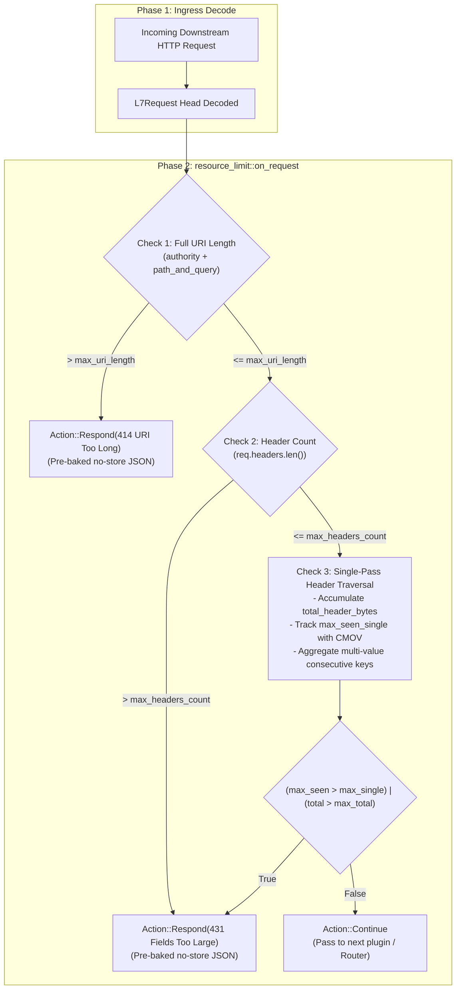

# Resource Limit Plugin (`resource_limit`) — Architectural Specification

This document specifies the internal pipeline design, single-pass branch-minimized execution loop, anti-CPDoS cache control headers, and zero-allocation memory invariants of the **`resource_limit`** pre-route perimeter gatekeeper plugin.

---

## 1. System Mindset & Architectural Invariants

The `resource_limit` plugin operates at the ingress pre-route phase of Velda Edge, enforcing physical resource boundaries before router trie lookup, authentication plugins, body streaming, or upstream connection leasing. It adheres strictly to five core architectural invariants:

1. **Pre-Route Ingress Isolation**:
   Terminates requests exceeding physical bounds **prior** to router trie resolution or downstream pipeline execution. Prevents oversized queries and headers from wasting CPU cycles in WAF regexes, access log formatters, or upstream backend connection pools.
2. **CPDoS (Cache-Poisoned Denial of Service) Invariant**:
   All 414 (`URI Too Long`) and 431 (`Request Header Fields Too Large`) rejection responses strictly include immutable `Cache-Control: no-store` headers. This prevents forward reverse proxies and CDNs with normalized cache keys from caching client-induced limit rejections.
3. **Single-Pass Branch-Minimized Header Loop**:
   Avoids inner conditional jumps (`if val_len > ...`, `if total_header_bytes > ...`) inside the header traversal loop. Employs branchless `CMOVA` (`.max()`) to track maximum seen header sizes and defers validation to a single bitwise OR check after the loop completes.
4. **Header Name Bombing & Multi-Value Aggregation**:
   Evaluates header name sizes (`name.as_str().len()`) against `max_single_header_bytes` to prevent name-based memory exhaustion. Aggregates consecutive entries sharing the same `HeaderName` in $O(1)$ stack registers to prevent multi-value fragmentation bypasses.
5. **Pre-Baked Zero-Allocation Rejection**:
   Responses use pre-allocated static byte slices (`Bytes::from_static`) and pre-warmed `HeaderWorkspace` instances. Rejecting bad traffic consumes **0 heap allocations** and executes in single-digit nanoseconds.

---

## 2. End-to-End Request Hot-Path Pipeline



---

## 3. Subsystem Architecture

### 3.1 Branch-Minimized Header Verification Loop

```rust
let mut prev_name: Option<&HeaderName> = None;
let mut current_key_val_bytes = 0usize;
let mut max_single_header_seen = 0usize;
let mut total_header_bytes = 0usize;

for (name, val) in &req.headers {
    let name_len = name.as_str().len();
    let val_len = val.as_bytes().len();

    total_header_bytes += name_len + val_len + 4;
    max_single_header_seen = max_single_header_seen.max(name_len);

    if prev_name == Some(name) {
        current_key_val_bytes += val_len + 2;
    } else {
        prev_name = Some(name);
        current_key_val_bytes = val_len;
    }
    max_single_header_seen = max_single_header_seen.max(current_key_val_bytes);
}

if (max_single_header_seen > self.limits.max_single_header_bytes)
    | (total_header_bytes > self.limits.max_header_bytes)
{
    return Action::Respond(self.header_fields_too_large_response.clone());
}
```

### 3.2 Protocol Isolation Invariant (`ALL_HTTP` vs `ALL_L7`)

Per `AGENTS.md` Rule 2.7, `resource_limit` declares `SupportedProtocols::ALL_HTTP`:
- gRPC operates over HTTP/2 binary framing without query strings, uses `grpc-status` trailers instead of HTTP 414/431 JSON bodies, and has native buffer limit parameters in `GrpcConfig`.
- REST HTTP requires text framing estimates (`+4 bytes`), query string enforcement, and RFC 9110 status codes.
