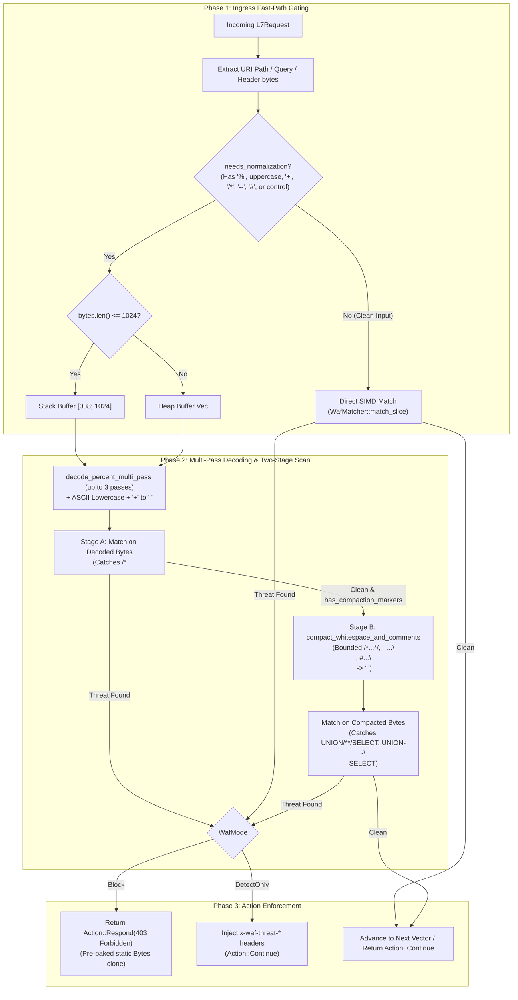

# Web Application Firewall Lite Plugin (`waf_lite`) — Architectural Specification

This document specifies the internal engine design, hardware-optimized execution pipeline, anti-evasion normalization algorithms, and memory invariants of the **`waf_lite`** pre-route perimeter firewall plugin.

---

## 1. System Mindset & Architectural Invariants

The `waf_lite` plugin operates at the ingress pre-route phase of Velda Edge, enforcing high-throughput Layer 7 threat rejection at the edge perimeter before downstream route matching or upstream connection leasing. It adheres strictly to six core architectural invariants:

1. **Pre-Route Ingress Isolation**:
   Evaluates incoming requests **prior** to route trie resolution, authentication plugins (`jwt_auth`, `hmac_auth`, `oauth2_introspection`), payload reading, or upstream connection leasing. Malicious scanners probing non-existent paths or admin interfaces are neutralized immediately, shielding backend connection pools.
2. **Deterministic $O(N)$ Zero-Regex Execution**:
   Replaces backtracking regular expressions (PCRE/regex) with SIMD multi-pattern Aho-Corasick automata (`aho_corasick::AhoCorasick`). Scanning latency is strictly linear with respect to input byte length, completely eliminating Regular Expression Denial of Service (ReDoS) vulnerabilities.
3. **Zero Heap Allocation & Zero UTF-8 Validation on Hot Path**:
   All scanning and normalization operate directly on raw byte slices (`&[u8]`). Inputs $\le 1024$ bytes (99.99% of paths, queries, and headers) are normalized in-place on a fixed stack buffer (`[0u8; 1024]`). Eliminating `std::str::from_utf8` validation prevents CPU overhead and completely removes `String::from_utf8_lossy` heap allocation fallbacks.
4. **Two-Stage Anti-Evasion & Comment-Smuggling Defense**:
   Normalizes request vectors and defends against comment-wrapping and parameter-pollution bypasses:
   - *Triple Percent-Encoding Defense*: Up to 3 recursive in-place passes handle nested percent sequences (`%25252e` $\to$ `%252e` $\to$ `%2e` $\to$ `.`).
   - *Form-Urlencoded Query Space*: Decodes `+` to ASCII space `' '` for query string parameters.
   - *Stage A (Pre-Comment-Strip Scan)*: Evaluates percent-decoded, lowercased bytes *before* SQL comment stripping so attackers cannot hide `<script>`, `${jndi:...}`, or `;whoami` inside `/* ... */`.
   - *Stage B (Bounded Comment & Whitespace Compaction)*: Folds `\t`, `\r`, `\n`, multiple spaces, and bounded SQL comments (`/* ... */`, `-- ... [\r\n]`, `# ... [\r\n]`) into a single space `' '` without crossing `&`, `<`, or `$`, and without truncating trailing parameters on unterminated `-- `.
   - *Raw Non-ASCII Byte Defense*: Inspects raw `HeaderValue::as_bytes()` directly, preventing bypass via `0x80`–`0xFF` byte prefixing.
   - *Duplicate Header Smuggling Defense*: Inspects all occurrences of duplicate headers (`HeaderMap::get_all`).
5. **Automatic Compile-Time & Sync-Time Deduplication ("Khử trùng")**:
   `velda-sync` automatically strips any `custom_blocked_patterns` or `custom_blocked_user_agents` that are already covered by (exact match or superstring of) [`dictionary.rs`](file:///home/phucle/Desktop/velda-edge/crates/velda-plugin/src/pre_route/waf_lite/dictionary.rs) built-ins or repeated within the custom list, persisting the deduplicated configuration into `plugins.bin`.
6. **Pre-Baked Static Responses**:
   Rejections clone an immutable pre-allocated `403 Forbidden` response template (`L7Response::from_bytes`) in single-digit nanoseconds. Detect mode injects pre-baked static `HeaderValue` constants without runtime string parsing.

---

## 2. End-to-End Request Hot-Path Pipeline



---

## 3. Core Architectural Subsystems

### 3.1 Static Dictionary & Threat Classification (`dictionary.rs`)

[`dictionary.rs`](file:///home/phucle/Desktop/velda-edge/crates/velda-plugin/src/pre_route/waf_lite/dictionary.rs) owns the zero-allocation static knowledge base:
- `ThreatVector`: 1-byte `Copy` enum (`PathTraversal`, `SqlInjection`, `CrossSiteScripting`, `RemoteCodeExecution`, `MaliciousScanner`, `CustomPattern`).
- `BUILTIN_ATTACK_SIGNATURES: &[(&str, ThreatVector)]`: 119 curated, non-overlapping lowercase attack signatures across Path Traversal, SQLi, XSS, Log4j, Shell RCE, and Framework CVEs.
- `BUILTIN_MALICIOUS_USER_AGENTS: &[&str]`: 15 automated scanner User-Agent substrings.

### 3.2 SIMD Multi-Pattern Matching Engine (`WafMatcher` in `scanner.rs`)

`WafMatcher` compiles built-in and deduplicated custom signatures into two deterministic finite automata (`aho_corasick::AhoCorasick`):

```
WafMatcher
├── pattern_ac: AhoCorasick (SIMD multi-pattern automaton for attack signatures)
├── pattern_meta: Vec<ThreatVector> (Indexed 1:1 with pattern automaton IDs)
└── ua_ac: AhoCorasick (SIMD multi-pattern automaton for malicious scanners)
```

No closure wrappers or temporary `Vec<u8>` allocations are used during construction or serving. `WafMatcher::check_patterns` and `WafMatcher::check_user_agent` operate directly on raw byte slices `&[u8]`.

---

## 4. Security & Evasion Mitigations Matrix

| Attack Vector / Evasion Technique | Exploit Syntax / Payload | Vulnerability in Naive WAF | Mitigation in `waf_lite` |
| :--- | :--- | :--- | :--- |
| **Double / Triple URL-Encoding** | `%25252e%25252e%25252fetc/passwd` | Single decode stops at `%252e` or `%2e`, missing `../`. | 3-pass in-place decoding collapses nested `%25` sequences to `../`. |
| **SQL Inline & Line Comments** | `UNION/**/SELECT`, `UNION--%0aSELECT` | Split keywords evade fixed `union select` signature. | Stage B folds bounded `/*...*/`, `--...[\r\n]`, and `#...[\r\n]` into `' '`. |
| **Comment-Wrapped XSS / RCE** | `/*<script>alert(1)</script>*/`, `/*${jndi:...}*/` | Naive comment stripping deletes `<script>` or `${jndi:}` before matching. | Stage A scans percent-decoded bytes *before* comment folding, and comment folding refuses to cross `<` or `$`. |
| **Parameter Smuggling via Comments** | `?a=/*&id=1'+UNION+SELECT+1&b=*/` | Comment stripper deletes middle query parameters between `/*` and `*/`. | Comment folding aborts on `&`, preserving all query parameters. |
| **Unterminated `--` Truncation** | `?a=--%20&id=1'+UNION+SELECT+1` | Treating `-- ` without `\n` as EOF comment truncates rest of query string. | Single-line `--` only folds when terminated by `\n` or `\r`. |
| **Non-ASCII Byte Evasion** | `Referer: \x80${jndi:ldap...}` | `HeaderValue::to_str()` fails with `Err`, skipping header scan entirely. | Scans raw `val.as_bytes()` directly without UTF-8 validation. |
| **Duplicate Header Smuggling** | Multiple `User-Agent` / custom headers | `req.headers.get()` inspects only the first header. | Iterates over `req.headers.get_all(hdr)` for every configured header. |

---

## 5. Thread Safety & Lifecycle Architecture

1. **Immutable Configuration**: Once compiled during bootstrap or dynamic configuration sync (`velda-sync`), `WafLitePlugin` is completely immutable. Worker threads share access via `Arc<dyn PreRoutePlugin>` without mutexes, rwlocks, or atomic synchronization on the hot path.
2. **Thread-Local Stack Buffer**: The 1024-byte normalization buffer resides on the worker thread's execution stack (`[0u8; 1024]`), guaranteeing zero contention across CPU cores.
3. **Dynamic Reconfiguration**: Route plugin plans are updated via LKG atomic pointer swapping (`Arc<PluginTable>`). Updating WAF signatures or operational modes requires zero gateway restarts and incurs zero connection drops.
