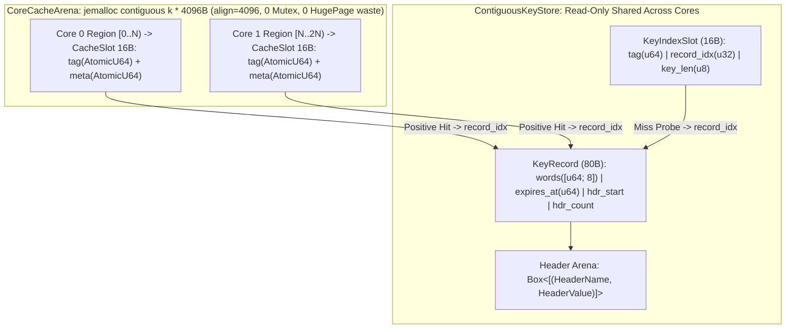

# API Key Authentication (`api_key_auth`) — Deep Architecture

## 1. Contiguous `k * 4096` Memory & Per-Core Cache Topology

---

## 2. Integer-Packed Constant-Time Verification (`[u64; 8]`)

- Keys are strictly bounded to **`1..=64` bytes** (`MAX_API_KEY_LEN = 64`), rejecting oversized credential headers immediately in `O(1)` before hashing or table access.
- `encode_key_words()` packs raw header bytes into **`[u64; 8]`** (`64` bytes = 1 L1d cache line) and folds them into a non-zero `u64` `tag`.
- `ct_eq_words()` executes 8 branchless `u64` XORs + ORs (`(a_len ^ b_len) | (a[0]^b[0]) | ... | (a[7]^b[7]) == 0`), guaranteeing constant-time verification without cross-crate dependencies or heap allocations.

---

## 3. User-Space `k * 4096` Allocation & MESI Isolation

- Both `CoreCacheArena` and `ContiguousKeyStore::index` allocate via `std::alloc::alloc_zeroed(Layout::from_size_align(k * 4096, 4096))`, mapping directly onto `jemalloc` user-space `4096`-byte page runs without requesting `2MB` HugePages.
- Each core reads and writes strictly inside its own `4096`-byte-aligned partition using `Ordering::Relaxed` atomic loads/stores and `velda_core::clock::coarse_sec()`, eliminating `Mutex` contention and cross-core MESI RFO invalidations.
- `inject_headers` overwrites target headers directly on `HeaderWorkspace` via `insert()`, and `hide_credentials` removes `header_name` when enabled.
