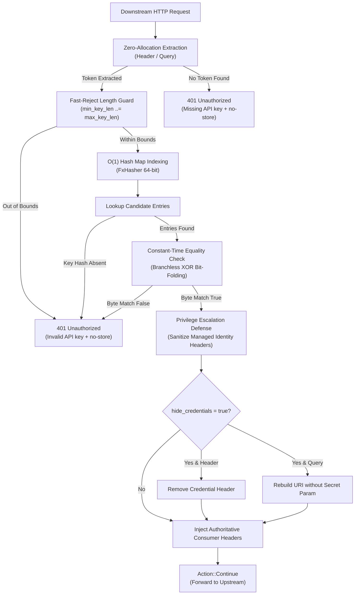
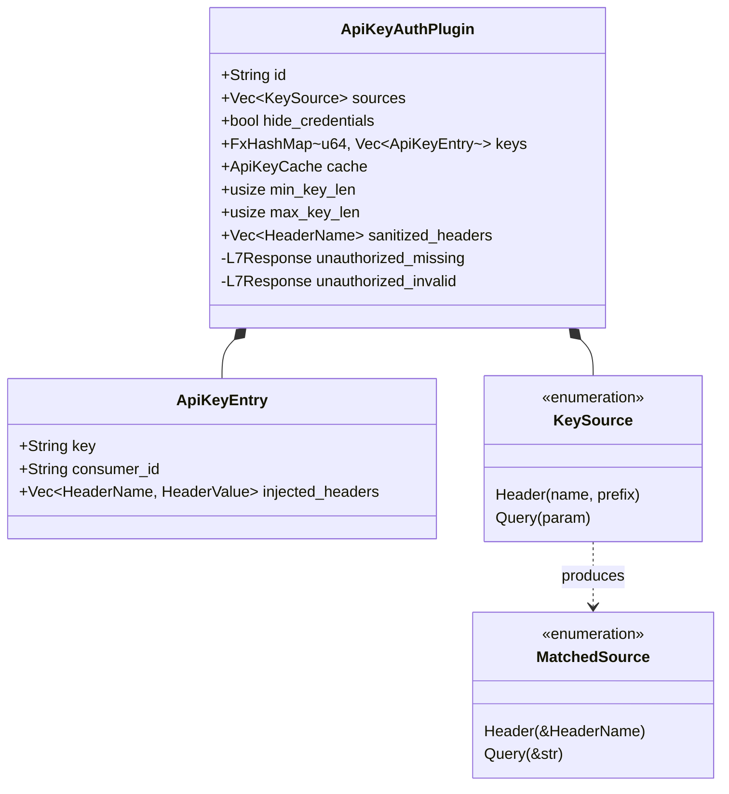

# API Key Authentication Plugin (`api_key_auth`) — Architectural Specification

This document details the internal architecture, memory layout, cryptographic invariants, and execution pipeline of the hardened **`api_key_auth`** plugin in Velda Edge.

---

## 1. Architectural Philosophy & Invariants

The `api_key_auth` plugin operates at the **`pre_upstream`** pipeline phase, enforcing zero-trust ingress token verification for B2B APIs, server-to-server microservices, and webhook endpoints prior to forwarding requests to backend upstreams.



### Core Invariants:
1. **100% Lock-Free Hot-Path**: Direct lookup against the immutable in-memory store in RAM (`self.keys`). Zero mutex locks, zero core bouncing, zero thread contention under massive single-key B2B traffic.
2. **Zero Heap Allocations on Evaluation**: Request evaluation borrows strings and headers directly; header injection bumps atomic ref-counts (`HeaderName`/`HeaderValue`).
3. **Cryptographic Constant-Time Verification (CWE-208)**: Key byte comparison executes in constant time using branchless bitwise XOR fold, eliminating timing attacks and 64-bit non-cryptographic hash collision forgeries.
4. **CPDoS Defense**: All `401 Unauthorized` responses pre-bake `Cache-Control: no-store` to prevent caching proxies or CDNs from poisoning error states.
5. **Privilege Escalation Defense**: All consumer identity headers defined across any key (`sanitized_headers`) are stripped from incoming client requests before injection.
6. **Full Credential Hygiene**: Both Header credentials and URI Query parameters are sanitized when `hide_credentials: true`.

---

## 2. Memory Layout & Data Structures



### 2.1 Fast In-Memory Key Store
Keys are stored in an immutable `FxHashMap<u64, Vec<ApiKeyEntry>>`:
- Primary index: 64-bit hash of trimmed key string.
- Value: Vector of `ApiKeyEntry` instances handling potential hash collisions cleanly.
- `min_key_len` and `max_key_len`: Calculated during initialization for sub-nanosecond fast rejection.

### 2.2 Constant-Time Equality Algorithm
```rust
#[inline]
pub fn constant_time_eq(a: &[u8], b: &[u8]) -> bool {
    if a.len() != b.len() {
        return false;
    }
    let mut diff = 0u8;
    for i in 0..a.len() {
        diff |= a[i] ^ b[i];
    }
    diff == 0
}
```
- **CPU Characteristics**: Executes a linear sequence of XOR and OR operations over the byte slices without conditional branching (`JNZ`/`JZ`).
- **Timing Independence**: Clock cycles depend strictly on key length, completely neutralizing timing analysis probes.

---

## 3. Threat Modeling & Security Mitigations

| Threat Vector | CVE / CWE Class | Mitigation Mechanism |
| :--- | :--- | :--- |
| **Hash Collision Key Forgery** | CWE-328 / CWE-347 | `constant_time_eq` validates full key bytes after hash index lookup; collision on 64-bit hash does not grant access. |
| **Timing Side-Channel Probe** | CWE-208 | Branchless bitwise XOR fold compares all bytes uniformly without early-exit on byte mismatch. |
| **Length Bombing / Hash DoS** | CWE-400 | Fast-Reject Length Guard rejects tokens outside `[min_key_len, max_key_len]` in < 1ns before hashing. |
| **Identity Header Spoofing** | CWE-287 / CWE-250 | All managed identity headers (`sanitized_headers`) stripped from client requests before injecting authenticated claims. |
| **Credential Leakage in Query** | CWE-200 / CWE-598 | `strip_query_param` reconstructs the URI without the secret query param when `hide_credentials = true`. |
| **Cache Poisoning DoS (CPDoS)** | CWE-444 / CWE-1188 | Both missing (401) and invalid (401) responses return pre-baked `Cache-Control: no-store`. |

---

## 4. Pipeline Execution Lifecycle

1. **Extraction**:
   - `extract_token_ref` iterates configured `sources`.
   - Headers: Checks all values for matching `HeaderName` (`get_all`), performs ASCII prefix comparison, returns token slice without cloning `HeaderName`.
   - Query: Iterates query pairs (`&`), extracts parameter value matching configured name.
2. **Length Guard**:
   - Token length checked against `[min_key_len, max_key_len]`.
   - Out-of-bounds tokens immediately return `401 Unauthorized` with `no-store`.
3. **Lookup & Constant-Time Validation**:
   - Computes `key_hash`.
   - Traverses candidate bucket in `self.keys`.
   - Validates candidate via `constant_time_eq`.
4. **Sanitization & Injection**:
   - If `hide_credentials`: strips matched header or rebuilds URI without query param.
   - Clears pre-existing `sanitized_headers` from downstream request.
   - Injects pre-compiled metadata headers into `req.headers`.
5. **Handoff**:
   - Returns `Action::Continue` directly to Upstream proxy pipeline.
