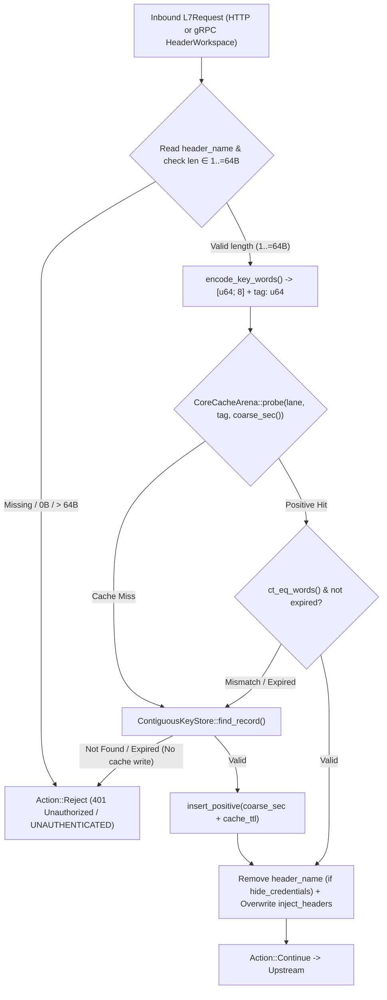

# API Key Authentication (`api_key_auth`)



## 1. What This Plugin Does

`api_key_auth` authenticates incoming HTTP (`1.1`, `2`, `3`) and gRPC requests on a unified `HeaderWorkspace` against an in-memory, `k * 4096`-byte contiguous key store backed by a lock-free per-core cache arena (`velda_core::clock::coarse_sec()`).

## 2. Where It Sits in Velda Edge

- **Execution Phase**: `pre_upstream` (runs after route matching, strictly on routes where `api_key_auth` is attached).
- **Thread Placement**: Inline on Frontline Traffic Workers (`velda-worker-{i}`).
- **Supported Protocols**: HTTP/1.1, HTTP/2, HTTP/3, and gRPC (`SupportedProtocols::ALL_HTTP | SupportedProtocols::GRPC`).
- **Capability**: `PluginCapability::header_only(AccessLevel::Write)` (zero payload buffering).

## 3. Quick Start Configuration (Multi-Key)

```json
{
  "id": "api_key_auth",
  "config": {
    "header_name": "x-api-key",
    "hide_credentials": true,
    "cache_ttl_secs": 300,
    "cache_slots_per_core": 256,
    "keys": [
      {
        "key": "sk-live-enterprise-tenant-a-9f8e7d6c5b4a",
        "expires_at": 0,
        "inject_headers": {
          "x-tenant-id": "tenant-a",
          "x-tier": "enterprise",
          "x-rate-tier": "unlimited"
        }
      },
      {
        "key": "sk-live-partner-b-temp-2026-1a2b3c4d5e6f",
        "expires_at": 1893456000,
        "inject_headers": {
          "x-tenant-id": "partner-b",
          "x-tier": "standard"
        }
      },
      {
        "key": "sk-internal-monitor-readonly-778899aabbcc",
        "expires_at": 0,
        "inject_headers": {
          "x-tenant-id": "internal-ops",
          "x-role": "readonly"
        }
      }
    ]
  }
}
```

## 4. Documentation Directory

- [**RUNBOOK.md**](RUNBOOK.md): Parameter reference, multi-key configuration recipes, cache sizing, and incident triage.
- [**ARCHITECTURE.md**](ARCHITECTURE.md): `k * 4096` user-space jemalloc extents, `[u64; 8]` constant-time integer compare, and `coarse_sec()` cache layout.
- [**BENCHMARK.md**](BENCHMARK.md): First-principles 6-scenario benchmark suite (`KB 01`–`KB 06`) and verified release ASM audit (`0` allocs, `0` spills, `0` lock fences).
- [**TEST.md**](TEST.md): Verified unit and validation test cases.
