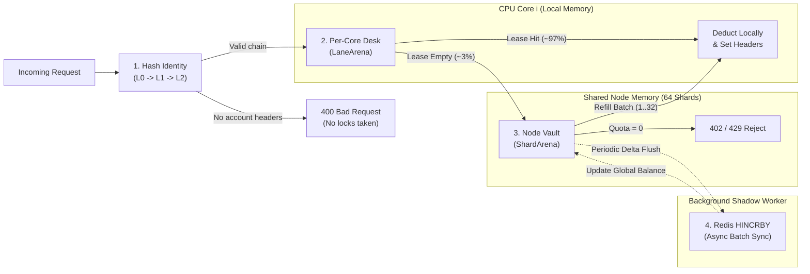
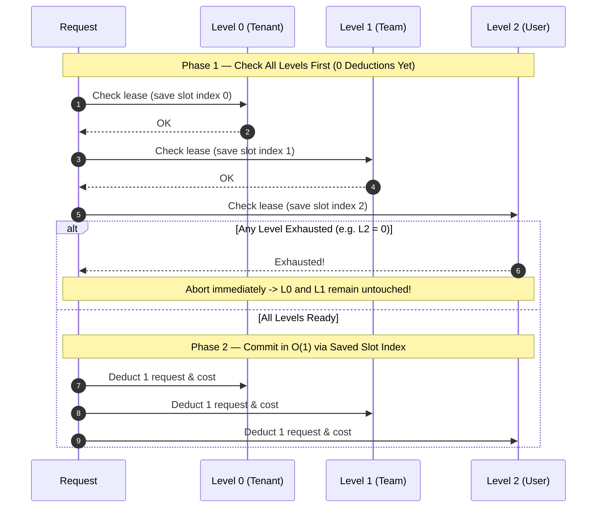
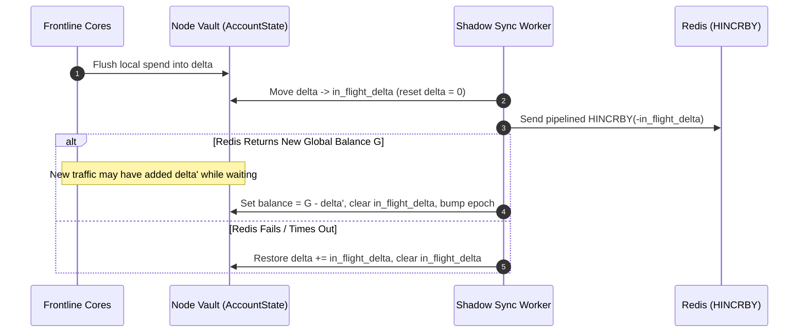

# API Metering & Monetization (`api_metering`) — Architecture Guide

This guide explains how `api_metering` delivers multi-level quota and wallet accounting at ~`70k–77k req/s` on 2 vCPUs without hitting Redis or locking across CPU cores on every request.

---

## 1. The Core Idea: Three-Tier Escrow

Checking a central counter or Redis on every HTTP request creates lock contention and network latency. Instead, `api_metering` splits accounting into three tiers — just like a **local cash register**, a **store vault**, and **bank settlement**:

1. **Tier 1 — Per-Core Desk (`LaneArena`)**: Each CPU core keeps a small, private batch of pre-approved quota ("micro-lease", up to `32` requests) in its own local memory. ~97% of requests only touch their own core's desk — zero cross-core cache fighting.
2. **Tier 2 — Node Vault (`ShardArena`, 64 shards)**: When a core's micro-lease runs out, it briefly locks one of 64 independent shards to flush what it spent and lease a fresh batch.
3. **Tier 3 — Background Bank Sync (`providers/*`)**: When `etp_id` is configured, `providers/mod.rs` dispatches cleanly to the selected SoT provider (`redis`, `valkey`, `dragonfly`, `aws_elasticache`, `gcp_memorystore`, `upstash`, `postgres`, `mysql`, `dynamodb`), batching Lua-free `HINCRBY`, parameterized SQL CTE (`velda.velda_api_metering`), or DynamoDB `velda_api_metering` updates completely off the request path; when `etp_id` is `None`, the plugin operates purely in-memory on the local node.



---

## 2. How Hierarchical Quotas Work (2-Phase Check-Then-Commit)

Suppose a route enforces 3 levels: **Tenant (`L0`) $\rightarrow$ Team (`L1`) $\rightarrow$ User (`L2`)**.

If the User (`L2`) is out of quota, we **must not** deduct a request from the Tenant (`L0`) or Team (`L1`). To prevent partial deductions, every request runs in **two phases**:

- **Phase 1 (Check & Reserve)**: Walk `L0 -> L1 -> L2`. Make sure every level has enough quota/credits (refilling from the Node Vault if needed) and remember each level's direct slot index (`record_idx`). If *any* level is exhausted, **stop immediately with 0 deductions**.
- **Phase 2 (Commit)**: Jump directly to each level's `record_idx` in $O(1)$ time (no second hash-table lookup) and subtract the request.



---

## 3. Identity Key Layout & Division-Free Hashing

Each present header in `account_headers` is hashed cumulatively (`L0`, `L0|L1`, `L0|L1|L2`) in 8-byte chunks using `SWAR` + `SplitMix64` — **zero hardware division instructions** (`ud2 = 0`), so long enterprise tenant names never fail or trap.

Bit `0` of the 64-bit key tells Phase 1 whether another child level follows:

```text
  63                                                         1   0
  +----------------------------------------------------------+---+
  |               63-bit Account Segment Hash                | C |
  +----------------------------------------------------------+---+
                                                               │
                 C = 1 : Has child level (keep walking) ───────┘
                 C = 0 : Leaf level (stop walking)

  Reserved sentinel values in hash table:
    0 = Empty slot    1 = Tombstone (deleted)    >= 2 = Live key
```

---

## 4. Memory Layout & Why RAM Doesn't Fragment

Instead of allocating millions of small Rust objects on the heap, `api_metering` stores everything in contiguous **4 KiB-aligned page slabs** (`(k + 1) * 4096 B`) split into two arrays:

1. **Index Array (`16 B` per slot)**: 4 slots fit inside a single 64-byte CPU cache line, making hash-table probing fast and pointing directly to the account record.
2. **Dense Record Array**:
   - **Per-Core Record (`128 B` = 2 cache lines)**: Stores only the core's local lease counters and unflushed spend.
   - **Node-Global Record (`192 B` = 3 cache lines)**: Stores the authoritative wallet balance, up to `4` inline quota windows (`24 B` each, no heap pointers), and node grace budget.

```text
  Index Slab (16B/slot, 4 slots per 64B cache line)
  ┌──────────────────┬──────────────────┬──────────────────┬──────────────────┐
  │ key | record_idx │ key | record_idx │ key | record_idx │ key | record_idx │
  └─────────┬────────┴──────────────────┴──────────────────┴──────────────────┘
            │
            ▼  O(1) Direct Offset
  Record Slab (128B per-core  OR  192B node-global)
  ┌───────────────────────────────────────────────────────────────────────────┐
  │ CL0 (64B): Identity hash, tier fingerprint, balance, unflushed deltas     │
  │ CL1 (64B): Inline quota windows [0..2] (no Vec / no Box pointers)         │
  │ CL2 (64B): Window [3], node grace budget, reconcile epoch (192B only)     │
  └───────────────────────────────────────────────────────────────────────────┘
```

- **Bounded Growth & Eviction**: Tables grow in powers of 2 up to `32,768` accounts per shard (`~2.09M` accounts node-wide across 64 shards). Above that, a bounded CLOCK sweep (max `64` probes) evicts the coldest idle account in $O(1)$ time.
- **Zero External Fragmentation**: When a slab doubles, the old contiguous slab is freed as one block (`VmHWM == VmRSS`).

---

## 5. Adaptive Leasing, Node Grace & Redis Reconciliation

### 5.1 Adaptive Micro-Lease Sizing
To avoid overshooting small quotas across multiple cores while staying fast on large quotas:
- When remaining quota `avail < 256`: lease **`1` request** at a time (strict accuracy).
- When `avail >= 256`: lease **`clamp(avail / 128, 1, 32)` requests** per refill.

When `grace_enabled: true`, the node grants a small bounded grace buffer (`clamp(limit / 200, 2, 1000)`) so multi-core lease rounding doesn't trigger premature `402`/`429` errors just below the limit.

### 5.2 Lossless Redis Sync
Even if new requests arrive *while* a Redis `HINCRBY` batch is in flight over the network, no deductions are lost or double-counted:



---

## 6. Module Map

| File | Role |
| :--- | :--- |
| `plugin.rs` | `PreUpstreamPlugin` entrypoint (`on_upstream_request`), ETP attachment, cold `400`/`402`/`429` builders. |
| `algorithm.rs` | `ShardedMeteringState`, 2-phase Check-Then-Commit loop, and KV delta collection/reconciliation. |
| `lease.rs` | Per-core lease check, $O(1)$ local deduction, and `#[cold]` node shard refill. |
| `arena.rs` | `PageSlab<T>` allocator, `LaneArena` (`128B`), `ShardArena` (`192B`), and CLOCK eviction. |
| `key.rs` | SWAR + SplitMix64 hashing, `AccountKeyChain` (`bit 0`), and `resolve_tier()`. |
| `window.rs` | `FixedWindow`, `SlidingWindow`, and `TokenBucket` math on `24B` `InlineWindowSlot`. |
| `config.rs` | JSON config parsing, `CompiledTier` compilation, and grace budget calculation. |
| `providers/` | Pure dispatch (`mod.rs`) across 9 self-contained SoT adapters (`redis`, `valkey`, `dragonfly`, `aws_elasticache`, `gcp_memorystore`, `upstash`, `postgres`, `mysql`, `dynamodb`), each separating framing (`wire.rs`/`codec.rs`/`http.rs`/`sigv4.rs`), DDL (`schema.rs`), orchestration (`client.rs`), and `sync.rs`. |
| `mod.rs` | Crate exports. |
