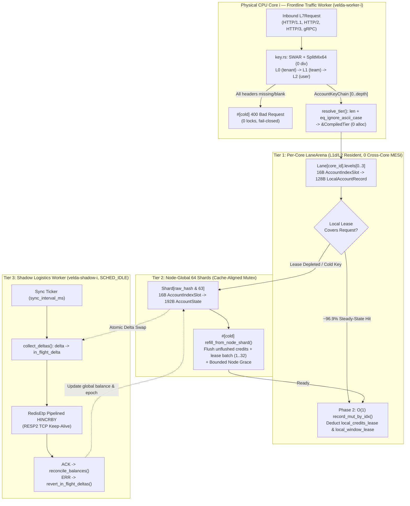
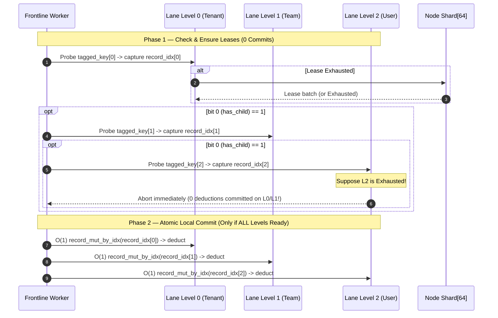
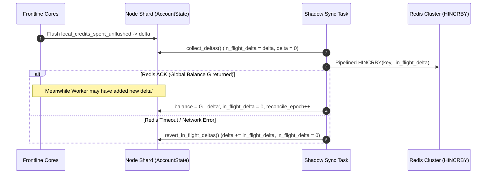

# API Metering & Monetization (`api_metering`) — Deep Systems Architecture

This specification details the thread-per-core escrow topology, 2-phase hierarchical Check-Then-Commit protocol, `PageSlab` cache-line geometry, adaptive micro-leasing, and lossless distributed reconciliation mechanics of the **`api_metering`** plugin in **Velda Edge**.

---

## 1. Dual-Tier Escrow & Thread-Per-Core Topology

`api_metering` decouples steady-state request metering from cross-core lock contention and external Redis I/O across three isolated memory/execution tiers:



### Architectural Guarantees
1. **Zero Cross-Core Cache Bouncing on Hits**: Each core operates exclusively inside its own `LaneArena` (`self.lanes[core_lane]`), eliminating MESI invalidation ping-pong on hot tenants.
2. **Zero-IO Hot Path**: Frontline workers never touch sockets, filesystems, or JSON parsers. Redis synchronization executes asynchronously on Shadow Workers (`pbww: 1..=100`).
3. **Fail-Closed Before Locking**: Missing/blank account headers short-circuit immediately to `400 Bad Request` before acquiring any `LaneArena` or `ShardArena` lock.

---

## 2. 2-Phase Hierarchical Check-Then-Commit Protocol

To guarantee that a leaf rejection (e.g., `L2 user` exhausted) never partially deducts parent quotas (`L0 tenant`, `L1 team`), `evaluate_chain_compiled()` executes strictly in two phases while holding the local `LaneArena` lock:



- **O(1) Phase-2 Direct Indexing**: Phase 1 captures each level's dense slab index (`record_idx`) inside `PendingLevelLease`. Phase 2 writes directly via `record_mut_by_idx(p.record_idx)` without re-probing the hash table.

---

## 3. Cumulative Key Hashing & Tagged `bit 0` Geometry

Each hierarchy level `L` hashes cumulatively (`L0`, `L0|L1`, `L0|L1|L2`) using 64-bit SWAR chunking (`slice::as_chunks::<8>()`) followed by a SplitMix64 avalanche with **zero division instructions**:

```text
+-----------------------------------------------------------------------------------+
|                        64-BIT TAGGED KEY & SENTINEL LAYOUT                        |
+-----------------------------------------------------------------------------------+
|  Bits [63 .. 1] : 63-bit Account Segment Hash (raw_hash = hash.max(2))            |
|  Bit  [0]       : Hierarchy Continuation Flag (has_child)                         |
|                   ├── 1 -> Parent level (continue to L_{i+1})                     |
|                   └── 0 -> Leaf level   (stop traversal immediately)              |
+-----------------------------------------------------------------------------------+
|  Special Index Table Sentinels (AccountIndexSlot.key):                            |
|    0x0000_0000_0000_0000 (0) -> SLOT_EMPTY                                        |
|    0x0000_0000_0000_0001 (1) -> SLOT_TOMBSTONE                                    |
|    >= 2                      -> Live Tagged Key                                   |
+-----------------------------------------------------------------------------------+
```

---

## 4. `PageSlab` & Cache-Line Memory Geometry

Both `LaneLevelArena` and `ShardArena` separate **probe metadata** (`16 B`) from **account state** (`128 B` / `192 B`) inside contiguous `(k + 1) * 4096 B` extents (`alloc_zeroed`, 4 KiB-aligned):

```text
+-----------------------------------------------------------------------------------+
|                 2-TIER CONTIGUOUS PageSlab<T> ((k + 1) * 4096 B)                  |
+-----------------------------------------------------------------------------------+
|  Tier A: Index Slab (16B/slot -> 4 slots fit in ONE 64B L1D Cache Line)           |
|  +--------------------+--------------------+--------------------+---------------+ |
|  | key (8B, u64)      | record_idx (4B)    | clock_ref (1B)     | _pad (3B)     | |
|  +--------------------+--------------------+--------------------+---------------+ |
|                                  |                                                |
|                                  +--> Direct O(1) Offset into Tier B              |
|                                                                                   |
|  Tier B (Per-Core): LocalAccountRecord (128B = 2 Cache Lines, align(64))          |
|  +------------------------------------------------------------------------------+ |
|  | CL0 (0x00..0x3F): tagged_key, raw_hash, tier_fp, epoch, credits_lease/snap   | |
|  | CL1 (0x40..0x7F): unflushed_credits, window_lease[4], window_epoch[4], hint  | |
|  +------------------------------------------------------------------------------+ |
|                                                                                   |
|  Tier B (Node-Global): AccountState (192B = 3 Cache Lines, align(64))             |
|  +------------------------------------------------------------------------------+ |
|  | CL0 (0x00..0x3F): account_hash, tier_fp, last_access, balance, delta, inflt  | |
|  | CL1 (0x40..0x7F): windows[0..2] (InlineWindowSlot: 24B each, no pointers)    | |
|  | CL2 (0x80..0xBF): windows[3], grace_credits, grace_win[4], epoch, win_count  | |
|  +------------------------------------------------------------------------------+ |
+-----------------------------------------------------------------------------------+
```

- **Zero External Fragmentation**: Slabs resize in powers of 2 (`64 -> 128 -> ... -> 32,768`) by allocating the new contiguous extent and immediately deallocating the old extent (`VmHWM == VmRSS`).
- **CLOCK Eviction Cap**: When a shard or lane reaches `MAX_ACCOUNTS_PER_SHARD = 32,768`, `evict_local_clock` / `evict_one_clock_slot` scans at most `64` slots, bounding worst-case eviction latency to $O(1)$.

---

## 5. Adaptive Micro-Lease, Node Grace & Redis Reconciliation

### 5.1 Adaptive Batch Leasing & Bounded Node Grace
$$\text{LeaseBatch}(\text{avail}) = \begin{cases} 1 & \text{if } \text{avail} < 256 \\ \operatorname{clamp}(\lfloor \text{avail} / 128 \rfloor,\, 1,\, 32) & \text{otherwise} \end{cases}$$

- Near exhaustion (`avail < 256`), leasing collapses to `1` request per refill to prevent overshooting strict limits.
- When `grace_enabled = true`, each node shard grants a bounded grace budget:
  $$\text{NodeGrace} = \operatorname{clamp}(\lfloor \text{limit} / 200 \rfloor,\, 2,\, 1000)$$
  absorbing small cross-core lease skew without permitting unbounded overdraft.

### 5.2 Lossless Distributed Delta Conservation


---

## 6. Security & Compiler Safety Invariants

1. **Zero-Trap Machine Code (`ud2 = 0`)**: Division-free hashing (`as_chunks::<8>()`), saturated arithmetic, and checked/masked slice indexing yield `0` panic traps on the hot path under `x86-64-v3`.
2. **Header Spoofing Prevention**: Inbound `x-metering-*` headers are authoritatively overwritten via `HeaderWorkspace::insert`.
3. **JSON Payload Safety**: Cold `402 Payment Required` responses escape `tier` and `window` identifiers via `push_json_escaped` before serialization.
