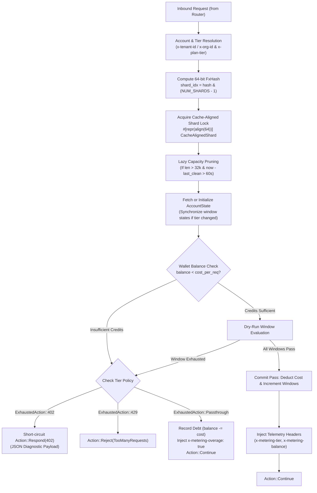

# Architecture & Accounting Invariants (`api_metering`)

## 1. High-Level Accounting Flow



---

## 2. Monetization & Accounting Invariants

### 2.1 Integer Micro-Credits Invariant ($10^{-6}$)
- Currency and token accounting strictly uses 64-bit signed integers (`i64`):
  $$1.000000 \text{ USD / Credit} = 1,000,000 \text{ micro-credits}$$
- Eliminates rounding drift, negative zero (`-0.0`), and floating-point comparison hazards completely.
- Allows seamless negative balance tracking for overage debt collection.

### 2.2 Two-Phase Evaluation (Dry-Run before Commit)
When multiple windows bound an account (e.g. daily quota AND monthly quota AND prepaid credits):
1. **Dry-Run Pass**: Clones window states and evaluates remaining capacity without mutating real state.
2. **Commit Pass**: If and only if all policies permit, balance is deducted and window counters are advanced.
3. Guarantees that failed requests (e.g. rejected by second window) never falsely drain wallet credits.

### 2.3 Sharded Concurrent Storage
- 64 independent cache-aligned stripes (`#[repr(align(64))]`) distribute accounting operations across CPU cores.
- Zero cross-core cache invalidation on L1/L2 caches.
- State is partitioned deterministically via `FxHash(tenant_id) & 63`.

---

## 3. Memory Layout

```text
ShardedMeteringState (64 Cache-Aligned Stripes)
 ├── Shard 0  [Align 64] -> Mutex<FxHashMap<u64, AccountState>>
 ├── Shard 1  [Align 64] -> Mutex<FxHashMap<u64, AccountState>>
 ...
 └── Shard 63 [Align 64] -> Mutex<FxHashMap<u64, AccountState>>

AccountState (Tracked Tenant Identity)
 ├── last_access_sec: u64
 ├── balance_micro_credits: i64  (Can be negative during overage)
 └── windows: Vec<WindowState>   (Sliding / Fixed macro windows)
```
