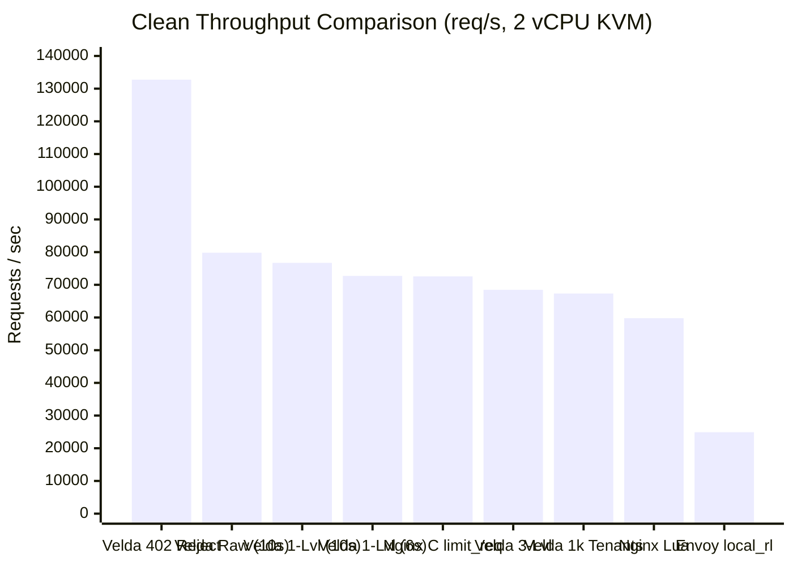
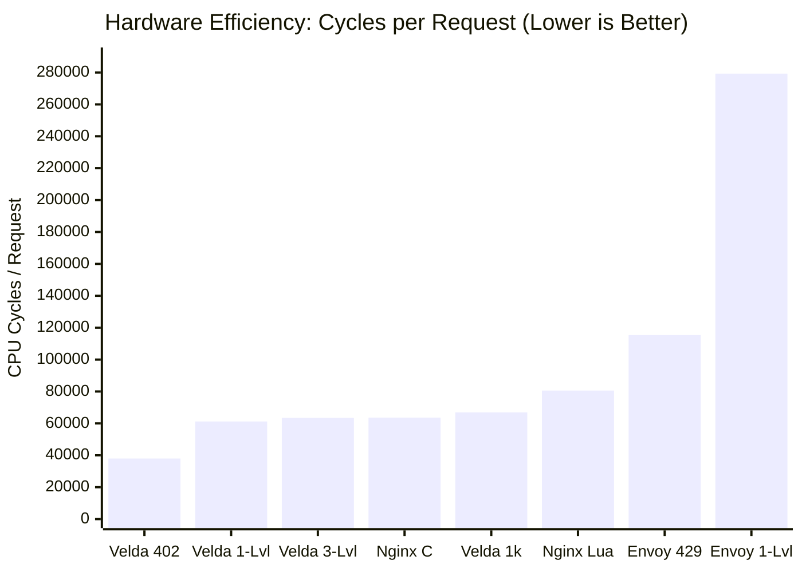

# Performance Benchmark Specification & Empirical Data (`api_metering`)

5-tier diagnostic benchmark measurements for [`api_metering`](crates/velda-plugin/src/pre_upstream/api_metering/) executed on an isolated 2-KVM testbed (`velda-gw` $\leftrightarrow$ `velda-obs`), comparing **Velda Edge (`x86-64-v3`)** directly against **Nginx 1.24.0 (`ngx_http_limit_req_module`)**, **Nginx 1.24.0 + Lua (`lua_shared_dict`)**, and **Envoy Proxy 1.31.4 (`envoy.filters.http.local_ratelimit`)**.

---

## 1. Testbed & Measurement Protocol

- **Gateway Node (`velda-gw`, `192.168.122.10`)**: `2` vCPUs (`11th Gen Intel Core i5-11400H @ 2.70GHz`, SMT off, `32 KiB` L1d/core), `1.9 GB` RAM, Ubuntu 24.04 LTS (`Linux 6.8.0`). All engines pinned/configured with **`2` worker threads/processes** listening on `0.0.0.0:8080`.
- **Observer & Backend Node (`velda-obs`, `192.168.122.20`)**: `4` vCPUs, `velda-bench-backend` (`192.168.122.20:8081/ping`, HTTP/1.1 Keep-Alive), `wrk` (`-t4 -c64 --latency`, after 2s warmup).
- **Competitor Configurations (Identical Topology `0.0.0.0:8080 -> 192.168.122.20:8081`)**:
  - **Velda Edge (`api_metering`)**: Per-core `LaneArena` (`128B`) + 64-shard `ShardArena` (`192B`), `O(1)` Phase-2 commit (`record_mut_by_idx`), injects `x-metering-tier`, `x-metering-remaining`, `x-metering-window`, `x-metering-balance`.
  - **Nginx `1.24.0` (C `limit_req_zone`)**: `worker_processes 2; access_log off; limit_req_zone $http_x_tenant_id zone=tenant_c:32m` (no header mutation).
  - **Nginx `1.24.0` + Lua (`lua_shared_dict`)**: `worker_processes 2; access_log off; lua_shared_dict metering_dict 32m` with `dict:incr()` + `ngx.req.set_header(...)` (OpenResty / Kong / APISIX in-memory pattern).
  - **Envoy `1.31.4` (`local_ratelimit`)**: `--concurrency 2`, `envoy.filters.http.local_ratelimit` matching `x-tenant-id` descriptor + `x-ratelimit-*` response headers.
- **Two Measurement Passes**:
  1. **Clean Macro Pass** (`6s` / `10s`, no `perf` attached): Measures unperturbed serving throughput and tail latencies.
  2. **Synchronized Micro Pass (`perf stat`)** (`10s` for pass-through / `6s` for exhaustion): Attaches PMU hardware counters (`cycles`, `instructions`, `branches`, `branch-misses`, `L1-dcache-loads`, `L1-dcache-load-misses`, `cache-references`, `cache-misses`) and syscall/scheduler tracepoints (`raw_syscalls:sys_enter`, `syscalls:sys_enter_futex`, `context-switches`, `cpu-migrations`) identically to each target process. *(Note: `LLC-loads`/`LLC-load-misses` hardware counters report `<not supported>` under this KVM vPMU; `cache-references`/`cache-misses` are measured instead.)*

---

## 2. Clean Macro Baseline (No Profiler Attached)

### 2.1 Gateway Comparison — `1`-Level Tenant Key (`x-tenant-id`, `6s`, `-t4 -c64`)

| Metric | **Velda Edge (`api_metering`)** | **Nginx 1.24 (C `limit_req`)** | **Nginx 1.24 + Lua (`lua_shared_dict`)** | **Envoy 1.31.4 (`local_ratelimit`)** |
| :--- | :---: | :---: | :---: | :---: |
| **Total Requests (`6.01s–6.10s`)** | **443,559** | 442,615 | 364,687 | 149,647 |
| **Throughput (req/s)** | **72,718.11** | 72,566.63 | 59,789.14 | 24,906.63 |
| **Mean Latency** | **0.89 ms** | 0.87 ms | 1.06 ms | 2.58 ms |
| **P50 Latency** | **825.00 µs** | 846.00 µs | 1.04 ms | 2.55 ms |
| **P90 Latency** | 1.22 ms | **1.14 ms** | 1.43 ms | 3.05 ms |
| **P99 Latency** | 3.15 ms | **1.76 ms** | 2.02 ms | 3.73 ms |
| **Max Latency** | 18.88 ms | 7.26 ms | 11.57 ms | 24.85 ms |
| **Socket / HTTP Errors** | **0** | **0** | **0** | **0** |

### 2.2 Velda Edge Feature Cost vs Raw Proxy (`6s` & `10s`, `-t4 -c64`)

| Configuration | Throughput (req/s) | Mean Latency | P50 Latency | P90 Latency | P99 Latency | Non-2xx |
| :--- | :---: | :---: | :---: | :---: | :---: | :---: |
| **Raw Proxy (`plugins: []`, `10s` × 2 mean)** | **79,814.31** *(83,105 / 76,523)* | 771.63–842.24 µs | 697–758 µs | 1.13–1.20 ms | 2.47–3.02 ms | 0 |
| **`api_metering` 1-Level (`10s` × 2 mean)** | **76,706.87** *(78,235 / 75,179)* | 815.32–850.00 µs | 753–794 µs | 1.18–1.19 ms | 2.16–2.67 ms | 0 |
| **`api_metering` 1-Level (`6s`, O(1) Phase-2)** | **72,718.11** | 0.89 ms | 825.00 µs | 1.22 ms | 3.15 ms | 0 |
| **`api_metering` 3-Level (`tenant+team+user`, `6s`)** | **68,447.63** | 0.95 ms | 0.86 ms | 1.36 ms | 3.60 ms | 0 |
| **`api_metering` 1,000 Tenants (`1`-Level, `6s`)** | **67,324.89** | 0.95 ms | 0.86 ms | 1.36 ms | 3.55 ms | 0 |
| **`api_metering` `402` Exhaustion (`limit=1`, `6s`)** | **132,742.41** *(809,689 reqs)* | **454.05 µs** | **444.00 µs** | **679.00 µs** | **1.02 ms** | 809,688 |



---

## 3. Full 5-Tier Synchronized Benchmarks (`wrk` + `perf stat` + `ps`)

All measurements below were captured concurrently with `perf stat` (`cycles, instructions, branches, branch-misses, L1-dcache-loads, L1-dcache-load-misses, cache-references, cache-misses, context-switches, cpu-migrations, raw_syscalls:sys_enter, syscalls:sys_enter_futex`). Tracepoint instrumentation reduces absolute RPS uniformly across all processes; relative and per-request ratios reflect true hardware cost.

### AM 01: `1`-Level Tenant Metering (`-H "x-tenant-id: bench-acme"`, `10s`)

| Metric Tier | **Velda Edge (`api_metering`)** | **Nginx 1.24 (C `limit_req`)** | **Nginx 1.24 + Lua (`lua_shared_dict`)** | **Envoy 1.31.4 (`local_ratelimit`)** |
| :--- | :---: | :---: | :---: | :---: |
| **Tier 1: Macro Serving** | | | | |
| Total Requests (`10s`) | **536,270** | 488,306 | 436,074 | 175,762 |
| Instrumented Throughput | **53,094.61 req/s** | 48,763.17 req/s | 43,177.96 req/s | 17,402.12 req/s |
| Mean / P50 / P90 / P99 | **1.21 ms / 1.03 ms / 2.03 ms / 2.98 ms** | 1.30 ms / 1.28 ms / 2.08 ms / 2.76 ms | 1.49 ms / 1.31 ms / 2.53 ms / 3.62 ms | 3.66 ms / 3.48 ms / 4.71 ms / 6.54 ms |
| **Tier 2: Domain SLA** | | | | |
| Algorithm & Header Injection | Lease Escrow + `4` `x-metering-*` | `limit_req` rbtree (0 header writes) | `lua_shared_dict:incr` + `2` headers | Descriptor TokenBucket + `x-ratelimit-*` |
| **Tier 3: System Resources** | | | | |
| CPU Utilization (2 vCPU max 200%) | **145%** | 154.2% *(76.7% + 77.5%)* | 160.2% *(80.7% + 79.5%)* | 156% |
| Resident Memory (`RSS`) | 32.0 MB (`32,748 KB`) | **13.5 MB** (`13,812 KB`) | 18.2 MB (`18,592 KB`) | 52.7 MB (`53,920 KB`) |
| **Tier 4: Kernel & OS (Normalized)** | | | | |
| `syscalls / req` | **3.90** (`2,090,932`) | 5.00 (`2,441,669`) | 4.89 (`2,133,953`) | 5.95 (`1,045,146`) |
| `context-switches / req` | `0.0214` (`11,499`) | `0.0254` (`12,403`) | `0.0140` (`6,120`) | **`0.0034`** (`600`) |
| `cpu-migrations` (`10s`) | 1 | 0 | 0 | 1 |
| `futex` Syscalls (`%` of syscalls) | **0 (`0.0000%`)** | 2 (`0.0001%`) | **0 (`0.0000%`)** | 49 (`0.0047%`) |
| **Tier 5: HPC PMU Counters** | | | | |
| `cycles / req` | **61,214** (`32.83B`) | 63,558 (`31.04B`) | 80,591 (`35.14B`) | 279,284 (`49.09B`) |
| `instructions / req` | 67,734 (`36.32B`) | **66,365** (`32.41B`) | 79,121 (`34.50B`) | 228,842 (`40.22B`) |
| `IPC` (`insn / cycle`) | **1.11** | 1.04 | 0.98 | 0.82 |
| `branches / req` | **11,900** | 12,670 | 14,808 | 40,407 |
| `branch-miss %` | **0.91%** (`57.9M`) | 1.02% (`63.0M`) | 1.03% (`66.2M`) | 2.59% (`183.6M`) |
| `L1-dcache-load-misses %` | 10.03% (`906.7M`) | 9.21% (`792.9M`) | 10.21% (`924.1M`) | **7.91%** (`938.2M`) |
| `cache-misses %` (of cache-refs) | 11.21% (`61.3M`) | **10.14%** (`49.9M`) | 11.15% (`67.5M`) | 13.03% (`132.5M`) |

---

### AM 02: Velda Edge Feature Cost — Raw Proxy vs `1`-Level vs `3`-Level Hierarchy (`10s`)

| Metric Tier | **Velda Raw (`plugins: []`)** | **Velda `1`-Level (`x-tenant-id`)** | **Velda `3`-Level (`tenant+team+user`)** |
| :--- | :---: | :---: | :---: |
| Total Requests (`10s`) | 491,960 | 536,270 | 522,247 |
| Instrumented Throughput | 49,150.60 req/s | 53,094.61 req/s | 51,708.31 req/s |
| Mean / P50 / P90 / P99 | 1.32 ms / 1.30 ms / 1.92 ms / 2.83 ms | 1.21 ms / 1.03 ms / 2.03 ms / 2.98 ms | 1.24 ms / 1.05 ms / 2.13 ms / 3.19 ms |
| CPU % / RSS | 146% / 31.3 MB (`32,032 KB`) | 145% / 32.0 MB (`32,748 KB`) | 152% / 32.4 MB (`33,128 KB`) |
| `syscalls / req` | 4.01 (`1,973,072`) | 3.90 (`2,090,932`) | 4.01 (`2,092,015`) |
| `context-switches / req` | `0.0250` (`12,320`) | `0.0214` (`11,499`) | `0.0225` (`11,760`) |
| `futex` Syscalls (`10s`) | 4 (`0.0002%`) | **0 (`0.0000%`)** | 8 (`0.0004%`) |
| `cycles / req` | 62,772 (`30.88B`) | **61,214** (`32.83B`) | 63,439 (`33.13B`) |
| `instructions / req` | **63,049** (`31.02B`) | 67,734 (`36.32B`) | 72,588 (`37.91B`) |
| `IPC` (`insn / cycle`) | 1.00 | 1.11 | **1.14** |
| `branches / req` | 11,265 | 11,900 | 12,841 |
| `branch-miss %` | 0.98% | 0.91% | **0.88%** |
| `L1-dcache-load-misses %` | 10.59% | 10.03% | **9.85%** |
| `cache-misses %` | 12.72% | 11.21% | **10.75%** |

- **Overhead per extra hierarchy depth** (`1`-Level $\rightarrow$ `3`-Level under Phase-2 `O(1)` `record_mut_by_idx()`): **`+4,854` insn/req** (`+7.2%` instructions, `+2,225` cycles/req).

---

### AM 03: `1,000` Rotating Tenants (`wrk -s tenants1k.lua`, `10s`, `-t4 -c64`)

Tests L1D/L2 table probing pressure across `1,000` distinct tenant keys (`t-0`..`t-999`) and `1,000` 3-level chains (`t-0..99` $\times$ `tm-0..9` $\times$ `u-0..99`).

| Metric Tier | **Velda `1k` (`1`-Level)** | **Velda `1k` (`3`-Level)** | **Nginx + Lua `1k`** | **Envoy `1k`** |
| :--- | :---: | :---: | :---: | :---: |
| Total Requests (`10s`) | **465,777** | 447,690 | 415,065 | 184,682 |
| Instrumented Throughput | **46,118.44 req/s** | 44,327.31 req/s | 41,096.50 req/s | 18,454.44 req/s |
| Mean / P50 / P90 / P99 | **1.37 ms / 1.32 ms / 2.19 ms / 3.04 ms** | 1.44 ms / 1.28 ms / 2.38 ms / 3.90 ms | 1.55 ms / 1.39 ms / 2.53 ms / 3.74 ms | 3.46 ms / 3.34 ms / 4.20 ms / 5.00 ms |
| CPU % / RSS | 155% / 33.8 MB (`34,584 KB`) | 156% / 34.2 MB (`35,016 KB`) | 162% / 18.5 MB (`18,904 KB`) | 166% / 52.8 MB (`54,016 KB`) |
| `syscalls / req` | **4.01** | 4.03 | 4.93 | 6.02 |
| `context-switches / req` | `0.0217` (`10,093`) | `0.0217` (`9,721`) | `0.0144` (`5,983`) | `0.0033` (`617`) |
| `futex` Syscalls (`10s`) | 8 (`0.0004%`) | 6 (`0.0003%`) | 2 (`0.0001%`) | 35 (`0.0031%`) |
| `cycles / req` | **66,876** (`31.15B`) | 69,844 (`31.27B`) | 82,366 (`34.19B`) | 261,582 (`48.31B`) |
| `instructions / req` | **70,052** (`32.63B`) | 73,447 (`32.88B`) | 79,550 (`33.02B`) | 230,637 (`42.59B`) |
| `IPC` (`insn / cycle`) | **1.05** | **1.05** | 0.97 | 0.88 |
| `branches / req` | **12,317** | 13,008 | 14,910 | 40,682 |
| `branch-miss %` | **0.92%** | **0.92%** | 1.06% | 2.50% |
| `L1-dcache-load-misses %` | 10.49% | 10.22% | 10.27% | **7.76%** |
| `cache-misses %` | 12.44% | 13.92% | 11.50% | **10.78%** |

---

### AM 04: Exhaustion Short-Circuit Saturation (`402` vs `429`, `-t4 -c64`)

Evaluates quota exhaustion short-circuiting (`limit = 1`) without forwarding requests upstream (`6s` perf-instrumented Envoy vs `10s` perf-instrumented Velda; clean `6s` Velda = `132,742.41 req/s`).

| Metric Tier | **Velda Edge (`402` JSON Responder)** | **Envoy 1.31.4 (`429` LocalRateLimit)** |
| :--- | :---: | :---: |
| Instrumented Throughput | **82,346.88 req/s** (`831,711 / 10.10s`) | 37,999.43 req/s (`231,790 / 6.10s`) |
| Instrumented Mean / P50 / P90 / P99 | **766.36 µs / 748 µs / 1.31 ms / 1.82 ms** | 1.68 ms / 1.56 ms / 2.39 ms / 3.59 ms |
| Clean Uninstrumented (`6s`) | **132,742.41 req/s** (`P50 444 µs`, `P99 1.02 ms`) | — |
| Non-2xx Rejection Rate | **100.00%** (`831,711 / 831,711`) | **100.00%** (`231,790 / 231,790`) |
| CPU % / RSS | 159% / 34.6 MB (`35,380 KB`) | 135% / 51.5 MB (`52,688 KB`) |
| `syscalls / req` | **1.98** (`1,646,859`) | 2.94 (`681,048`) |
| `context-switches / req` | `0.0087` (`7,274`) | `0.0021` (`477`) |
| `futex` Syscalls (`%` of syscalls) | 127 (`0.0077%`) | 35 (`0.0051%`) |
| `cycles / req` | **37,979** (`31.59B`) | 115,352 (`26.74B`) |
| `instructions / req` | **41,165** (`34.24B`) | 112,256 (`26.02B`) |
| `IPC` (`insn / cycle`) | **1.08** | 0.97 |
| `branches / req` | **7,056** | 19,632 |
| `branch-miss %` | **0.85%** | 1.61% |
| `L1-dcache-load-misses %` | 10.10% | **7.67%** |
| `cache-misses %` | 13.41% | **9.58%** |



---

## 4. AM 05: Multi-Tenant Memory Scaling & Fragmentation (`1,000` Tenants × `3` Tiers × `100` Customers)

Measured via `/proc/self/status` (`VmRSS` / `VmHWM`) in `--release`:

| Scenario | Tracked Accounts | Workers | `VmRSS` Before | `VmRSS` After | **RAM Delta** | `VmHWM` vs `VmRSS` | Populate Time |
| :--- | :---: | :---: | :---: | :---: | :---: | :---: | :---: |
| `1k` tenants × `100` customers (`2`-level) | **101,000** | 2 | 2,664 KB | 48,752 KB | **45.01 MB** (`46,088 KB`) | `48,752 == 48,752 KB` | 51.22 ms |
| `1k` tenants × `3` tiers × `100` customers (`3`-level) | **304,000** | 2 | 3,176 KB | 151,224 KB | **144.58 MB** (`148,048 KB`) | `151,224 == 151,224 KB` | 214.79 ms |
| `1k` tenants × `3` tiers × `100` customers (`3`-level) | **304,000** | 8 | 3,180 KB | 195,704 KB | **188.01 MB** (`192,524 KB`) | `195,704 == 195,704 KB` | 105.38 ms |

---

## 5. AM 06: CPU Symbol Distribution (`perf record`) & Release ASM Audit (`x86-64-v3`)

### 5.1 `perf record -F 997` Distribution on `AM 02` (`3-Level`, `15K` samples, `32.14B` cycles)
```bash
perf record -F 997 -p $(pidof velda-edge) -g -- sleep 8
python3 .agent/skills/velda-benchmark/scripts/analyze_perf.py /tmp/velda_perf_full.txt --markdown
```

| Execution Layer | Share | Symbol Breakdown |
| :--- | :---: | :--- |
| **Linux Kernel Network Stack & Virtio** | **60.84%** | `virtqueue_notify`, `__irqentry_text_start`, `__ip_queue_xmit`, `tcp_sendmsg`, kernel `sk_buff` slab (`3.30%`: `kmem_cache_alloc_node`, `kmem_cache_free`, `__alloc_skb`) |
| **Velda Userspace Serving + `api_metering`** | **39.54%** | `velda-worker-{0,1}` hot-path + `libc recv/__send` + `[vdso] clock_gettime` |
| **Tokio Async Runtime & TLS** | **0.11%** | Minimal epoll reactor dispatch |
| **Userspace Heap Allocator (`malloc`/`free`)** | **0.00%** | `0` userspace allocator symbols in hot samples |
| **Kernel `futex` Contention** | **0.02%** | `8` `futex` calls across `522,247` requests (`0.0004%` of syscalls) |

### 5.2 Release Machine-Code Audit (`audit_asm.py`, `x86-64-v3`)
```bash
RUSTFLAGS="-C target-cpu=x86-64-v3" cargo rustc -p velda-plugin --release --lib -- --emit=asm
python3 .agent/skills/velda-benchmark/scripts/audit_asm.py --symbol "ApiMeteringPlugin.*on_upstream_request" target/release/deps/velda_plugin-*.s
```

| Symbol | Instructions | Heap Escapes (`alloc::*`) | Stack Spills | Unaligned Vectors | Indirect Jumps | `ud2` Traps |
| :--- | :---: | :---: | :---: | :---: | :---: | :---: |
| `ApiMeteringPlugin::on_upstream_request` | `408` | **0** | `0 W / 0 R` | `0` | `0` | **0** |
| `ShardedMeteringState::evaluate_chain_compiled` | inlined | **0** | `0 W / 0 R` | `0` | `0` | **0** |
| `refill_from_node_shard` | — | **0** | `0 W / 0 R` | `0` | `0` | **0** |
| `handle_missing_account` (`#[cold]`) | — | **0** | `0 W / 0 R` | `0` | `0` | **0** |
| `handle_overage_allowed` (`#[cold]`) | `115` | **0** | `0 W / 0 R` | `0` | `0` | **0** |
| `handle_exhausted` (`#[cold]`) | `401` | `2` (cold path only) | `0 W / 0 R` | `24` (cold copy) | `0` | **0** |
