# Performance Benchmark Specification: API Metering (`api_metering`)

This benchmark specification follows the **Velda Benchmark Engineering** methodology (`velda-benchmark`): first-principles hardware modeling, predictive blind-spot analysis, 5-tier diagnostic metrics, isolated dual-KVM measurements, multi-tenant memory scaling, and `x86-64-v3` release assembly verification.

---

## 1. First-Principles Reasoning & Core Hypothesis

### 1.1 Component Characterization
- **Primary Axis**: **Memory / Cache-Bound + Core-Local Synchronization**.
- **Core Hypothesis**:
  1. **Zero-Cost Invariant**: On steady-state lease hits, `on_upstream_request` must perform **`0` heap allocations**, **`0` hardware divisions (`DIV`)**, **`0` cross-core mutex locks**, and **`0` network I/O**.
  2. **Hardware Cost Center**: Probing `16 B` `AccountIndexSlot` entries, touching `128 B` `LocalAccountRecord` cache lines across `1..=3` hierarchy levels, hashing header slices (`SWAR + SplitMix64`), and writing `x-metering-*` headers into `HeaderWorkspace`.
  3. **Physical Ceiling**: L1D/L2 cache residency on `LaneArena` and HTTP/1.1 header parsing/serialization throughput on the gateway.

### 1.2 Predictive Blind-Spots & Stress Targets
| Boundary | Predicted Failure Mode | How We Test & Guard It |
| :--- | :--- | :--- |
| **Thread-to-Thread** | Multi-core lease skew overshooting strict limits, or hot-tenant mutex contention. | `LaneArena` per core + adaptive `1..32` micro-leases + bounded `NodeGrace` (`8`-thread concurrency test). |
| **Hardware / Cache** | Pointer chasing (`Vec<WindowState>`), unaligned SIMD traps, or `DIV` pipeline stalls on long tenant IDs. | Inline `24 B` windows inside `192 B` `AccountState`, `as_chunks::<8>()` SWAR hashing (`ud2 = 0`). |
| **Memory Lifecycle** | High-cardinality key flood (300k+ accounts) causing OOM or allocator fragmentation spikes. | `PageSlab` `(k+1)*4096 B` extents, `32,768` cap/shard with `<= 64`-probe CLOCK eviction (`VmHWM == VmRSS`). |
| **External Dependency** | Redis timeout/disconnect dropping in-flight billing deltas. | `in_flight_delta` atomic swap + `revert_in_flight_deltas()` recovery (`distributed_sync_test`). |
| **Hierarchy Depth** | Extra probe cost when scaling from 1 header (`tenant`) to 3 headers (`tenant -> team -> user`). | Phase-1 captures `record_idx`; Phase-2 commits in $O(1)$ via `record_mut_by_idx()`, removing 3 redundant probes. |

---

## 2. Isolated Testbed & 5-Tier Diagnostic Framework

### 2.1 Dual-KVM Testbed (`velda-gw` $\leftrightarrow$ `velda-obs`)
- **Network Fabric**: Isolated Linux bridge `virbr0` (`virtio-net`, MTU 1500).
- **Gateway (`velda-gw`, `192.168.122.10`)**: 2 vCPUs pinned 1:1 (Intel Core i5-11400H @ 2.70GHz), 1.9 GB RAM, Ubuntu 24.04 LTS (Kernel 6.8.0), `velda-edge v0.1.0-release` (`x86-64-v3`).
- **Load Generator & Backend (`velda-obs`, `192.168.122.20`)**: 4 vCPUs, `velda-bench-backend` (`8081` `/ping`), `wrk -t4 -c64 -d10s --latency` (3s warmup + 2 × 10s runs per mode).

### 2.2 5-Tier Diagnostic Metrics Tracked (Zero-Bloat)
1. **Macro Serving**: Throughput (`req/s`), Delta vs Raw Proxy (`%`), `Mean`, `P50`, `P90`, `P99` latency, and HTTP error rate.
2. **Domain SLA**: Lease hit rate (`~96.9%` at batch `32`), fail-closed `400`/`402` rejection accuracy, `0` hardware `DIV`.
3. **System Resources**: Process `VmRSS` & `VmHWM` drift, `0` heap allocations on hot path.
4. **Kernel & OS**: Normalized `syscalls/req`, `futex` avoidance on lease hits.
5. **HPC & Assembly**: `audit_asm.py` verification (`alloc::*`, stack spills, unaligned vectors, indirect jumps, `ud2` traps).

---

## 3. Empirical KVM Benchmark: Raw Proxy vs `api_metering`

| Metric (2 vCPUs, `wrk -t4 -c64 -d10s`) | Raw Proxy (`plugins: []`) | `api_metering` 1-Level (`x-tenant-id`) | `api_metering` 3-Level (`tenant` + `team` + `user`) |
| :--- | :---: | :---: | :---: |
| **Run 1 Throughput** | 83,105.46 req/s | 78,234.92 req/s | 68,666.03 req/s |
| **Run 2 Throughput** | 76,523.15 req/s | 75,178.81 req/s | 69,793.51 req/s |
| **Mean Throughput** | **79,814.31 req/s** | **76,706.87 req/s** | **69,229.77 req/s** |
| **Delta vs Raw Proxy** | — | **-3.89%** (+`1.0 µs` CPU/req) | **-13.26%** (+`3.8 µs` CPU/req) |
| **Mean Latency** | 771.63–842.24 µs | 815.32–850.00 µs | 920.00–930.00 µs |
| **P50 Latency** | 697.00–758.00 µs | 753.00–794.00 µs | 860.00–870.00 µs |
| **P90 Latency** | 1.13–1.20 ms | 1.18–1.19 ms | 1.25–1.33 ms |
| **P99 Tail Latency** | 2.47–3.02 ms | 2.16–2.67 ms | 2.52–2.88 ms |
| **Gateway RSS Footprint** | 33,320 KB | 33,804 KB (`+484 KB` after ~3.38M reqs) | 33,804 KB |
| **Socket / HTTP Errors** | **0** | **0** | **0** |

```mermaid
xychart-beta
    title "KVM Latency Distribution (µs, Run 1): Raw Proxy vs 1-Level vs 3-Level"
    x-axis ["P50", "P90", "P99"]
    y-axis "Latency (microseconds)" 0 --> 3200
    bar [697, 1130, 2470]
    bar [753, 1180, 2160]
    bar [860, 1330, 2520]
```

---

## 4. Memory Scaling & Fragmentation Probe (`--release`)

Measured directly from `/proc/self/status` (`VmRSS` / `VmHWM`) for **1,000 tenants × 3 tiers × 100 customers**:

| Scenario | Tracked Accounts | Workers | `VmRSS` Delta | `VmHWM` vs `VmRSS` | Populate Time |
| :--- | :---: | :---: | :---: | :---: | :---: |
| `1k` tenants × `100` customers (`2`-level) | **101,000** | 2 | **45.01 MB** (`46,088 KB`) | `48,752 == 48,752 KB` (0 spike) | 51.22 ms |
| `1k` tenants × `3` tiers × `100` customers (`3`-level) | **304,000** | 2 | **144.58 MB** (`148,048 KB`) | `151,224 == 151,224 KB` (0 spike) | 214.79 ms |
| `1k` tenants × `3` tiers × `100` customers (`3`-level) | **304,000** | 8 | **188.01 MB** (`192,524 KB`) | `195,704 == 195,704 KB` (0 spike) | 105.38 ms |

- **Takeaway**: `304,000` live hierarchical accounts consume **~`145–188 MB`** total (~`498 B/account` including hash-table slack) with **zero external fragmentation** (`VmHWM == VmRSS`).

---

## 5. Verified Release Assembly & Symbol Audit (`x86-64-v3`)

Audited via `audit_asm.py` on `RUSTFLAGS="-C target-cpu=x86-64-v3" cargo rustc -p velda-plugin --release --lib -- --emit=asm`:

| Symbol | Role | Heap Escape (`alloc::*`) | Stack Spills | Unaligned Vectors | Indirect Jumps | `ud2` Traps |
| :--- | :--- | :---: | :---: | :---: | :---: | :---: |
| `ApiMeteringPlugin::on_upstream_request` | Hot-path entrypoint (`408` insts) | **0** | `0 W / 0 R` | `0` | `0` | **0** |
| `ShardedMeteringState::evaluate_chain_compiled` | 2-phase check & O(1) commit | **0** | `0 W / 0 R` | `0` | `0` | **0** |
| `refill_from_node_shard` | Node-Global shard escrow refill | **0** | `0 W / 0 R` | `0` | `0` | **0** |
| `handle_missing_account` | `#[cold]` `400 Bad Request` | **0** | `0 W / 0 R` | `0` | `0` | **0** |
| `handle_overage_allowed` | `#[cold]` overage headers (`115` insts) | **0** | `0 W / 0 R` | `0` | `0` | **0** |
| `handle_exhausted` | `#[cold]` `402`/`429` builder (`401` insts) | `2` (cold path only) | `0 W / 0 R` | `24` (cold JSON copy) | `0` | **0** |

---

## 6. Comprehensive 6-Scenario Comparative Matrix

| Scenario | Workload & Blind-Spot Target | Velda Edge (`api_metering`) | Kong (`rate-limiting`) | Envoy (`ratelimit`) | APISIX (`limit-count`) |
| :--- | :--- | :---: | :---: | :---: | :---: |
| **AM 01: 1-Level Metering** | `wrk -t4 -c64 -d10s` (`x-tenant-id`) | **76,707 req/s** (`-3.89%`) | *[TBD]* | *[TBD]* | *[TBD]* |
| **AM 02: 3-Level Hierarchy** | `tenant -> team -> user` 2-phase commit | **69,230 req/s** (`-13.26%`) | *[TBD]* | *[TBD]* | *[TBD]* |
| **AM 03: 304k Account Scale** | `1k` tenants × `3` tiers × `100` customers | **144.58 MB** (2C) / **188.01 MB** (8C) | *[TBD]* | *[TBD]* | *[TBD]* |
| **AM 04: Exhaustion Reject** | `400` missing / `402` quota / `429` burst | **Verified** (`0` locks on `400`) | *[TBD]* | *[TBD]* | *[TBD]* |
| **AM 05: Redis Shadow Sync** | Background `HINCRBY` + disconnect recovery | **Verified** (mock RESP2 + `revert`) | *[TBD]* | *[TBD]* | *[TBD]* |
| **AM 06: PMU Hardware Audit** | `perf stat` IPC, `L1-dcache-miss`, `futex` | *[TBD]* | *[TBD]* | *[TBD]* | *[TBD]* |
