# Performance Benchmark Specification: API Metering & Tenant Usage Accounting (`api_metering`)

This document specifies the standardized benchmarking framework, verified `x86-64-v3` release assembly audit, isolated KVM empirical measurements (`velda-gw` $\leftrightarrow$ `velda-obs`), and multi-tenant memory scaling results for [`api_metering`](crates/velda-plugin/src/pre_upstream/api_metering/) in **Velda Edge**.

---

## 1. Test Environment & Measurement Methodology

### 1.1 Dedicated 2-KVM Testbed Specification
- **Network Fabric**: Linux Kernel Bridge `virbr0` with `virtio-net`, MTU 1500.
- **Gateway Node (`velda-gw`, `192.168.122.10`)**: 2 vCPUs (11th Gen Intel Core i5-11400H @ 2.70GHz), 1.9 GB RAM, Ubuntu 24.04 LTS (Kernel 6.8.0), running `velda-edge v0.1.0-release` (`x86-64-v3`, `2` pinned workers, HTTP/1.1 `0.0.0.0:8080`).
- **Backend & Observer Node (`velda-obs`, `192.168.122.20`)**: 4 vCPUs, running `velda-bench-backend` (`192.168.122.20:8081` `/ping`) and `wrk` (`-t4 -c64 -d10s --latency` after 3s warmup).
- **Core Isolation Invariant**: Frontline workers (`velda-worker-{0..1}`) execute metering exclusively on thread-local `LaneArena` shards in steady state, refilling micro-leases from 64-shard `NodeGlobal` state only on lease depletion.

### 1.2 Micro-Architectural Technical Invariants
- **Zero-Allocation Hot Path (`alloc::* == 0`)**: `on_upstream_request`, `evaluate_chain_compiled`, and `refill_from_node_shard` perform zero heap allocations.
- **Zero-Division SWAR Hashing (`ud2 == 0`)**: `hash_account_segment()` processes 8-byte chunks via `slice::as_chunks::<8>()` + SplitMix64 without hardware `DIV` instructions or panic traps.
- **O(1) Phase-2 Direct Commit**: Phase 1 captures each level's `record_idx` in `PendingLevelLease`; Phase 2 commits directly via `record_mut_by_idx()` without re-probing the hash table.

---

## 2. Empirical Verification: Raw Proxy vs `api_metering` (1-Level & 3-Level)

Executed via `wrk -t4 -c64 -d10s --latency http://192.168.122.10:8080/ping` (3s warmup + 2 × 10s runs per mode):

| Evaluation Dimension | Raw Proxy (`plugins: []`) | `api_metering` 1-Level (`x-tenant-id`) | `api_metering` 3-Level (`tenant` + `team` + `user`) |
| :--- | :---: | :---: | :---: |
| **Run 1 Throughput** | 83,105.46 req/s | 78,234.92 req/s | 68,666.03 req/s |
| **Run 2 Throughput** | 76,523.15 req/s | 75,178.81 req/s | 69,793.51 req/s |
| **Mean Throughput** | **79,814.31 req/s** | **76,706.87 req/s** | **69,229.77 req/s** |
| **Throughput Delta vs Raw** | — | **-3.89%** (~+1.0 µs CPU/req) | **-13.26%** (~+3.8 µs CPU/req) |
| **Avg Latency** | 771.63–842.24 µs | 815.32–850.00 µs | 920.00–930.00 µs |
| **P50 Latency** | 697.00–758.00 µs | 753.00–794.00 µs | 860.00–870.00 µs |
| **P75 Latency** | 890.00–950.00 µs | 960.00–980.00 µs | 1,040.00–1,070.00 µs |
| **P90 Latency** | 1.13–1.20 ms | 1.18–1.19 ms | 1.25–1.33 ms |
| **P99 Tail Latency** | 2.47–3.02 ms | 2.16–2.67 ms | 2.52–2.88 ms |
| **Gateway RSS Footprint** | 33,320 KB | 33,804 KB (+484 KB after ~3.38M reqs) | 33,804 KB |
| **Socket / HTTP Errors** | **0** | **0** | **0** |

```mermaid
xychart-beta
    title "KVM P50 / P75 / P90 Latency Distribution (µs, Run 1): Raw vs 1-Level vs 3-Level"
    x-axis ["p50", "p75", "p90"]
    y-axis "Latency (microseconds)" 0 --> 1500
    bar [697, 890, 1130]
    bar [753, 960, 1180]
    bar [860, 1070, 1330]
```



---

## 3. Memory Scaling & Fragmentation Probe (`--release`)

Measured via `/proc/self/status` (`VmRSS` / `VmHWM`) for `1,000` tenants × `3` tiers × `100` customers:

| Scenario | Tracked Accounts | Workers | `VmRSS` Delta | `VmHWM` vs `VmRSS` | Population Time |
| :--- | :---: | :---: | :---: | :---: | :---: |
| `1k` tenants × `100` customers (`2`-level) | **101,000** | 2 | **45.01 MB** (`46,088 KB`) | `48,752 == 48,752 KB` (0 spike) | 51.22 ms |
| `1k` tenants × `3` tiers × `100` customers (`3`-level) | **304,000** | 2 | **144.58 MB** (`148,048 KB`) | `151,224 == 151,224 KB` (0 spike) | 214.79 ms |
| `1k` tenants × `3` tiers × `100` customers (`3`-level) | **304,000** | 8 | **188.01 MB** (`192,524 KB`) | `195,704 == 195,704 KB` (0 spike) | 105.38 ms |

- **External Fragmentation**: `PageSlab<T>` allocates contiguous `(k + 1) * 4096 B` 4 KiB-aligned extents (`alloc_zeroed`) and deallocates old extents immediately on power-of-2 growth, keeping `VmHWM == VmRSS` with zero heap scatter.

---

## 4. Verified Release Assembly & Symbol Audit (`x86-64-v3`)

Generated with:
```bash
RUSTFLAGS="-C target-cpu=x86-64-v3" cargo rustc -p velda-plugin --release --lib -- --emit=asm
python3 .agent/skills/velda-benchmark/scripts/audit_asm.py --symbol "ApiMeteringPlugin.*on_upstream_request" target/release/deps/velda_plugin-*.s
```

| Symbol | Role | Heap Escape (`alloc::*`) | Stack Spills | Indirect Jumps | `ud2` Traps |
| :--- | :--- | :---: | :---: | :---: | :---: |
| `ApiMeteringPlugin::on_upstream_request` | Hot-path entrypoint (`408` insts) | **0** | `0 W / 0 R` | `0` | **0** |
| `ShardedMeteringState::evaluate_chain_compiled` | 2-phase check & O(1) commit | **0** | `0 W / 0 R` | `0` | **0** |
| `refill_from_node_shard` | Node-Global shard escrow refill | **0** | `0 W / 0 R` | `0` | **0** |
| `handle_missing_account` | `#[cold]` `400 Bad Request` responder | **0** | `0 W / 0 R` | `0` | **0** |
| `handle_overage_allowed` | `#[cold]` overage header tagging (`115` insts) | **0** | `0 W / 0 R` | `0` | **0** |
| `handle_exhausted` | `#[cold]` `402` JSON / `429` builder (`401` insts) | `2` (cold path only) | `0 W / 0 R` | `0` | **0** |

---

## 5. Comprehensive 6-Scenario Comparative Matrix

```text
╔═════════════════════════════════════════════════════════════════════════════════════════════════════════════╗
║                           COMPREHENSIVE 6-SCENARIO API METERING BENCHMARK MATRIX                            ║
╠══════════════════════════════════╦══════════════════════════════╦═════════════════════════╦═════════════════╣
║ Scenario Identifier              ║ Workload Pattern             ║ Gateway State           ║ Status          ║
╠══════════════════════════════════╬══════════════════════════════╬═════════════════════════╬═════════════════╣
║ AM 01: 1-Level Tenant Metering   ║ wrk -t4 -c64 -d10s (x-tenant)║ Pro tier, FixedWindow   ║ Measured (-3.9%)║
║ AM 02: 3-Level Hierarchy         ║ tenant + team + user         ║ 2-Phase Check-Commit    ║ Measured (-13%) ║
║ AM 03: 304k Account RAM Scale    ║ 1k tenants x 3 tiers x 100   ║ 2 & 8 workers           ║ Measured (145MB)║
║ AM 04: Exhaustion Short-Circuit  ║ 402 / 429 saturation         ║ Cold rejection path     ║ Verified (curl) ║
║ AM 05: Redis Shadow Sync         ║ Distributed HINCRBY pipeline ║ Shadow Worker pbww=20   ║ *[TBD on cluster]*║
║ AM 06: Cross-Gateway Comparison  ║ Velda vs Kong vs APISIX      ║ 3-level hierarchy       ║ *[TBD on cluster]*║
╚══════════════════════════════════╩══════════════════════════════╩═════════════════════════╩═════════════════╝
```
