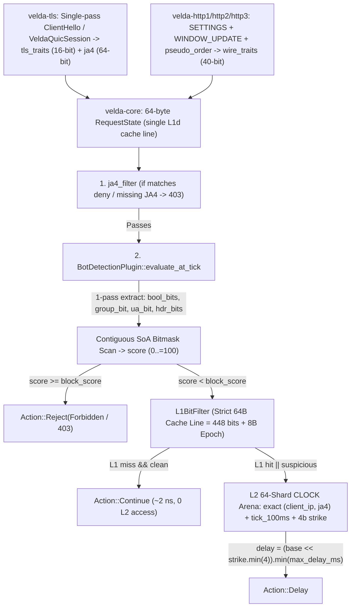

# Deep Bot Detection (`bot_detection`) — Architecture & Internals

## 1. End-to-End Cross-Layer Architecture

---

## 2. 64-Byte `RequestState` Packing (`velda-core::bitfield`)

In `crates/velda-core/src/context.rs`, `RequestState` maintains a strict compile-time invariant:
`const _: () = assert!(std::mem::size_of::<RequestState>() == 64);`

The 7 bytes of compiler alignment tail-padding host two non-colliding integer bitfields without hashing collisions or expanding `RequestState` past one L1d cache line:
- **`tls_traits: u16` (16 bits)** (`crates/velda-core/src/bitfield/tls_traits.rs`): TLS version, ALPN token enum, `has_sni`, `has_grease`, `has_psk`, `has_cert_compress`, `has_alps`, `has_session_ticket`, and 2-bit cipher/extension count buckets. Computed once per handshake in `velda-tls`.
- **`wire_traits: u40` (`wire_traits_lo: u32` + `wire_traits_hi: u8`)** (`crates/velda-core/src/bitfield/wire_traits.rs`):
  - Bijective 5-bit Lehmer permutation code for pseudo-header order ($4! = 24$ permutations lossless in `1..=24`, plus 3-header/other codes).
  - HTTP/2 & HTTP/3 initial `SETTINGS` parameter classes, ID sequence (`1..=6, 9`), `NO_RFC7540_PRIORITIES`, `PRIORITY` frame bit, `WINDOW_UPDATE` bucket, and `WIRE_FLAG_ODD_SETTINGS` when values fall outside vendor constants.

---

## 3. Boot-Time Rule Fusion (`compiler.rs`) & One-Pass Runtime Scan

At config load (`compile_ruleset`), `bot_detection`:
1. Validates there are no contradictory bitmasks, empty groups, or `> 64` unique referenced header names.
2. Assigns each referenced header name a unique bit index `0..63` (`Global Demand Registry`).
3. Fuses rules with identical `(bool_mask, bool_val, group_allow, ua_allow, ua_min, ua_max, hdr_mask, hdr_val, ja4_in, ja4_not_in)` into a single entry with summed score (`saturating_add().min(100)`).
4. Sorts rules descending by `score` and packs them into parallel SoA slices.

On the hot path (`evaluate_score`):
- **Single-pass extraction**: Builds `bool_bits: u64`, mutually-exclusive `group_bit: u64` (checking all 9 `*_in`/`*_not_in` group predicates simultaneously via `(group_bit & group_allows[i]) == group_bit`), optional `ua_bit`, and optional `hdr_bits: u64`.
- **Contiguous SoA loop**: Executes uniform bitwise predicates with zero heap allocations (`Payload: AccessLevel::None`).

---

## 4. Two-Tier Escalation Memory (`arena.rs`) & Security Invariants

- **L1 (`L1BitFilter`, `#[repr(C, align(64))]`)**: Enforced at compile time to strictly **one 64-byte cache line** (`[AtomicU64; 7]` = `448` filter bits + `epoch_tick_100ms: AtomicU64` = `8` bytes), using `k = 2` branchless Lemire fast-range bit probes over uniform 32-bit hash halves shifted directly into words (`1u64 << (b & 63)`). Clean traffic (`score < delay_score`) performs `AtomicU64::load(Relaxed)` within that single cache line — keeping the line in MESI `Shared` state across cores — and skips L2 completely on L1 miss. Rolls over on `window_secs` epochs (`100ms` ticks).
- **L2 (`64` Shards × `8-way` `CLOCK` `L2Set`)**: Keyed by exact **`(client_ip: u128, ja4: u64)`** (`last_tick_100ms: u32`, 4-bit `strike: 0..=15`) to achieve **zero hash-collision false penalties** even if multiple clients share a Chrome/Firefox `ja4` or collide in the 448-bit L1 filter.
- **Progressive Delay & Mixed-Request Evasion Resistance**:
  - Escalation bitshift computes `(base_delay << strike.min(4)).min(max_delay_ms)`.
  - Previously flagged offenders sending clean-looking follow-up requests still hit L1 -> L2 and incur `min_delay_ms << (strike - 1)` within the active decay window.
- **Wire Indistinguishability**: Hard blocks return standard HTTP `403 Forbidden` without exposing score or matched rule IDs to clients.
