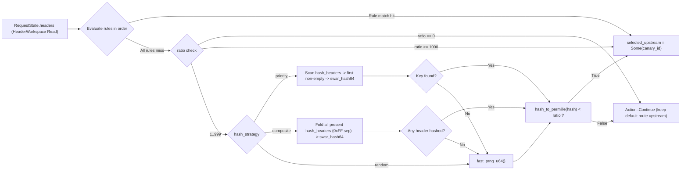
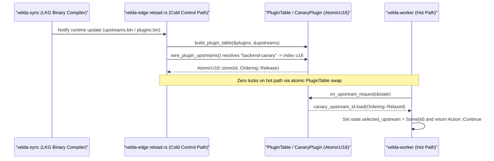

# Canary Architecture & Mathematical Design

The `canary` plugin lives inside the `pre_upstream` pipeline stage (`crates/velda-plugin/src/pre_upstream/canary/`). It selects a target upstream index (`u16`) purely from downstream request headers without touching heap memory or mutating HTTP headers.

---

## 1. Execution & Data-Flow Pipeline



---

## 2. Cold-Path Wiring vs Hot-Path Isolation



### Sentinel Safety (`u16::MAX`)
`CanaryPlugin::new` initializes `canary_upstream_id` to `u16::MAX` (`65535`). During `on_upstream_request`, if the stored index equals `u16::MAX` (indicating an unwired or misconfigured target string), `canary` returns `Action::Continue` immediately without modifying `state.selected_upstream`, preserving default baseline routing safely.

---

## 3. Division-Free Permille Arithmetic & Overflow Proof

Hardware 64-bit division (`divq`) costs 35–80+ cycles and stalls execution pipelines. Conversely, monotonic request counters risk wrapping around or distorting ratios when distributed across lockless worker threads.

`canary` maps any uniformly distributed 64-bit hash $H \in [0, 2^{64} - 1]$ onto permille interval $[0, 999]$ via Lemire fixed-point multiplication:

$$\text{permille}(H) = \left\lfloor \frac{H \times 1000}{2^{64}} \right\rfloor = \text{hi64}\!\left((H \text{ as u128}) \times 1000\right)$$

In Rust (`crates/velda-plugin/src/pre_upstream/canary/hash.rs`):

```rust
pub const fn hash_to_permille(hash: u64) -> u32 {
    (((hash as u128).wrapping_mul(1000)) >> 64) as u32
}
```

### Mathematical Properties
1. **Strict Overflow Immunity**:
   $H_{\max} \times 1000 = (2^{64} - 1) \times 1000 < 1000 \times 2^{64} < 2^{74} \ll 2^{128}$.
   Shifting right by 64 yields maximum quotient $999$, fitting safely in `u32` ($0 \le \text{permille}(H) \le 999$).
2. **Exact Range Comparison**:
   `hash_to_permille(hash) < ratio`:
   - For `ratio = 0`: always `false` ($0 \le \text{permille}$).
   - For `ratio = 1000`: always `true` ($\text{permille} \le 999 < 1000$).
   - Plus explicit `ratio == 0` / `ratio >= 1000` short-circuits skip header hashing completely.
3. **Negligible Modulo Bias**:
   $2^{64} \equiv 616 \pmod{1000}$. Exactly 616 of the 1,000 buckets have $\lfloor 2^{64}/1000 \rfloor + 1$ preimages and 384 buckets have $\lfloor 2^{64}/1000 \rfloor$ preimages. Maximum per-bucket probability deviation from $0.001$ is bounded by:
   $$\Delta p \le \frac{1}{2^{64}} \approx 5.42 \times 10^{-20} \quad (\text{aggregate across } R \le 1000 \text{ buckets}: < 3.3 \times 10^{-17})$$
4. **Hardware Lowering (`x86-64-v3`)**:
   LLVM compiles `hash_to_permille` to a single BMI2 unsigned multiply instruction without flags (`mulxq %rax, %rax, %rax`), taking **~3 cycles latency** with **zero `divq` and zero `ud2` trap instructions**.

---

## 4. SWAR Key Extraction & Hashing (`swar_hash64`)

Instead of calling per-byte hash traits (`std::hash::Hasher` with per-byte SipHash loops) or copying headers into scratch buffers:

1. **8-Byte SWAR Chunking**: `slice::as_chunks::<8>()` consumes 64-bit aligned/unaligned little-endian words (`u64::from_le_bytes`), mixing each word via XOR and an odd Weyl-ratio multiplier (`0x9E37_79B9_7F4A_7C15`), followed by single-cycle bit rotation (`rotate_left(27)`).
2. **Tail Folding**: Remaining 0–7 bytes are shifted into a single `u64` register (`tail_word`) and mixed identically without branching per tail byte.
3. **SplitMix64 Avalanche**: Ensures single-bit differences in short keys (e.g., `"user-0001"` vs `"user-0002"`) flip ~50% of all 64 output bits before `hash_to_permille`:
   - `z ^= z >> 30; z = z.wrapping_mul(0xBF58_476D_1CE4_E5B9);`
   - `z ^= z >> 27; z = z.wrapping_mul(0x94D0_49BB_1331_11EB);`
   - `z ^ (z >> 31)`

---

## 5. Module Ownership Boundaries

| File | Responsibility |
| :--- | :--- |
| `mod.rs` | Public API exports for `canary` subsystem. |
| `validation.rs` | Strict JSON schema (`CanarySchemaConfig`), `HeaderName::from_bytes` syntax checks, `ratio <= 1000` check. |
| `config.rs` | Zero-allocation runtime representation (`CanaryConfig`, `HeaderRule`, `RuleOperator`, `HashStrategy`). |
| `hash.rs` | Pure `#[inline(always)]` `swar_hash64`, `hash_to_permille`, `fast_prng_u64`, and `evaluate_permille`. |
| `plugin.rs` | `CanaryPlugin` state (`AtomicU16`), `HeaderWorkspace` read extraction, `PreUpstreamPlugin` hot-path execution. |
