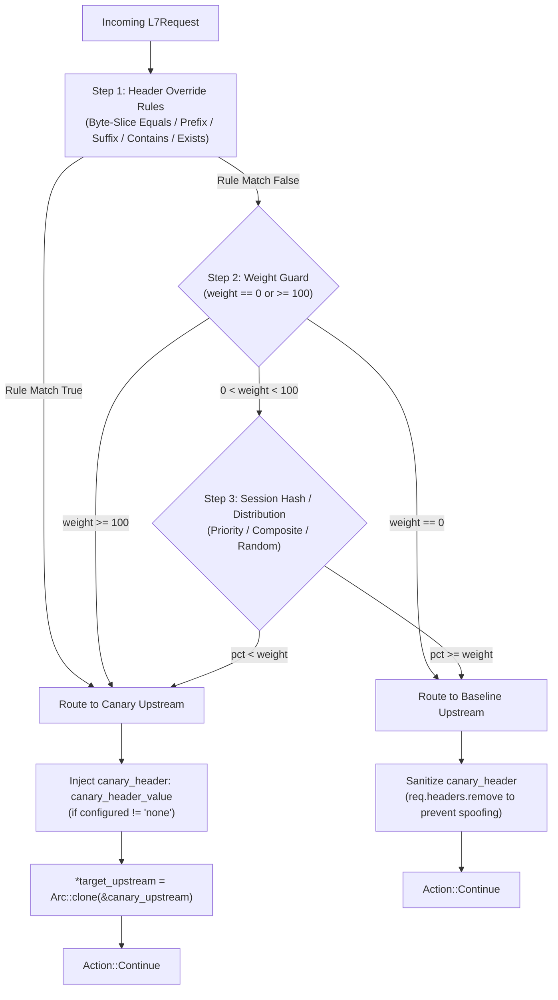
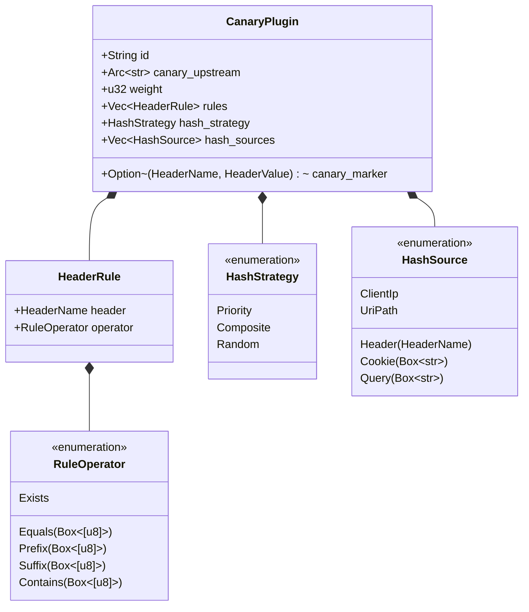

# Canary Traffic Splitting Plugin (`canary`) — Architectural Specification

This document details the internal architecture, memory layout, anti-spoofing security guarantees, and execution pipeline of the hardened **`canary`** plugin in Velda Edge.

---

## 1. Architectural Philosophy & Invariants

The `canary` plugin executes during the **`pre_upstream`** pipeline phase, immediately prior to upstream connection leasing. It steers traffic between the baseline upstream and the canary upstream using three complementary mechanisms:

### Core Invariants:
1. **100% User-Defined & Zero Hardcoded Defaults**: All header, cookie, and query parameter names are explicitly configured by the operator. No implicit defaults (`x-user-id`, `session_id`) exist in the codebase.
2. **Byte-Level Fast Evaluation (Zero Regex DFA/NFA overhead)**: Header override rules evaluate directly on raw byte slices (`&[u8]`) using ASCII case-insensitive comparisons, avoiding both UTF-8 validation and regular expression state-machine overhead.
3. **Lock-Free Pseudo-Random Distribution**: Uniform percentage calculation utilizes thread-local Xorshift64* PRNG, eliminating global atomic cache-line bouncing (`lock xadd` MESI invalidation) across multi-core CPU workers.
4. **Anti-Spoofing Canary Marker Sanitation**: When traffic is routed to the baseline upstream, any client-supplied canary marker header (`canary_header`) is stripped from the request, preventing malicious clients from spoofing canary feature flags or sandbox modes on production systems.
5. **Authoritative Client IP Extraction**: Client IP hashing prioritizes `x-real-ip` (set by the Gateway's transport listener from verified socket peer) and rightmost `x-forwarded-for`, defending against client-controlled leftmost XFF spoofing.

---

## 2. Memory Layout & Data Structures

### Data Structure Details:
- **`canary_marker`**: Pre-compiled `Option<(HeaderName, HeaderValue)>`. When configured as `"none"`, memory footprint and header mutation overhead are completely eliminated.
- **`HeaderRule.header`**: Pre-compiled `http::header::HeaderName` allowing $O(1)$ pre-hashed header map lookups instead of parsing string tokens on every request.
- **`HashSource::Header`**: Pre-compiled `HeaderName` for fast key extraction.

---

## 3. Hashing Pipeline & Algorithms

### Strategy 1: Priority Fallback (`HashStrategy::Priority`)
Iterates sequentially through `hash_sources`. The first source yielding a non-empty byte slice is hashed via `rustc_hash::FxHasher`:
$$\text{pct} = \text{FxHasher}(\text{bytes}) \pmod{100}$$
If no configured source matches (e.g. anonymous user without header, cookie, or query), execution falls back to `fast_prng_percent()`.

### Strategy 2: Composite Key (`HashStrategy::Composite`)
Feed bytes from all configured sources into `FxHasher` separated by delimiters without intermediate heap allocation (`String::format` or `Vec<String>`):
$$\text{FxHasher}(\text{src}_1 \mathbin{\Vert} \text{sep} \mathbin{\Vert} \text{src}_2 \mathbin{\Vert} \dots) \pmod{100}$$

### Strategy 3: Random (`HashStrategy::Random`)
Generates high-entropy pseudo-random numbers in $\sim 1\ \text{ns}$ using thread-local Xorshift64*:
$$x \leftarrow x \oplus (x \gg 12); \quad x \leftarrow x \oplus (x \ll 25); \quad x \leftarrow x \oplus (x \gg 27)$$
$$\text{pct} = (x \times 0x2545f4914f6cdd1d) \pmod{100}$$

---

## 4. Multi-Value Header & Cookie Handling

In HTTP/2 (RFC 9113 §8.2.3), headers like `Cookie` or custom tagging headers can arrive as multiple lines.
- **`rules` matching**: Evaluates all lines via `req.headers.get_all(&self.header)`.
- **`extract_cookie_value`**: Iterates across all `COOKIE` headers and splits by `;`, extracting the targeted cookie name case-insensitively.
