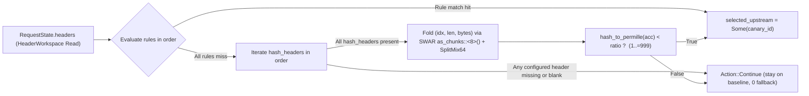
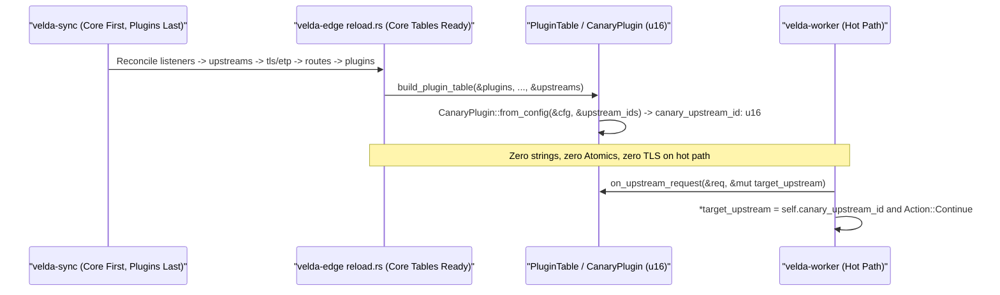

# Canary Architecture & Mathematical Design

The `canary` plugin lives inside the `pre_upstream` pipeline stage (`crates/velda-plugin/src/pre_upstream/canary/`). It operates strictly as a pure, stateless function over downstream request headers in `HeaderWorkspace` — with zero heap allocations, zero thread-local state, zero header mutations, and zero random fallback.

---

## 1. Execution & Data-Flow Pipeline



---

## 2. Cold-Path Wiring vs Hot-Path Isolation



### Core-First Construction & Fail-Safe Missing-Header Policy
- Because `velda-sync` and `velda-edge` load core `upstreams` before ecosystem `plugins`, `CanaryPlugin` resolves `"canary_upstream"` straight into an immutable `u16` (`canary_upstream_id`) at instantiation — no `Arc<str>`, no `AtomicU16`, and no `u16::MAX` runtime guard.
- If **any** header in `hash_headers` is absent or whitespace-only when rules miss, `evaluate_permille()` returns `None` immediately via `?`, leaving the request on its default baseline upstream (`*target_upstream` unchanged). Because no PRNG fallback exists, anomalous or unauthenticated requests never leak randomly into canary.

---

## 3. Division-Free Permille Arithmetic & Monotonicity Proof

Hardware 64-bit division (`divq`) costs 35–80+ cycles and stalls execution pipelines. Conversely, monotonic request counters risk wrapping around or distorting ratios when distributed across lockless worker threads.

`canary` maps any uniformly distributed 64-bit hash $H \in [0, 2^{64} - 1]$ onto permille interval $[0, 999]$ via Lemire fixed-point multiplication:

$$\text{permille}(H) = \left\lfloor \frac{H \times 1000}{2^{64}} \right\rfloor = \text{hi64}\!\left((H \text{ as u128}) \times 1000\right)$$

In Rust (`crates/velda-plugin/src/pre_upstream/canary/hash.rs`):

```rust
pub const fn hash_to_permille(hash: u64) -> u32 {
    (((hash as u128).wrapping_mul(1000)) >> 64) as u32
}
```

### Mathematical Properties
1. **Strict Overflow Immunity**:
   $H_{\max} \times 1000 = (2^{64} - 1) \times 1000 < 1000 \times 2^{64} < 2^{74} \ll 2^{128}$.
   Shifting right by 64 yields maximum quotient $999$, fitting safely in `u32` ($0 \le \text{permille}(H) \le 999$).
2. **Monotonic Rollout Invariant (`1 <= ratio <= 999`)**:
   Since `permille(H)` depends strictly on the invariant `hash_headers` byte sequence and **not** on `ratio`, increasing `ratio` from $r_1$ to $r_2 > r_1$ guarantees $\{H : \text{permille}(H) < r_1\} \subset \{H : \text{permille}(H) < r_2\}$. No key pinned to canary at $r_1$ ever moves back to baseline at $r_2$.
3. **Negligible Modulo Bias**:
   $2^{64} \equiv 616 \pmod{1000}$. Exactly 616 of the 1,000 buckets have $\lfloor 2^{64}/1000 \rfloor + 1$ preimages and 384 buckets have $\lfloor 2^{64}/1000 \rfloor$ preimages. Maximum per-bucket probability deviation from $0.001$ is bounded by:
   $$\Delta p \le \frac{1}{2^{64}} \approx 5.42 \times 10^{-20} \quad (\text{aggregate across } R \le 999 \text{ buckets}: < 3.3 \times 10^{-17})$$
4. **Hardware Lowering (`x86-64-v3`)**:
   LLVM lowers `hash_to_permille` inside `CanaryPlugin::on_upstream_request` to a single BMI2 unsigned multiply instruction (`mulxq %rax, %rax, %rax`), with **zero `divq`, zero `ud2`, zero `alloc::*`, and zero `__tls_get_addr`**.

---

## 4. Multi-Header SWAR Folding (`evaluate_permille`)

1. **Ordered Multi-Header Mixing**:
   For each `(idx, hdr)` in `hash_headers`:
   - `extract_header_bytes(req, hdr)?` reads the trimmed non-empty header value slice directly from `HeaderWorkspace` (early-exits with `None` if missing or blank).
   - Mixes slot index and byte length via `splitmix64(acc ^ ((idx as u64) << 32) ^ (bytes.len() as u64).wrapping_add(1))`, ensuring boundary shifts (`("ab", "c")` vs `("a", "bc")`) produce completely distinct digests.
2. **8-Byte SWAR Chunking + SplitMix64**:
   `swar_hash64` consumes 8-byte words via `slice::as_chunks::<8>()` (`u64::from_le_bytes`), packs any remaining 0–7 tail bytes into a single register, and passes the accumulator through SplitMix64 constants (`0xBF58_476D_1CE4_E5B9`, `0x94D0_49BB_1331_11EB`) for full 64-bit bit-avalanche before `hash_to_permille`.

---

## 5. Module Ownership Boundaries

| File | Responsibility |
| :--- | :--- |
| `mod.rs` | Public API exports for `canary` subsystem. |
| `validation.rs` | Strict JSON schema (`CanarySchemaConfig` with `#[serde(deny_unknown_fields)]`), `ratio` in `1..=999`, non-empty `hash_headers` + RFC 9110 `HeaderName` validation. |
| `config.rs` | Zero-allocation runtime representation (`CanaryConfig`, `HeaderRule`, `RuleOperator`). |
| `hash.rs` | Pure stateless `swar_hash64`, `hash_to_permille`, and fail-safe `evaluate_permille` (`Option<u32>`). |
| `plugin.rs` | `CanaryPlugin` immutable `canary_upstream_id: u16`, `HeaderWorkspace` read matching, `PreUpstreamPlugin` hot-path execution. |
