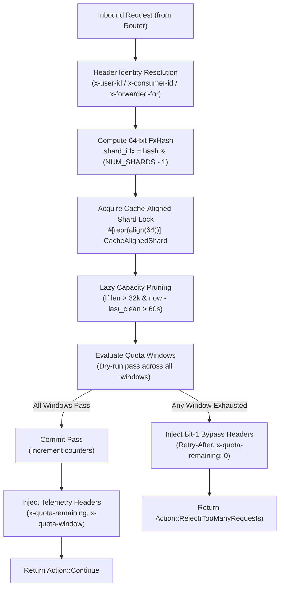

# Architecture & Concurrency Invariants (`consumer_quota`)

## 1. High-Level Architecture Flow



---

## 2. Hardware Invariants

### 2.1 Zero-Float Math via Basis Points ($0..10,000$)
Floating point calculations (`f64`, `f32`) on the hot path introduce register spilling, non-deterministic IEEE-754 rounding, and potential floating point exploit vectors.
In [`consumer_quota::algorithm`](./algorithm.rs):
- Sliding window interpolation uses Basis Points (1 bp = 0.01%):
  $$\text{weight\_bp} = \frac{\text{elapsed\_into\_epoch} \times 10,000}{\text{window\_seconds}}$$
  $$\text{effective\_count} = \text{curr\_count} + \frac{\text{prev\_count} \times (10,000 - \text{weight\_bp})}{10,000}$$
- Token bucket refills use integer Nano-Tokens ($10^{-9}$ tokens):
  $$\text{refill\_tokens} = \frac{\Delta t_{\text{nanos}} \times \text{limit} \times 10^9}{\text{window\_seconds} \times 10^9}$$

### 2.2 Lock-Striped Cache-Aligned Sharding (`#[repr(align(64))]`)
To eliminate L1/L2 data cache bouncing and false sharing across worker cores:
- The state container [`ShardedQuotaState`](./algorithm.rs#L160) allocates 64 independent shards.
- Each shard contains its own `std::sync::Mutex<FxHashMap<u64, Vec<WindowState>>>` aligned to 64 bytes (the L1 cacheline boundary on x86_64).
- Across 4 worker cores, the probability of two cores hitting the exact same shard lock simultaneously is $\frac{1}{64} \approx 1.56\%$. Uncontended atomic CAS operations complete in $< 10 \text{ ns}$.

### 2.3 Cardinality Explosion & DoS Defense
Malicious bots generating billions of randomized user IDs could exhaust proxy memory:
- Each shard caps storage at `MAX_ACCOUNTS_PER_SHARD = 32_768` active identities (total system capacity: $\approx 2,097,152$ concurrent users).
- If capacity is exceeded, lazy TTL pruning sweeps entries inactive for $> 86,400 \text{ seconds}$ (24 hours) at most once every 60 seconds per shard.

---

## 3. Memory Layout

```text
ShardedQuotaState (Total ~4.2 MB for 2M tracked identities)
 ├── Shard 0  [Align 64] -> Mutex<FxHashMap<u64, Vec<WindowState>>>
 ├── Shard 1  [Align 64] -> Mutex<FxHashMap<u64, Vec<WindowState>>>
 ...
 └── Shard 63 [Align 64] -> Mutex<FxHashMap<u64, Vec<WindowState>>>

WindowState (Enum, 24 bytes)
 ├── Sliding { curr_epoch: u64, curr_count: u64, prev_count: u64 }
 ├── Fixed   { curr_epoch: u64, curr_count: u64 }
 └── Bucket  { nano_tokens: u64, last_refill: Instant }
```
