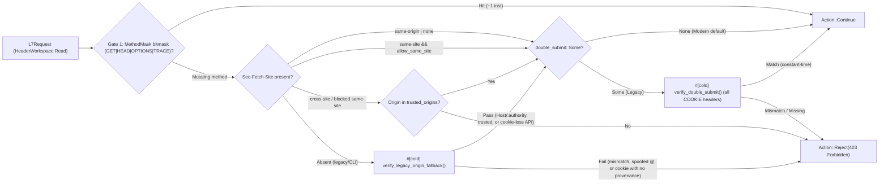

# CSRF Protection Architecture (`csrf`)

The `csrf` plugin executes inside the `pre_upstream` pipeline stage (`crates/velda-plugin/src/pre_upstream/csrf/`). It enforces layered Cross-Origin Protection strictly over `HeaderWorkspace` with zero heap allocations, zero `SystemTime` syscalls, and out-of-line `#[cold]` branches for legacy paths so modern browser traffic stays inside a compact L1i footprint.

---

## 1. Hot-Path vs Cold-Path Execution Architecture

---

## 2. L1i Instruction Cache Isolation (`#[cold] #[inline(never)]`)

Before cold-splitting, inlining legacy `Referer` parsing, `Host` / `:authority` normalization, multi-`Cookie` byte scanning, and SIMD `constant_time_eq` produced `1,099` x86-64 instructions in `CsrfPlugin::on_upstream_request`.

Moving both non-modern routines out-of-line:
- **`CsrfPlugin::verify_legacy_origin_fallback` (`#[cold] #[inline(never)]`)**: Only fetched when `Sec-Fetch-Site` is absent and `enforce_origin` is enabled. Distinguishes **absent provenance** (allows cookie-less API/CLI callers; blocks cookie-bearing callers) from **present malformed headers** (such as `Referer: https://evil.com@host/`, which fail closed `403` even without cookies).
- **`CsrfPlugin::verify_double_submit` (`#[cold] #[inline(never)]`)**: Keeps byte scanning across `req.headers.get_all(COOKIE)` and `constant_time_eq` out of the Modern Tokenless instruction path.
- **Measured ASM Impact (`x86-64-v3`)**: Cuts `CsrfPlugin::on_upstream_request` from **`1,099` → `507` instructions (-53.9%)**, stack reads **`85 → 22` (-74.1%)**, and unaligned vector ops **`10 → 2` (-80.0%)**.

---

## 3. HTTP/2 Multi-Header & Authority Handling

1. **HTTP/2 `Cookie` Concatenation Fix**: RFC 9113 permits HTTP/2 clients to split `cookie` headers into multiple independent header entries. `verify_double_submit` iterates `req.headers.get_all(COOKIE)` rather than `.get(COOKIE)`, ensuring cookies placed in subsequent `cookie:` lines are never missed.
2. **HTTP/2 `:authority` Resolution**: `matches_request_host` checks `HOST` header first and falls back to `req.uri.authority()`, supporting HTTP/2 `:authority` frames where the `Host` header is absent.
3. **Origin Pattern Validation**: `validation.rs` enforces explicit `http://` or `https://` schemes, rejects bare wildcards (`*`, `https://*`), rejects single-label wildcards (`https://*.com`), and forbids `@`, `/`, `?`, `#`, and whitespace inside `trusted_origins`.

---

## 4. Module Ownership Boundaries

| File | Responsibility |
| :--- | :--- |
| `mod.rs` | Public API exports (`CsrfPlugin`, `CsrfConfig`, `CsrfDoubleSubmitConfig`). |
| `validation.rs` | Strict JSON schema (`#[serde(deny_unknown_fields)]`), `MethodMask` validation, cookie token check, `HeaderName::from_bytes`, and strict `trusted_origins` authority validation. |
| `plugin.rs` | Compiled `MethodMask`, `OriginPattern` matchers, hot `on_upstream_request`, and `#[cold]` legacy fallback / Double-Submit helpers. |
