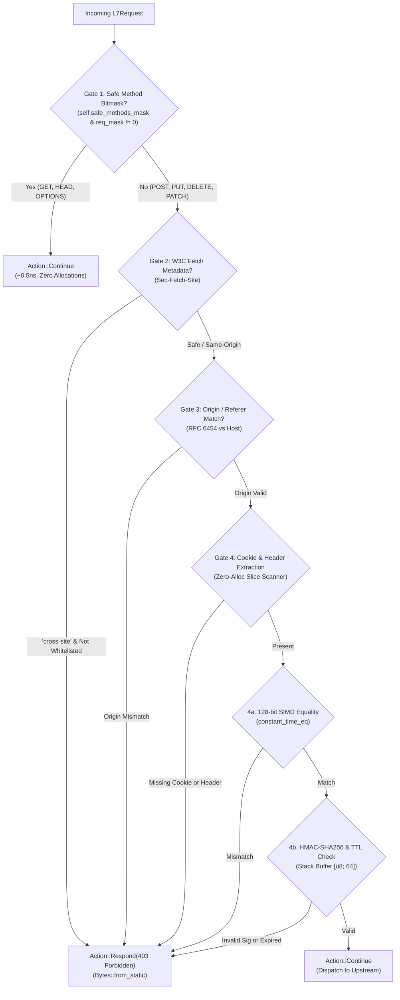

# CSRF Protection Plugin (`csrf`) — Architectural Specification

This document specifies the internal engine design, defense-in-depth pipeline, memory invariants, and cryptographic verification model of the **`csrf`** pre-upstream plugin (OWASP CSRF Defense / RFC 6454 / W3C Fetch Metadata).

---

## 1. Architectural Mindset & Invariants

The `csrf` plugin functions as an edge gatekeeper protecting upstream application services from unauthorized cross-site mutations:

1. **Pre-Upstream Phase Ownership**:
   Executes during the `pre_upstream` lifecycle phase, directly preceding upstream request forwarding. Requests violating CSRF constraints are terminated at the gateway edge with an immediate `403 Forbidden`, preventing resource execution or database side effects on backend services.
2. **Zero-Allocation Hot Path**:
   Cookie extraction operates directly over raw HTTP byte slices without allocating `String`s, `Vec`s, or dynamic `HashMap`s. Token formatting, HMAC-SHA256 calculations, and constant-time comparisons run exclusively in CPU registers and stack buffers (`[u8; 64]`).
3. **Hardware-Accelerated Safe Method Bypass**:
   Uses a compact `u16` bitmask (`MethodMask`) to evaluate whether the incoming request is idempotent (`GET`, `HEAD`, `OPTIONS`, `TRACE`). Safe methods bypass validation in **1 CPU instruction (~0.5ns)**.
4. **Subdomain Cookie Tossing Defense (RFC 6265 §8.5)**:
   Traditional Double-Submit Cookie schemes are vulnerable to cookie tossing from sibling subdomains. Velda Edge implements **Cryptographic Signed Stateless Tokens** (`<timestamp_hex>.<nonce_hex>.<hmac_sha256_hex>`). Attackers lacking the gateway's secret key cannot fabricate a valid signature.

---

## 2. End-to-End Request Pipeline



---

## 3. Core Architectural Subsystems

### 3.1 Gate 1: Safe Method Bitmask (`MethodMask`)

Standard string comparisons across allowed methods introduce $O(N)$ branch checks. In Velda Edge:
```rust
let req_mask = MethodMask::from_method(&req.method);
if (self.safe_methods_mask & req_mask) != 0 {
    return Action::Continue;
}
```
Idempotent requests exit immediately within a single instruction, preserving raw proxy throughput for read-heavy workloads.

---

### 3.2 Gate 2: W3C Fetch Metadata (`Sec-Fetch-Site`)

Modern browsers automatically attach the `Sec-Fetch-Site` header, which JavaScript execution contexts cannot manipulate:
- `same-origin`: Dispatched from the same origin.
- `same-site`: Dispatched from the same registrar domain.
- `none`: Direct user navigation (address bar, bookmarks).
- `cross-site`: Dispatched from an untrusted foreign domain.

If `cross-site` is detected on a mutating request, the gateway inspects `trusted_origins`. If the requesting origin is not explicitly whitelisted, the request is dropped before parsing cookies or body streams.

---

### 3.3 Gate 3: RFC 6454 Origin & Referer Verification

For browsers that do not support Fetch Metadata, the plugin validates the `Origin` header (or fallback `Referer` origin component) against the `Host` header or configured `trusted_origins` using the 256-byte L1 cache-resident `SUBDOMAIN_CHAR_LUT`.

---

### 3.4 Gate 4: Zero-Allocation Byte Scanner & Signed Token Verification

#### 3.4.1 Zero-Allocation Cookie Scanner
Instead of splitting `Cookie` strings into vectors, [`extract_cookie_value`](file:///home/phucle/Desktop/velda-edge/crates/velda-plugin/src/pre_upstream/csrf/plugin.rs) walks the raw byte slice looking for `b"<cookie_name>="` bounded by `;` or whitespace, returning an sub-slice `&[u8]` without heap allocations.

#### 3.4.2 114-Byte Stateless Signed Token Layout
```text
┌───────────────────────┬───┬─────────────────────────────────┬───┬──────────────────────────────────────────────────────────────────┐
│ Timestamp Hex (16 B)  │ . │        Nonce Hex (32 B)         │ . │                     HMAC-SHA256 Hex (64 B)                       │
└───────────────────────┴───┴─────────────────────────────────┴───┴──────────────────────────────────────────────────────────────────┘
Total Length: 16 + 1 + 32 + 1 + 64 = 114 Bytes
```
1. **Instant Shape Guard**: Validates that `token.len() == 114`, `token[16] == b'.'`, and `token[49] == b'.'`.
2. **Branchless Hex Timestamp Decoding**: Decodes the 16-character timestamp hex using a compile-time 256-byte branchless lookup table (`HEX_LUT`), confirming `now.saturating_sub(ts) <= token_ttl_secs` without string allocation or radix branching.
3. **Stack-Allocated HMAC-SHA256**: Feeds the first 49 bytes into `ring::hmac::sign`, writes the hex digest into a stack buffer `[u8; 64]`, and executes loop-free branchless 128-bit vector constant-time comparison (`constant_time_eq_64`) across four `u128` registers.
