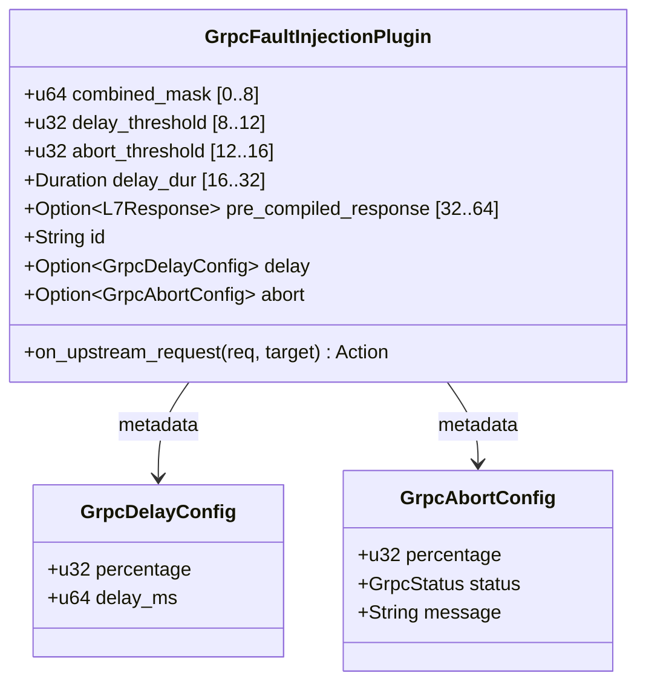

# gRPC Fault Injection Plugin (`grpc_fault_injection`) — Architectural Specification

This document details the internal architecture, probability thresholds, memory layout, and execution pipeline of the **`grpc_fault_injection`** plugin in Velda Edge.

---

## 1. Architectural Philosophy & Invariants

The `grpc_fault_injection` plugin executes during the **`pre_upstream`** pipeline phase, immediately prior to upstream connection leasing. It enables microservice resilience and chaos engineering specifically tailored for gRPC RPC traffic over HTTP/2 and HTTP/3 (QUIC).

```mermaid
flowchart TD
    Req["Incoming L7Request (gRPC over H2/H3)"] --> FastPath{"Fast-Path Guard\n(self.combined_mask == 0)"}
    FastPath -->|True (~0.3ns)| Continue["Action::Continue\n(Zero PRNG, Zero TLS, Zero Branch Drift)"]
    FastPath -->|False| RollPRNG["Step 1: Single 64-bit PRNG Roll (~0.8ns)\ndelay_roll = r >> 32\nabort_roll = r as u32"]
    
    RollPRNG --> CheckFaults{"Step 2: Dual Threshold Comparison\n(delay_roll < delay_threshold)\n(abort_roll < abort_threshold)"}
    
    CheckFaults -->|Delay + Abort| Act1["Action::delay(self.delay_dur, Action::Respond(3-slot resp))"]
    CheckFaults -->|Delay + Continue| Act2["Action::delay(self.delay_dur, Action::Continue)"]
    CheckFaults -->|No Delay + Abort| Act3["Action::Respond(3-slot resp)"]
    CheckFaults -->|No Delay + Continue| Act4["Action::Continue"]
```

### Core Invariants:
1. **Single-Cycle Fast-Path Guard (`combined_mask`)**: When injection is disabled or 0%, the plugin bypasses in exactly 1 CPU comparison instruction (`self.combined_mask == 0`) taking ~0.3ns, with zero PRNG generation, zero TLS lookup, and zero branch misprediction.
2. **Zero 64-Bit Runtime Division**: `Duration::from_millis(delay_ms)` is pre-computed at config load time, completely eliminating the 15–25 CPU cycle integer division (`ms / 1000`) on the hot path.
3. **Single PRNG Entropy Roll**: A single 64-bit random word provides two statistically independent 32-bit random outcomes for delay and abort, cutting PRNG overhead and TLS accesses by 50%.
4. **Minimal 3-Slot Response Footprint**: Pre-compiles gRPC Trailers-Only responses pre-allocated to exactly 3 header slots (`content-type`, `grpc-status`, `grpc-message`), cutting hash table cloning memory overhead by 10x compared to the default 32 slots.
5. **Cache Line Alignment (`#[repr(C, align(64))]`)**: All hot-path data fields fit inside the first 64-byte L1D cache line for 100% cache locality.
6. **Canonical Trailers-Only Abort (RFC 9113 / gRPC Spec)**: Abort responses always return `HTTP 200 OK` (HTTP/2) with `content-type: application/grpc`, `grpc-status: <1..=16>`, and `grpc-message`. Status `0` (`OK`) is strictly forbidden for aborts to prevent client protobuf deserialization crashes on empty bodies.
7. **Protocol Isolation (Rule 2.7)**: Restricted strictly to `SupportedProtocols::GRPC`. The plugin cannot be attached to HTTP REST or Raw TCP routes.

---

## 2. Memory Layout & Data Structures



---

## 3. Configuration Contract

Declarative configuration is validated by `velda-sync` prior to hot-path compilation:
- `delay.enabled`: Boolean flag.
- `delay.fixed_delay_ms`: Latency injected in milliseconds (`1..=60_000`).
- `delay.percentage`: Probability percentage (`0..=100`).
- `abort.enabled`: Boolean flag.
- `abort.grpc_status`: Canonical gRPC error status (`1..=16`).
- `abort.grpc_message`: Non-empty printable ASCII string.
- `abort.percentage`: Probability percentage (`0..=100`).
