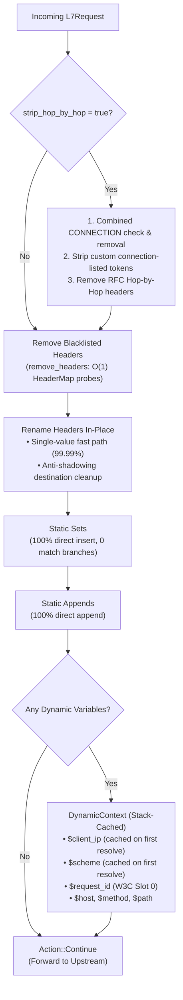
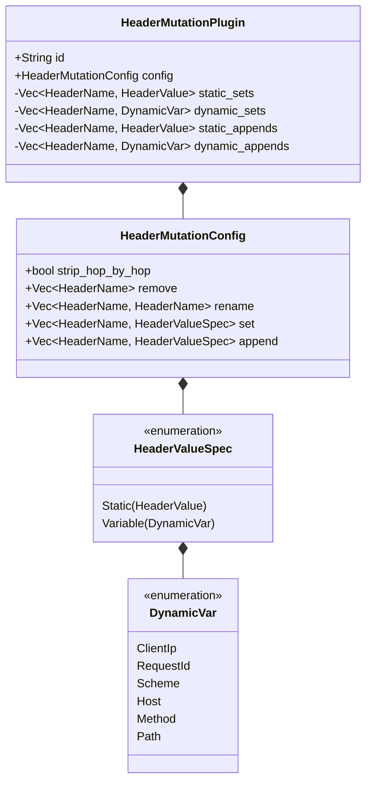

# Header Mutation Plugin (`header_mutation`) — Architectural Specification

This document details the internal architecture, zero-allocation algorithms, memory layout, and request transformation pipeline of the **`header_mutation`** plugin in Velda Edge.

---

## 1. Architectural Philosophy & Invariants

The `header_mutation` plugin operates at the **`pre_upstream`** pipeline phase immediately after route matching and load balancing, transforming the outgoing `L7Request` before upstream socket transmission.

### Core Invariants:
1. **Pre-Partitioned Static & Dynamic Arrays**: Static header specifications are segregated into `static_sets` and `static_appends` during initialization. The request hot path inserts them directly into `HeaderMap` without executing `match` branching.
2. **Single-Pass Hop-by-Hop Removal**: `headers.remove(http::header::CONNECTION)` combines the presence check and table removal in a single hash probe. In clean HTTP/2, HTTP/3, or keep-alive requests without `Connection`, token splitting is completely bypassed.
3. **Anti-Hop-by-Hop Strip Abuse (CVE-2022-26143)**: Fast length-bucket dispatch guarantees that essential protocol headers (`Host`, `Authorization`, `x-request-id`, `x-real-ip`, etc.) cannot be deleted by client-supplied `Connection` tokens.
4. **Anti-Shadowing Header Renaming**: Before a header is renamed from `source` to `target`, the destination `target` is wiped clean to prevent malicious client-injected shadow headers.
5. **Stack-Cached Dynamic Context**: When a request references dynamic variables (e.g. both `x-real-ip` and `x-forwarded-for` referencing `$client_ip`), resolution runs once and caches the `HeaderValue` on the stack, eliminating redundant string operations.
6. **Zero Allocation for Static Headers**: Pre-computes `HeaderName` and `HeaderValue` during configuration compilation, requiring zero heap allocation during request serving.

---

## 2. Memory Layout & Data Structures

---

## 3. Hot-Path Complexity & Performance

- **Static Insertion / Removal**: $O(1)$ amortized hash table lookup via `http::HeaderMap`.
- **Hop-by-Hop Stripping**: $O(K)$ where $K$ is the number of hop-by-hop headers present (typically 0 or 1).
- **Dynamic Context**: $O(1)$ stack allocation, caching `client_ip` and `scheme` pointers.
