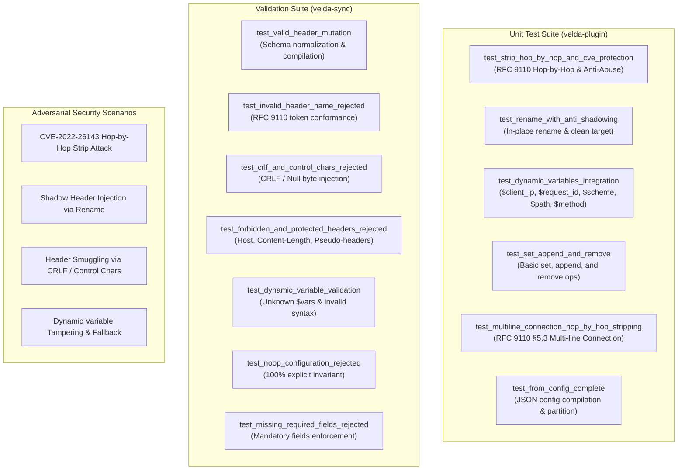

# Header Mutation Plugin (`header_mutation`) — Test Specification

This document details the testing architecture, automated unit test catalog, CVE-class adversarial security validations, and live reproduction verification for the **`header_mutation`** pre-upstream plugin.

---

## 1. Test Architecture & Scope

The `header_mutation` test suite covers four essential functional and security dimensions:



1. **RFC 9110 Hop-by-Hop Stripping & CVE-2022-26143 Anti-Abuse**:
   - Verification that RFC hop-by-hop headers (`Connection`, `Keep-Alive`, `Proxy-Authenticate`, `Proxy-Authorization`, `TE`, `Trailer`, `Transfer-Encoding`, `Upgrade`) are purged.
   - Verification that arbitrary headers declared inside `Connection: ...` are stripped.
   - Verification that essential security and routing headers (`Host`, `Authorization`, `x-request-id`, `x-real-ip`, `x-forwarded-for`, etc.) are protected from stripping even when explicitly requested by an attacker in `Connection`.
2. **Anti-Shadowing Header Renaming**:
   - Verification of the single-value fast path for in-place renaming.
   - Verification that any pre-existing header with the target name is purged prior to inserting the renamed value, preventing duplicate/shadowing headers.
3. **Dynamic Variable Resolution & Stack-Caching**:
   - Verification of `$client_ip`, `$request_id`, `$route_id`, `$upstream_id`, `$scheme`, `$host`, `$method`, `$path`, and `$$` escape.
   - Verification that multi-reference variables (`$client_ip` used across multiple headers) resolve once and share the stack-cached value.
4. **Declarative Synchronization & Defense-in-Depth (`velda-sync`)**:
   - Rejection of invalid header names (spaces, colons, non-ASCII characters).
   - Rejection of CRLF (`\r`, `\n`) and control character injections.
   - Rejection of manipulations targeting forbidden/protected headers (`Host`, `Content-Length`, `Transfer-Encoding`, `:` pseudo-headers).
   - Rejection of no-op empty configurations.

---

## 2. Automated Test Catalog

### 2.1 Plugin Engine Suite (`crates/velda-plugin/src/pre_upstream/header_mutation/plugin.rs`)

| Test Function | Purpose | Key Assertions |
| :--- | :--- | :--- |
| `test_strip_hop_by_hop_and_cve_protection` | Hop-by-hop stripping and CVE-2022-26143 defense | Strips `upgrade`, `custom-hop`; preserves `host`, `authorization`, `x-request-id` despite presence in `Connection`. |
| `test_rename_with_anti_shadowing` | Anti-shadowing header rename logic | In-place rename of `x-old` $\to$ `x-new`; purges pre-existing `x-new` value to avoid shadowing. |
| `test_dynamic_variables_integration` | Dynamic variable interpolation and stack caching | Resolves `$client_ip`, `$request_id`, `$route_id`, `$scheme`, `$upstream_id`, `$host`, `$method`, `$path`, `$$`. |
| `test_set_append_and_remove` | Standard mutation primitives | Correctly executes `set_headers`, `append_headers`, and `remove_headers` concurrently. |
| `test_from_config_complete` | Complete configuration deserialization | Pre-partitions static vs dynamic sets and appends from `HeaderMutationConfig`. |

### 2.2 Sync Validation Suite (`crates/velda-sync/src/post_sync/plugin/pre_upstream/header_mutation.rs`)

| Test Function | Purpose | Key Assertions |
| :--- | :--- | :--- |
| `test_valid_header_mutation` | Valid configuration compilation | Validates and compiles a full-featured mutation configuration. |
| `test_invalid_header_name_rejected` | RFC 9110 token validation | Rejects names containing spaces, colons, non-ASCII characters. |
| `test_crlf_and_control_chars_rejected` | Header smuggling defense | Rejects values containing `\r`, `\n`, `\0`, or non-printable ASCII. |
| `test_forbidden_and_protected_headers_rejected` | Core protocol protection | Rejects stripping or overriding `host`, `content-length`, or `:path`. |
| `test_dynamic_variable_validation` | Dynamic variable validation | Rejects unknown dynamic variables like `$unknown_var` or incomplete syntax. |
| `test_noop_configuration_rejected` | 100% explicit configuration invariant | Rejects configuration where no actions are enabled. |
| `test_missing_required_fields_rejected` | Schema completeness | Rejects configs missing mandatory fields. |

---

## 3. Adversarial Security Scenarios

### Scenario 1: Hop-by-Hop Header Strip Abuse (CVE-2022-26143)
- **Attack Vector**: An attacker sends `Connection: Host, Authorization, x-request-id, x-real-ip` attempting to induce the reverse proxy to strip authentication and routing metadata before forwarding to the backend.
- **Defense Implementation**:
  - `is_protected_against_connection_strip()` runs a length-bucketed hash probe before stripping any token from `Connection`.
  - Protected headers (`host`, `authorization`, `x-request-id`, `x-real-ip`, `x-forwarded-for`, etc.) are retained regardless of the `Connection` header contents.

### Scenario 2: Shadow Header Injection via Rename
- **Attack Vector**: An attacker supplies both `X-Device-Type: mobile` and a spoofed `X-Client-Device: desktop`. If renaming only sets the target without removing existing values, downstream microservices might read the attacker's shadow value depending on their header iterator order.
- **Defense Implementation**:
  - The plugin clears the destination header via `headers.remove(target)` before inserting the renamed value.

### Scenario 3: Header Smuggling via CRLF Injection
- **Attack Vector**: Attempting to inject `\r\nInjected-Header: evil` into static configuration values.
- **Defense Implementation**:
  - `velda-sync` parses and verifies every header value against RFC 9110 visible character constraints (`0x20..=0x7E`), rejecting control characters at configuration load time.

---

## 4. Running Test Suites

Execute unit test suites via Cargo:

```bash
# Run unit tests for header_mutation plugin
cargo test -p velda-plugin --lib pre_upstream::header_mutation

# Run sync validator tests for header_mutation
cargo test -p velda-sync --lib post_sync::plugin::pre_upstream::header_mutation

# Run all plugin tests
cargo test -p velda-plugin
```

---

## 5. Live Azure Reproduction & Verification

Executed directly from client node (VM2 `172.16.0.5`) against gateway node (VM1 `172.16.0.4:80`):

```bash
# 1. Verify static and dynamic header injection
curl -s -v http://172.16.0.4:80/api/headermut/ping \
  -H "x-internal-secret: client-leak" \
  -H "x-client-device: mobile-ios" \
  -H "Connection: close, upgrade, authorization"

# Expected Upstream Request State:
# - x-internal-secret: REMOVED
# - x-client-device: RENAMED to x-device-type: mobile-ios
# - authorization: PRESERVED (CVE-2022-26143 protected)
# - x-gateway: "velda-edge"
# - x-client-ip: "172.16.0.5"
# - x-request-id: "<monotonic-uuid>"
```
