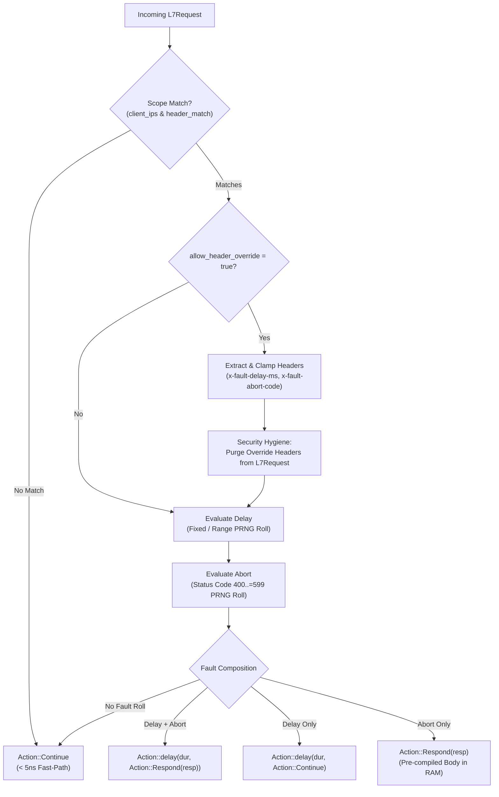
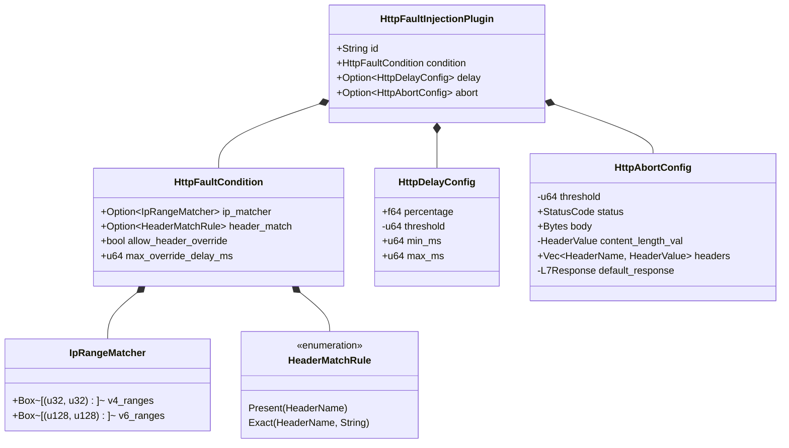

# HTTP Fault Injection Plugin (`http_fault_injection`) — Architectural Specification

This document details the internal architecture, zero-allocation algorithms, memory layout, targeting scope, and execution pipeline of the **`http_fault_injection`** plugin in Velda Edge.

---

## 1. Architectural Philosophy & Invariants

The `http_fault_injection` plugin operates at the **`pre_upstream`** pipeline phase immediately after route selection and before upstream dispatch. It provides Chaos Engineering and resilience testing exclusively for HTTP traffic (HTTP/1.1, HTTP/2 Web/REST, HTTP/3).

### Core Invariants:
1. **Precedence Rule (Delay First, Then Abort)**: When a request matches both delay and abort criteria, the gateway delays execution first, then aborts with the synthetic HTTP response. This accurately models cascading database timeouts and worker pool exhaustion.
2. **Zero-Syscall PRNG**: Uses a thread-local XorShift64* pseudo-random number generator running in ~1 nanosecond with zero locks, zero memory allocations, and zero syscalls.
3. **Disjoint Interval IP Matching**: All IPv4 and IPv6 CIDR prefixes are converted at configuration compile time into sorted, non-overlapping `[start, end]` integer ranges (`u32` for IPv4, `u128` for IPv6). Matching uses $O(\log N)$ binary search (`partition_point`) with zero heap allocations.
4. **Authoritative Anti-Spoofing Extraction**: Evaluates edge `x-real-ip` first, falling back to nearest right-most proxy in `x-forwarded-for`.
5. **Slowloris Defense**: Dynamic delay override is strictly clamped to `max_override_delay_ms` (defaults to 5,000ms). Un-scoped dynamic override is rejected fail-fast at configuration compile time.
6. **Anti-Leak Token Purging**: All test tokens (`x-fault-delay-ms` and `x-fault-abort-code`) are stripped from request headers before upstream dispatch.
7. **RFC 9110 Error Bounds**: Abort status codes are strictly clamped to `400..=599`. Non-error status codes (200, 204, 304) are rejected.

---

## 2. Memory Layout & Data Structures

### 2.1 Pre-Allocated Abort Response (`HttpAbortConfig`)
The response body (`Bytes::from_static(b"fault filter abort\n")`), header map (`Content-Type`, `Content-Length`, `x-velda-fault: abort`), and default `L7Response` are created once during snapshot compilation:
- **Hot-Path Abort**: Clones the pre-warmed `default_response` via an atomic reference-count bump. Zero string formatting, zero heap allocation.

### 2.2 Disjoint Interval Binary Search (`IpRangeMatcher`)
- At startup, all CIDRs (e.g. `10.0.0.0/8`, `192.168.1.0/24`) are converted into `(start_bits, end_bits)` tuples, sorted by start bits, and contiguous/overlapping intervals are merged.
- At runtime:
  - If $N = 1$: Evaluates in ~0.5ns via two integer comparisons (`ip >= start && ip <= end`).
  - If $N > 1$: Evaluates in $O(\log N)$ using cache-friendly `partition_point`.

---

## 3. Protocol Isolation Invariant

- **Strict Boundary**: Declares `supported_protocols: SupportedProtocols::ALL_HTTP` (HTTP/1.1, HTTP/2, HTTP/3).
- **gRPC Decoupling**: For gRPC length-prefixed streaming traffic, use [`grpc_fault_injection`](../grpc_fault_injection/). `http_fault_injection` never intercepts gRPC routes.
