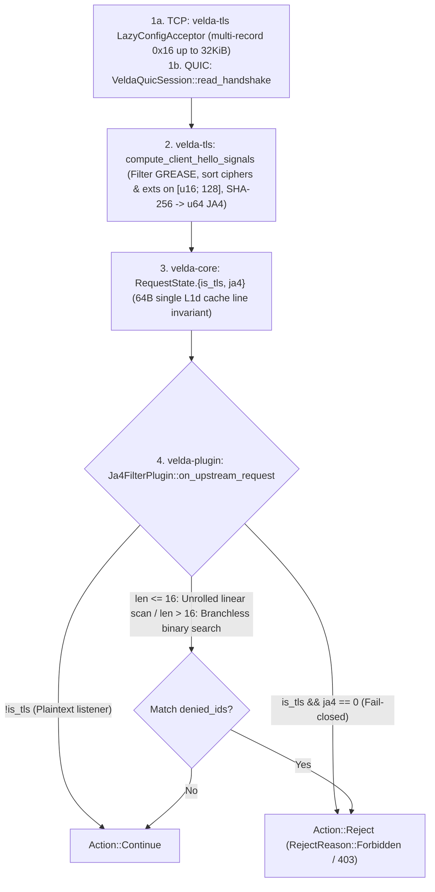

# JA4 TLS Fingerprint Filter (`ja4_filter`) — Deep Architecture

## 1. End-to-End Zero-Allocation Data Flow

---

## 2. Memory Layout & Cache-Line Geometry

In `crates/velda-core/src/context.rs`, `RequestState` was previously `48` bytes (with `16` bytes of alignment padding remaining before crossing into a second `64`-byte L1d cache line). Storing the compressed `ja4: u64` (`8` bytes) keeps `std::mem::size_of::<RequestState>() == 64` — avoiding the cache-line split that a `36`-byte heap `String` would cause.

`Ja4FilterPlugin` compiles `deny` entries at load time into a contiguous, sorted, deduplicated `Box<[u64]>`:
- `16` entries = `128` bytes (fits in 2 L1d cache lines).
- `128` entries = `1,024` bytes (fits completely in L1d).

---

## 3. Verified Release Assembly (`x86_64`)

Audited from `cargo rustc -p velda-plugin --lib --release -- --emit=asm`:
- Symbol: `Ja4FilterPlugin::on_upstream_request` (`71` instructions).
- **Stack Frame**: **`0` bytes** (zero `sub rsp`, zero callee-saved register spills).
- **Function Calls**: **`0`** (`call` count = `0`).
- **Heap Allocations**: **`0`**.
- **Linear Scan (`<= 16` rules)**: LLVM unrolls 8-way (`cmp qword ptr [rdi + 8*r10 + 0..56], rdx`).
- **Binary Search (`>= 17` rules)**: Branchless midpoint update (`cmova r8, r9`).

---

## 4. Crate Boundary & Security Invariants

- **Strict Crate Isolation**: `velda-tls` has zero knowledge of `velda-plugin`, routes, or L7 policies; it only extracts `(ja4, tls_traits)`. `velda-plugin` has zero knowledge of TLS sockets or `rustls`; it only reads `req.state.{is_tls, ja4}`.
- **Fail-Closed Handshake Enforcement**: On TLS listeners (`is_tls == true`), any connection missing a valid JA4 (`ja4 == 0`) fails inside `TlsServerEngine::accept` or is fail-closed rejected by `Ja4FilterPlugin`. Non-TLS plaintext listeners set `is_tls = false` and pass cleanly.
- **External Wire Indistinguishability**: Rejected connections return generic `403 Forbidden` (HTTP) or `PERMISSION_DENIED` (gRPC) without exposing JA4 fingerprint headers.
