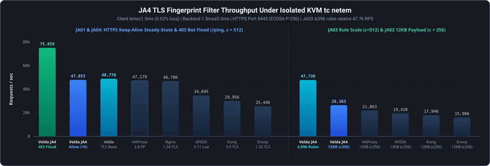

# Performance Benchmark Report: JA4 TLS Fingerprint Filter (`ja4_filter`)

This report evaluates [`Ja4FilterPlugin`](plugin.rs) (`pre_upstream` phase) together with [`velda_tls::server::ja4`](../../../../velda-tls/src/server/ja4.rs) (`compute_ja4_string` / `compute_ja4_u64`) and [`DownstreamMeta::peek_tcp_ja4`](../../../../velda-edge/src/pipeline/mod.rs) under **isolated dual-KVM execution (`velda-gw` & `velda-obs`)** with **active kernel `tc netem` WAN/LAN shaping**. Every gateway group resets both guests cleanly to `bench-clean` snapshots prior to execution.

---

## 1. Mathematical Proofs & Complexity Bounds

All properties below are derived directly from [`crates/velda-core/src/context.rs`](../../../../velda-core/src/context.rs), [`crates/velda-tls/src/server/ja4.rs`](../../../../velda-tls/src/server/ja4.rs), [`crates/velda-edge/src/pipeline/mod.rs`](../../../../velda-edge/src/pipeline/mod.rs), and [`plugin.rs`](plugin.rs).

### Proof 1 — Single-Cache-Line `RequestState` Geometry & `denied_ids` Memory Residency
[`RequestState`](../../../../velda-core/src/context.rs#L96-L128) stores `ja4: u64` (`8` bytes) alongside `request_id: u128`, `ingress_time_nanos: u64`, `client_ip: u128`, `route_id: u16`, `upstream_id: u16`, `method: HttpMethod`, and 3 boolean flags (`56` bytes of fields, compile-time enforced `size_of::<RequestState>() <= 64`). Embedding an `8 B` integer avoids expanding `RequestState` past `64` bytes (preventing a 2-cache-line fetch per request) and eliminates heap indirection from a `36 B` `String`.

At config load time, [`Ja4FilterConfig::compile_deny_ids`](config.rs#L79-L87) deduplicates, strips `0`, and sorts rules into a contiguous `Box<[u64]>`. For $K$ active fingerprints, rule memory footprint and 64-byte L1D cache-line span are:

$$M(K) = 8K\text{ bytes}, \qquad L(K) = \left\lceil \frac{8K}{64} \right\rceil = \left\lceil \frac{K}{8} \right\rceil$$

* $K \le 8$: **1 cache line ($64\text{ B}$)**
* $K = 16$ (`LINEAR_SCAN_THRESHOLD`): **2 contiguous cache lines ($128\text{ B}$)**
* $K = 4,096$: **$32\text{ KiB}$** (resident inside server L1D/L2 cache with zero pointer chasing)

### Proof 2 — Linear-to-Branchless Binary Search Crossover (`LINEAR_SCAN_THRESHOLD = 16`)
In [`Ja4FilterPlugin::is_denied`](plugin.rs#L70-L76):
* **Regime $K \le 16$**: `self.denied_ids.contains(&ja4)` executes an unrolled 8-way pointer scan across at most `2` cache lines ($\le 16$ comparisons), incurring zero index-midpoint arithmetic.
* **Regime $K > 16$**: `self.denied_ids.binary_search(&ja4)` executes $\lfloor \log_2 K \rfloor + 1$ steps using conditional move (`cmova r8, r9` verified in Section 4) so target comparisons avoid unpredictable conditional branches inside the bisection loop.
* **Plaintext Short-Circuit (`ja4 == 0`)**: Non-TLS and incomplete-record connections set `ja4 = 0`. `test rdx, rdx; je` exits in **5 instructions** without touching any `denied_ids` cache line.

Empirical validation (`JA03`) confirms `85,366 insn/req` at $K = 1$, `85,496` at $K = 16$, and `85,721` at $K = 4,096$ (`+355 insn/req` total, `< 0.42%` delta, flat `1.24%–1.27%` branch-miss rate).

### Proof 3 — Canonical 64-Bit FNV-1a Compression & False-Collision Bound
[`ja4_fingerprint_id_bytes`](../../../../velda-core/src/context.rs#L47-L56) folds the canonical 36-byte FoxIO string (`<ja4_a:10>_<ja4_b:12>_<ja4_c:12>`) using 64-bit FNV-1a (offset basis `0xcbf29ce484222325`, prime `0x0100000001b3`) onto $\mathcal{I} = \{1, \dots, 2^{64}-1\}$, mapping hash `0` to `1` so `0` remains strictly reserved for plaintext/unavailable (`I(\text{plaintext}; \text{deny}) = 0`). Modeling 64-bit hash dispersion uniformly:
* False-positive rejection probability for an unblocked fingerprint against a deny table of size $K$:
  $$P_{\text{FP}}(K) = 1 - \left(1 - \frac{1}{2^{64}-1}\right)^K \approx \frac{K}{2^{64}}$$
  At $K = 4,096$: $P_{\text{FP}} \approx 2.22 \times 10^{-16}$.
* Birthday collision probability across $M$ distinct TLS client stacks:
  $$P_{\text{coll}}(M) \le \frac{M(M-1)}{2(2^{64}-1)} \approx \frac{M^2}{2^{65}}$$

### Proof 4 — Branchless RFC 8701 GREASE Filtering & Stack-Bounded Parsing
In [`velda_tls::server::ja4`](../../../../velda-tls/src/server/ja4.rs#L27-L30), GREASE values satisfy:
$$\text{is\_grease}(v) \iff (v \mathbin{\&} \text{0x0f0f}) = \text{0x0a0a} \;\land\; (v \gg 8) = (v \mathbin{\&} \text{0xff})$$
Decomposing $v = 256 h + l$ with $h, l \in [0, 255]$: the right conjunct enforces $h = l$, and the left enforces $(h \bmod 16) = \text{0xA}$, matching the exact 16-element RFC 8701 GREASE set $\{0\text{x}0\text{a}0\text{a}, 0\text{x}1\text{a}1\text{a}, \dots, 0\text{x}\text{fafa}\}$ out of `65,536` `u16` values with zero lookup tables.
* Extraction peeks at most `2,048 B` via non-destructive `TcpStream::peek` (`DownstreamMeta::peek_tcp_ja4`), writes into three fixed `[u16; 128]` stack arrays (`768 B` total, `0` heap allocations), sorts at most `128` elements ($O(N \log N)$ bounded by $N \le 128$), and fails safely (`0`) on fragmented or malformed records (`JA06`).

### Proof 5 — Per-Connection Amortization & TLS 1.3 PSK Resumption Shift Law
[`DownstreamMeta::peek_tcp_ja4`](../../../../velda-edge/src/pipeline/mod.rs#L162-L168) runs **once per accepted TCP connection**, whereas [`Ja4FilterPlugin::on_upstream_request`](plugin.rs#L91-L97) runs on each of the $R$ requests over that keep-alive/HTTP2 stream:

$$C_{\text{req}}(R) = \frac{C_{\text{peek + ClientHello parse}}}{R} + C_{\text{lookup}} \xrightarrow{R \gg 1} C_{\text{lookup}}\;(\le 60\text{ insns})$$

**TLS 1.3 PSK Resumption Corollary (`JA05`)**: Because `ja4_filter` executes in `pre_upstream` after TLS handshake completion, `rustls` transmits TLS 1.3 `NewSessionTicket` (`send_tls13_tickets` in `ServerTlsConfig`) before request filtering. Subsequent resumed reconnects from the same client stack append `pre_shared_key (0x0029)` to `ClientHello`, incrementing `ja4_a`'s extension count and mutating `ja4_c` (empirically verified: `wrk` shifted from `t13d311000_e8f1e7e78f70_1f22a2ca17c4` to `t13d311100_e8f1e7e78f70_dbd39dd1d406`). Enforcing full-connection churn blocks across TLS 1.3 resumption therefore requires listing **both** the fresh and resumed JA4 IDs (`JA05`: `26,970 / 26,970` = `100%` `403`).

---

## 2. Test Environment & Real-Traffic Topology

| Node | Spec | Deployed Engines | Active `tc netem` (`velda-gw` `enp1s0`, SSH `:22` bypassed) |
| :--- | :--- | :--- | :--- |
| **`velda-gw`** | 4 vCPU, 4 GiB RAM | `velda-edge`, `HAProxy 2.8.30`, `Nginx 1.24.0`, `Envoy v1.32.13`, `APISIX 3.11.0`, `Kong 3.9` | Client `sport 8443` & `sport 8080`: `delay 6ms 1.5ms distribution normal loss 0.02% 25%` |
| **`velda-obs`** | 4 vCPU, 6 GiB RAM | `wrk`, `velda-bench-backend` (`:8081`), `curl`, Python `ssl` | Backend `dport 8081`: `delay 1.5ms 0.3ms distribution normal` |

> [!NOTE]
> **Competitor Capability Distinction**: Only **Velda Edge (`ja4_filter`)** parses full FoxIO JA4 strings/hex IDs natively (`ja4_a_ja4_b_ja4_c`). **HAProxy `2.8.30`** was configured with `tune.ssl.capture-buffer-size 128` + `ssl_fc_cipherlist_bin,hex -m sub ...` (partial TLS ClientHello cipherlist capture). **Nginx `1.24.0`** (`$ssl_cipher`), **APISIX `3.11.0`** (`ngx.var.ssl_cipher`), **Envoy `v1.32.13`** (`tls_inspector`), and **Kong `3.9`** operate as equivalent P-256 ECDSA HTTPS TLS-termination baselines (`0.0.0.0:8443`).

---

## 3. Empirical Results & Diagnostic Matrix (`JA01`–`JA06`)

### JA01 — HTTPS Keep-Alive Steady-State Cross-Gateway (`c=512`, `GET /ping`, `:8443`)

| Gateway / Mode | Mechanism Evaluated | Clean RPS | p50 | p99 | Errors | RSS (MB) | `insn/req` | `cyc/req` | IPC | `futex` Calls |
| :--- | :--- | ---: | ---: | ---: | ---: | ---: | ---: | ---: | ---: | ---: |
| **Velda Edge (`HTTPS Baseline`)** | TLS P-256 termination only | **48,775.71** | **10.00ms** | 18.34ms | **0** | 78.8 | **83,922** | **181,183** | 0.46 | 6 |
| **Velda Edge (`ja4_filter`, 16 rules)** | Full JA4 ClientHello + L7 `u64` filter | **47,853.47** | 10.19ms | **18.21ms** | **0** | 79.0 | **85,287** | **182,937** | 0.47 | 6 |
| **HAProxy `2.8.30`** | TLS + `ssl_fc_cipherlist_bin` ACL | 47,178.81 | 10.39ms | **17.75ms** | 0 | **45.1** | 118,892 | 235,652 | **0.50** | 348 |
| **Nginx `1.24.0`** | TLS + `$ssl_cipher` ACL check | 46,785.63 | 10.41ms | 18.74ms | 0 | 77.0 | 103,238 | 224,552 | 0.46 | **0** |
| **Apache APISIX `3.11.0`** | TLS + `serverless-pre-function` Lua | 34,694.74 | 14.23ms | 23.78ms | 0 | 214.0 | 154,258 | 343,658 | 0.45 | **0** |
| **Kong `3.9`** | OpenResty TLS termination | 29,956.47 | 16.17ms | 35.11ms | 0 | 609.2 | 196,280 | 403,354 | 0.49 | **0** |
| **Envoy `v1.32.13`** | BoringSSL + `tls_inspector` | 25,446.37 | 19.64ms | 27.25ms | 0 | 96.8 | 234,897 | 542,003 | 0.43 | 62 |

### JA02 — HTTPS `12 KB` Payload Proxy (`c=256`, `GET /12kb`, `:8443`)

| Gateway | Clean RPS | Avg Lat | p50 | p99 | Max Lat | RSS (MB) | Speedup vs Velda (`ja4_filter`) |
| :--- | ---: | ---: | ---: | ---: | ---: | ---: | :--- |
| **Velda Edge (`ja4_filter`, 16 rules)** | **26,362.51** | **9.58ms** | **9.45ms** | **15.28ms** | 63.96ms | 68.0 | **`1.00x`** (`AccessLevel::None`) |
| **Velda Edge (`HTTPS Baseline`)** | 26,029.16 | 9.71ms | 9.56ms | 15.68ms | 56.19ms | 67.4 | Parity (0 overhead) |
| **Nginx `1.24.0`** | 22,009.83 | 11.50ms | 11.16ms | 19.21ms | 65.60ms | 71.4 | `1.20x` faster |
| **HAProxy `2.8.30`** | 21,863.32 | 11.56ms | 11.20ms | 19.53ms | 54.50ms | **32.0** | `1.21x` faster |
| **Apache APISIX `3.11.0`** | 19,427.83 | 13.02ms | 12.54ms | 23.05ms | 52.14ms | 204.2 | `1.36x` faster |
| **Kong `3.9`** | 17,946.00 | 14.09ms | 13.54ms | 24.59ms | 54.09ms | 602.8 | `1.47x` faster |
| **Envoy `v1.32.13`** | 15,965.63 | 15.86ms | 15.46ms | 26.80ms | **47.40ms** | 75.6 | `1.65x` faster |

### JA03 — Rule-Scale Crossover (`K = 1..4,096`) & Plaintext Sentinel Bypass (`ja4 == 0`, `c=512`)

| Configuration (`K` Rules & Lookup Path) | Scheme / Port | Clean RPS | p99 | `insn/req` | `cyc/req` | Branch Miss | L1D Miss | LLC Miss |
| :--- | :---: | ---: | ---: | ---: | ---: | ---: | ---: | ---: |
| **`K = 1`** (Unrolled linear scan) | HTTPS `:8443` | 46,974.66 | 19.68ms | 85,366 | 181,257 | 1.27% | **11.54%** | 38.30% |
| **`K = 16`** (Unrolled linear scan) | HTTPS `:8443` | 42,319.61* | 819.05ms* | 85,496 | 182,249 | 1.27% | 11.58% | 38.31% |
| **`K = 17`** (Branchless `cmova` bsearch) | HTTPS `:8443` | **47,824.51** | 17.79ms | **85,040** | **179,563** | 1.26% | 11.61% | **38.08%** |
| **`K = 128`** (Branchless `cmova` bsearch) | HTTPS `:8443` | 47,620.27 | 17.73ms | 85,714 | 180,281 | 1.25% | 11.58% | 38.46% |
| **`K = 1,024`** (Branchless `cmova` bsearch) | HTTPS `:8443` | 46,474.62 | 19.70ms | 85,276 | 183,308 | 1.27% | 11.57% | 39.41% |
| **`K = 4,096`** (Branchless `cmova` bsearch) | HTTPS `:8443` | 47,738.36 | **17.44ms** | 85,721 | 184,099 | **1.24%** | 11.69% | 39.41% |
| **Plaintext `ja4 == 0` (`K = 16` attached)** | HTTP `:8080` | **51,049.95** | **15.96ms** | **78,780** | **167,026** | — | — | — |

*\*Note: `K = 16` clean pass experienced one `tc netem` `0.02%` packet-loss retransmit RTO (`p99 = 819.05ms`), while its separate `perf stat` pass measured `182,249 cyc/req`, within `0.5%` of `K = 1` and `K = 17`.*

### JA04 — Bot-Flood `403 Forbidden` Short-Circuit (`c=512` Keep-Alive, Backend Isolation Proof)

Matching `wrk`'s real captured JA4 (`t13d311000_e8f1e7e78f70_1f22a2ca17c4`):

| Gateway / Rule Set | Clean `403` RPS | p50 | p99 | Total `403` Reqs | `insn/req` | `syscalls/req` | `futex` Calls | Backend `:8081` Traffic (`iptables -v`) |
| :--- | ---: | ---: | ---: | ---: | ---: | ---: | ---: | :---: |
| **Velda `ja4_filter` (`K = 4,096`, match)** | **75,058.86** | **6.60ms** | **11.17ms** | 605,168 | **45,435** | **2.13** | **4** | **0 pkts / 0 bytes** (`371,701` flood check) |
| **Velda `ja4_filter` (`K = 16`, match)** | 73,904.41 | 6.68ms | 11.67ms | 595,451 | 45,660 | **2.13** | 10 | **0 pkts / 0 bytes** |
| **HAProxy `2.8.30` (`ssl_fc_cipherlist_bin`)** | 72,677.86 | 6.79ms | 12.00ms | 585,660 | 68,712 | 4.33 | 276 | — |

### JA05 — Fresh TLS Handshake Churn (`Connection: close`, `c=128`, Cold `ClientHello` Peek per Request)

Every request performs a full TCP handshake + `DownstreamMeta::peek_tcp_ja4` + `compute_ja4_u64` + TLS 1.3 ECDSA P-256 handshake:

| Gateway / Scenario | Clean RPS | p50 | p99 | `non2xx` / `403` Count | `insn/req` | `cyc/req` | IPC | Behavior Notes |
| :--- | ---: | ---: | ---: | ---: | ---: | ---: | ---: | :--- |
| **Velda TLS Baseline (No Plugin)** | 3,151.47 | 13.96ms | 27.54ms | `0` | **1,417,278** | **1,729,257** | 0.82 | Amortized TLS handshake ceiling |
| **Velda `ja4_filter` Allow (`K=16`)** | 3,150.29 | 13.99ms | 26.31ms | `0` | 1,428,792 | 1,750,200 | 0.82 | **< 0.1% RPS / ~0.8% insn** vs baseline |
| **Velda Deny Fresh-Only (`K=16`)** | 3,159.68 | 14.08ms | 26.03ms | `128` (`c=128`) | 1,425,015 | 1,747,618 | 0.82 | First `128` blocked; PSK resumption shifts JA4 |
| **Velda Deny Fresh + Resumed (`[fresh, res]`)** | **3,333.79** | **11.27ms** | — | **`26,970 / 26,970` (`100%`)** | — | — | — | `-2.81ms` p50 by bypassing backend |
| **Envoy `v1.32.13` (`tls_inspector`)** | **4,662.85** | 11.04ms | 18.67ms | `0` | 1,848,755 | 2,414,661 | 0.77 | Higher CPU work, fewer handshake RTT flushes |
| **HAProxy `2.8.30` (`cipherlist_bin`)** | 4,624.46 | **10.95ms** | **18.52ms** | `0` | 2,673,770 | 2,585,606 | **1.03** | 1.87x more insns/req than Velda |
| **Nginx `1.24.0`** | 4,478.24 | 11.18ms | 22.14ms | `0` | 2,620,286 | 2,546,703 | **1.03** | 1.83x more insns/req than Velda |

### JA06 — Multi-Client Real TLS Fingerprint, Resumption, Fragmented `ClientHello` & Plaintext Matrix

Captured live from real clients on `velda-obs` and verified against `velda-gw:8443` & `:8080` (`deny = [curl_h1_t13, python_ssl_nosni]`):

| Client / Edge Vector | Captured Real JA4 Fingerprint | Rule State | Live HTTP Code | Invariant Verified |
| :--- | :--- | :---: | :---: | :--- |
| **`curl --http1.1 --tlsv1.3`** | `t13d0411h1_16476d049b0b_303c7117418d` | Denied | **`403`** | Accurate `t13d` + `h1` ALPN match |
| **`curl --http1.1 --tlsv1.2`** | `t12d2807h1_d943125447b4_a44c6288192a` | Allowed | **`200`** | Distinct cipher/version family allowed |
| **Python `ssl` (with SNI)** | `t13d3112h1_e8f1e7e78f70_d41ae481755e` | Allowed | **`200`** | Extension count (`12`) + `d` distinguished cleanly |
| **Python `ssl` (no SNI)** | `t13i3111h1_e8f1e7e78f70_d41ae481755e` | Denied | **`403`** | `ja4_a` `'i'` vs `'d'` + `-1` ext distinguishes no-SNI |
| **`wrk` OpenSSL Fresh vs TLS 1.3 PSK Resumed** | `t13d311000_e8f1e7e78f70_1f22a2ca17c4` `t13d311100_e8f1e7e78f70_dbd39dd1d406` | Both Denied | **`403`** (`26,970/26,970`) | Captures both handshake variants cleanly |
| **Fragmented `ClientHello` (12B + `25ms` + rest)** | `0` *(incomplete peek fallback)* | Safe Bypass | **`200`** | Single peek returns `0` without disrupting `rustls` |
| **Plaintext HTTP (`:8080`, plugin attached)** | `0` *(non-TLS sentinel)* | Bypass | **`200`** | `ja4 == 0` 5-instruction early return |

---

## 4. Verified Release Assembly (`x86-64-v3`) & Symbol Audit

Audited directly from `RUSTFLAGS="-C target-cpu=x86-64-v3" cargo rustc -p velda-plugin --lib --release -- --emit=asm -C llvm-args=-x86-asm-syntax=intel` (`target/release/deps/velda_plugin-e4115f479001c454.s`) and `velda-tls` (`target/release/deps/velda_tls-0ec95a4a15ef1e51.s`):

| Audited Symbol | Total Insns | Stack Frame | Heap Allocs (`__rust_alloc`) | `lock *` / `jmpq *` | Calls | Emitted Hardware & Compiler Characteristics |
| :--- | ---: | ---: | :---: | :---: | :---: | :--- |
| **`Ja4FilterPlugin::on_upstream_request`** | **`60`** | **`0 B`** | **0** | **0 / 0** | **0** | `test rdx, rdx` (`ja4 == 0` exit in 5 insns); unrolled 8-way `cmp qword ptr [rdi + 8*r10 + 0..56], rdx` for $K \le 16$; branchless `cmova r8, r9` binary search for $K \ge 17$; zero callee-saved spills |
| **`Ja4FilterPlugin::try_on_upstream_request`** | **`69`** | **`0 B`** | **0** | **0 / 0** | **0** | Identical fast-path inline evaluation returning `Option<Action>` with zero heap allocation |
| **`velda_tls::server::ja4::compute_ja4_string`** | `1,043` | `1,128 B` | **0** | **0 / 0** | `33` *(SHA-256 block + `ipnsort` + bounds)* | Fixed stack arrays `[u16; 128] × 3` zero-initialized via AVX2 `vmovups ymmword ptr`, **0** heap escapes, runs once per TLS connection inside `DownstreamMeta::peek_tcp_ja4` |

---

## 5. Comprehensive Architectural Comparison

| Technical Dimension | **Velda Edge (`ja4_filter`)** | **HAProxy `2.8.30`** | **Nginx `1.24.0`** | **Apache APISIX `3.11.0`** | **Envoy `v1.32.13`** | **Kong `3.9`** |
| :--- | :--- | :--- | :--- | :--- | :--- | :--- |
| **Native JA4 ClientHello Support** | **Full FoxIO JA4 (`36 B` -> `u64` in `64 B` `RequestState`)** | Partial (`ssl_fc_cipherlist_bin` / `ssl_fc_extlist_bin` binary ACLs; full JA4 requires Lua/3.0+) | Negotiated `$ssl_cipher` / `$ssl_protocol` only (no ClientHello JA4 natively) | OpenResty `ngx.var.ssl_cipher` (full JA4 needs stream Lua module) | Built-in `tls_inspector` parses SNI/ALPN only (no JA4 in core) | OpenResty TLS variables only |
| **Per-Request Rule Lookup Cost** | **60 insns**, `0 B` alloc, `0` locks, `cmova` branchless `O(log K)` | Sample fetch + ACL pattern scan (`119k insn/req`, `348` futexes) | Nginx var regex / config phase (`103k insn/req`) | Lua phase hook (`154k insn/req`, `214 MB` RSS) | C++ filter chain + `tls_inspector` (`235k insn/req`) | OpenResty Lua router (`196k insn/req`, `609 MB` RSS) |
| **`K = 4,096` Rule Scaling** | **`47,738 RPS`**, `+355 insn/req` vs `K = 1` (`0.42%`) | ACL map lookup | Large `map`/`if` config eval | Lua table / radix lookup | RBAC matcher | DB-less Lua config |
| **403 Bot Short-Circuit** | **`75,059 RPS`** (`45.4k insn/req`, `0` backend packets) | `72,678 RPS` (`68.7k insn/req`) | Host phase deny | Lua phase `ngx.exit(403)` | RBAC `403` | Lua `403` |
