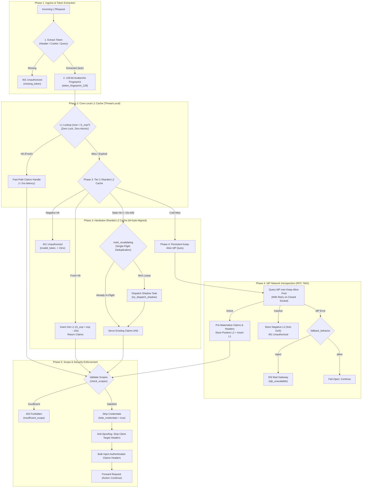

# OAuth 2.0 Token Introspection Plugin (`oauth2_introspection`) — Architectural Specification

This document specifies the internal engine design, hot-path execution pipeline, memory invariants, and cooperative multi-tier concurrency model of the **`oauth2_introspection`** pre-upstream plugin (RFC 7662).

---

## 1. System Mindset & Architectural Invariants

The `oauth2_introspection` plugin acts as an ultra-high-throughput, zero-IO Layer 7 token authentication and identity enrichment gateway at the edge, enforcing five non-negotiable architectural invariants:

1. **Zero-IO Hot-Path Invariant**:
   Serving paths **never** parse JSON, allocate dynamic memory, read from disk, or make synchronous network calls on warm requests. Granted scopes and upstream claim headers are pre-materialized into RAM at initial introspection time, reducing hot-path serving to sub-2ns L1 lookups and bulk header injection (`reserve` + `insert`).
2. **Two-Tier Hardware-Aligned Caching**:
   - **Tier 1 (Core-Local L1)**: Direct-mapped, zero-lock, zero-atomic cache local to each pinned worker thread (`thread_local!`), delivering sub-2ns lookup latency.
   - **Tier 2 (Hardware-Sharded L2)**: Dynamically sharded in-memory cache striped across CPU cores with `#[repr(align(64))]` cache-line alignment to eliminate false sharing.
3. **Smooth Cooperative Worker Coordination (Traffic Worker $\leftrightarrow$ Shadow Worker)**:
   - **Traffic Workers** (`velda-worker-{id}`, `SCHED_OTHER`): Serve client traffic exclusively. On token stale detection (< 15s remaining), dispatch an asynchronous background revalidation task to low-priority shadow workers via non-blocking queue (`try_dispatch_shadow`). If the queue is saturated, the task is dropped cleanly without blocking the traffic thread or polluting the hot path.
   - **Shadow Workers** (`velda-shadow-{id}`, `SCHED_IDLE`): Execute HTTP keep-alive calls in background OS idle priority. Upon completion, they update the L2 cache and release the single-flight lease. They never pollute thread-local storage or compete with active client traffic.
4. **Single-Flight In-Flight Deduplication**:
   When a token enters its stale window (< 15s remaining), an atomic revalidation lease (`mark_revalidating`) ensures that **exactly one** background refresh task is dispatched across all incoming requests and CPU cores, preventing thundering herd attacks against the Authorization Server.
5. **Anti-Header Spoofing Security**:
   All client-supplied request headers matching configured claim targets (e.g. `x-user-id`, `x-client-id`, `x-user-role`) are unconditionally stripped prior to injecting authenticated claims. If an optional claim is absent in the IdP response, fraudulent client headers are removed rather than leaked to upstream backends.

---

## 2. End-to-End Request Hot-Path Pipeline



---

## 3. Two-Tier Caching Engine Design

```
+-----------------------------------------------------------------------------------+
|                              Traffic Worker Thread                                |
|                                                                                   |
|  +-----------------------------------------------------------------------------+  |
|  |                 Tier 1: CoreLocalL1Cache (Thread-Local)                     |  |
|  |  Direct-Mapped: slot = fp & (L1_SIZE - 1) [64 entries, zero lock/atomic]    |  |
|  |  Entry: (u128 fp, Arc<CachedClaims>, u64 l1_expires_at)                     |  |
|  |  Invariant: l1_expires_at = expires_at.saturating_sub(15)                   |  |
|  +---------------------------------------+-------------------------------------+  |
|                                          |                                        |
+------------------------------------------|----------------------------------------+
                                           | L1 Miss (Fallthrough)
                                           v
+-----------------------------------------------------------------------------------+
|                        Tier 2: IntrospectionCache (L2 RAM)                        |
|                                                                                   |
|   Shard Array: Box<[AlignedCacheShard]> (Power of 2, 4 to 512 shards)             |
|   Shard Index: (fp as usize) & shard_mask                                         |
|                                                                                   |
|   +----------------------------------------------------------------------------+  |
|   | #[repr(align(64))] AlignedCacheShard                                       |  |
|   |   RwLock<CacheShard>                                                       |  |
|   |     +-- positive:     FxHashMap<u128, Arc<CachedClaims>>                   |  |
|   |     +-- negative:     FxHashMap<u128, u64>                                 |  |
|   |     +-- revalidating: FxHashMap<u128, u64> (In-Flight Dedup)               |  |
|   +----------------------------------------------------------------------------+  |
+-----------------------------------------------------------------------------------+
```

### 3.1 128-bit Full-Avalanche Fingerprinting (`token_fingerprint_128`)
Tokens vary widely in format: opaque random strings, UUIDs, or 1000+ byte JWTs with identical headers and signature trailers. 
The 128-bit fingerprint hashes 100% of the token bytes in 16-byte chunks using `as_chunks::<16>()` and SplitMix64/Golden-Ratio constants:
```rust
#[inline]
pub fn token_fingerprint_128(token: &str) -> u128
```
- **Zero Allocations**: Evaluates directly on borrowed `&str` bytes.
- **Zero Prefix/Suffix Blindness**: Covers every byte of the payload.
- **Collision Resistance**: $2^{128}$ space eliminates practical collision probability in RAM cache.

### 3.2 Tier 1: Core-Local L1 Cache (`CoreLocalL1Cache`)
- Pinned directly to the CPU thread via `thread_local!`.
- Stored as a flat 64-element array: `[Option<L1Entry>; 64]`.
- Keyed by `u128` fingerprint without storing `token: String` (zero heap allocation on insert).
- **The Stale-Window Invariant**: `l1_expires_at` is always set to `expires_at.saturating_sub(15)`. During the fresh window, L1 lookups succeed in < 2ns. The instant the token enters its final 15 seconds, L1 naturally misses, forcing a single check into L2.

### 3.3 Tier 2: Hardware-Sharded L2 Cache (`IntrospectionCache`)
- Scaled dynamically to CPU cores: `(cores * 4).next_power_of_two()`, clamped between 4 and 512 shards.
- Wrapped in `#[repr(align(64))] AlignedCacheShard(pub RwLock<CacheShard>)`, guaranteeing that every lock and shard sits on an independent cache line to prevent false sharing under extreme multi-core load.
- Uses `u128` keys across all internal maps (`positive`, `negative`, `revalidating`), completely avoiding repeated string hashing or allocations.

---

## 4. Cooperative Worker Coordination (Traffic $\leftrightarrow$ Shadow)

Velda Edge cleanly separates real-time request serving from asynchronous background maintenance:

| Attribute | Primary Traffic Worker (`velda-worker-{id}`) | Shadow Worker (`velda-shadow-{id}`) |
| :--- | :--- | :--- |
| **OS Scheduling** | `SCHED_OTHER` (Normal / Real-Time Priority) | `SCHED_IDLE` (Runs only when cores are free) |
| **Tokio Runtime** | Single-threaded `current_thread` core-pinned | Cooperative multi-task runtime |
| **Hot Path Access** | Reads L1 (sub-2ns), Reads L2 (sub-15ns) | Never touches L1; Updates L2 on completion |
| **Network I/O** | Zero I/O on cache hits | Executes HTTP/1.1 Keep-Alive IdP queries |
| **Saturated Queue** | Drops task immediately (`finish_revalidation`) | Discards backpressure without affecting traffic |

### 4.1 Stale-While-Revalidate Flow
1. Traffic Worker encounters a token with `remaining_ttl < 15s`.
2. Traffic Worker calls `cache.mark_revalidating(fp, now)`.
3. If `true` (lease won):
   - Constructs revalidation future and calls `crate::hook::try_dispatch_shadow(revalidation_task)`.
   - If dispatch fails (queue full), immediately calls `cache.finish_revalidation(fp)` and returns the existing valid claims.
4. If `false` (lease already held by another request):
   - Serves the existing valid claims immediately as a Hit.
5. In the background:
   - Shadow Worker calls `client.introspect(&token)`.
   - On success: updates L2 with new `expires_at` and clears `revalidating`.
   - On failure: calls `finish_revalidation(fp)`.
6. Subsequent requests on any Traffic Worker read L2, acquire the new fresh claims, and repopulate their core-local L1.

### 4.2 Bottleneck Elimination & Multi-Core Resilience Under Chaotic Traffic
Under high concurrency (e.g. 35,000+ mixed RPS with TLS, mTLS, and HTTP/3 QUIC contending for CPU):
1. **Zero Channel Blocking**: The dispatch between traffic worker and shadow worker is strictly non-blocking (`try_dispatch_shadow`). Traffic threads never invoke `.await` on channel capacity or block on a busy shadow worker.
2. **Strict CPU Scheduling Segregation**: Shadow workers run on `SCHED_IDLE` (or low task priority). They yield immediately if a traffic worker needs CPU for cryptographic TLS handshakes or wire framing.
3. **Graceful Cache Degradation**: If shadow revalidation cannot dispatch (e.g. queue backpressure), the lease is released (`finish_revalidation`), and the traffic worker continues serving the valid token claims until hard expiration.
4. **Zero Cache-Line Bouncing**: Shards are aligned to 64 bytes (`#[repr(align(64))] AlignedCacheShard`). Independent worker cores read and write separate cache lines, avoiding CPU bus locks on multi-socket AMD EPYC platforms.

---

## 5. Persistent HTTP Keep-Alive Client (`IdpKeepAliveClient`)

RFC 7662 network introspection is handled via an optimized persistent connection manager:

1. **Persistent Connection Pool**:
   - Maintains an idle pool of `TcpStream` instances with `pool_max_idle_connections` capacity and `keepalive_timeout_secs` eviction.
   - Sockets are configured with `TCP_NODELAY = true` and `SO_KEEPALIVE`.
2. **Transparent EOF Retry**:
   - If an Authorization Server closes an idle connection right as a request is sent (remote EOF or `BrokenPipe`), the client detects `is_pooled` and automatically reconnects once with a fresh socket, preventing spurious 502 errors.
3. **Resource Protection (`MAX_IDP_RESPONSE_SIZE = 64KB`)**:
   - Introspection response headers and body are strictly capped at 64KB, protecting against misconfigured or compromised IdP endpoints returning infinite streams.

---

## 6. Security & Anti-Spoofing Guarantees

1. **Negative Caching (Anti-DoS)**:
   - Revoked or nonexistent tokens (`active: false`) are cached in RAM for `negative_cache_ttl_seconds` (default: 10s).
   - Subsequent malicious requests are rejected in < 15ns without touching the IdP.
2. **Anti-Header Spoofing**:
   - Clients may attempt to inject headers like `x-user-id: 1` or `x-user-role: superadmin`.
   - The plugin unconditionally deletes all target headers defined in `claims_to_headers` from `req.headers` before injecting genuine claims, ensuring zero claim leakage.
3. **Fail-Closed vs Fail-Open (`fallback_behavior`)**:
   - `reject`: Safely returns `502 Bad Gateway` (`idp_unavailable`) if the IdP is unreachable.
   - `allow`: Allows fail-open routing for non-critical monitoring routes.
