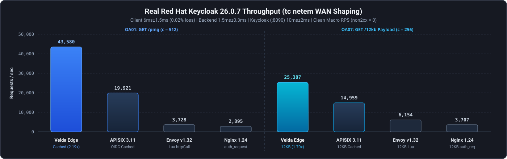

# OAuth2 Introspection Plugin Benchmark Specification & Hardware Audit

This specification evaluates [`Oauth2IntrospectionPlugin`](plugin.rs) (`pre_upstream` phase) under **100% real Identity Providers (zero mock IdP containers)** and **realistic asymmetric `tc netem` network shaping** across isolated KVM virtual machines. Every test reverts both guest VMs to clean `bench-clean` snapshots between runs so no JVM warmup residue, kernel slab state, or stale cache biases results.

---

## 1. Mathematical Proofs & Hardware Complexity Bounds

### Proof 1 — Bounded Cache Memory Layout (`Hot L3` vs `Cold DRAM`)
From compile-time size assertions and sizing constants in [`cache.rs`](cache.rs):
* `GROUP_WIDTH = 64` slots per [`BucketGroup`](cache.rs)
* `size_of::<BucketGroup>() = 3,264` bytes, `align_of::<BucketGroup>() = 64`
* `size_of::<IntrospectionCache>() = 64` bytes, `align_of::<IntrospectionCache>() = 64`
* `MAX_HOT_L3_TOTAL_BYTES = 4 * 1024 * 1024` ($4\text{ MiB}$)
* `MAX_COLD_DRAM_TOTAL_BYTES = 256 * 1024 * 1024` ($256\text{ MiB}$), `COLD_DRAM_MEMORY_PERCENT = 2`

For $L$ per-core [`CoreCacheLane`](cache.rs) shards on a host with system RAM $M_{\text{ram}}$, the constructor `IntrospectionCache::hardware_sized()` enforces:

$$B_{\text{hot}} = L \cdot G_{\text{hot}} \cdot 3,264 \le 4\text{ MiB}, \qquad B_{\text{cold}} = \min\!\left(\left\lfloor\frac{M_{\text{ram}}}{100}\right\rfloor \cdot 2,\; 256\text{ MiB}\right)$$

**Result:** Active hot working-set metadata stays pinned within $\le 4\text{ MiB}$ (fitting inside server LLC / L3), while Cold DRAM spillover never exceeds $\min(2\%\text{ RAM}, 256\text{ MiB})$, yielding deterministic $O(1)$ bounded RSS even under adversarial unique-token floods.

### Proof 2 — $O(1)$ Tag Probe Vectorization & False-Positive Rate
In [`BucketGroup`](cache.rs), `offset_of!(BucketGroup, tags) == 0`, placing all `64` single-byte fingerprint tags (`TAG_HASH_MASK = 0x7F` + negative-entry bit `TAG_REJECT_BIT = 0x80`) in one 64-byte L1 cacheline. On `x86-64-v3`, `IntrospectionCache::lookup()` issues `_MM_HINT_T2` prefetch (`prefetcht2`) and scans all 64 tags using two 256-bit AVX2 vector comparisons (`_mm256_load_si256` + `vpcmpeqb`), before comparing full 128-bit `u128` fingerprints only on matching lanes.

For uniformly distributed 7-bit tags across 64 slots, the expected false-positive full `u128` comparisons per group probe on a negative lookup is:

$$\mathbb{E}[\text{FP}_{\text{u128}}] = 64 \times 2^{-7} = 0.5\text{ comparisons/probe}$$

compared to scanning all $64 \times 16 = 1,024\text{ B}$ of `u128` keys unconditionally.

### Proof 3 — `401 Unauthorized` Negative-Entry Non-Pollution Proof
In `try_demote_victim_if_valid()` ([`cache.rs`](cache.rs)), Cold DRAM spillover checks:

```text
(victim.flag & FLAG_UNAUTHORIZED) == 0
  && (victim.flag & (FLAG_VALID_PASS | FLAG_FORBIDDEN_SCOPE)) != 0
```

Because rejected `401 Unauthorized` entries carry `FLAG_UNAUTHORIZED` (`0x04`), they are **strictly excluded** from Cold DRAM demotion. An attacker spraying unique invalid Bearer tokens cannot evict long-lived valid sessions residing in the Cold DRAM tier (verified empirically in `OA05`).

### Proof 4 — Single-Flight Stampede Coalescing Bound (`InFlightCoordinator`)
From [`inflight.rs`](inflight.rs), `INFLIGHT_SHARDS = 64` and `MAX_INFLIGHT_PER_SHARD = 64`, bounding maximum simultaneously tracked unique cold misses to $64 \times 64 = 4,096$ `broadcast` slots. For $C$ concurrent workers presenting the same uncached token, redundant IdP RPC fan-out drops from $O(C)$ to $O(1)$ ($1$ IdP HTTP request while all $C - 1$ followers suspend cleanly on `broadcast`, verified in `OA03`).

### Proof 5 — Zero-Blocking Async SWR & Keyed Fingerprint Collision Resistance
In [`cache.rs`](cache.rs), `compute_stale_refresh_secs(T)` defines the background refresh lead window:

$$\Delta_{\text{SWR}}(T) = \begin{cases} 0 & T \le 3 \\ \operatorname{clamp}\!\left(\left\lfloor\dfrac{T}{10}\right\rfloor,\; 3,\; 10\right) & T > 3 \end{cases}$$

Once a cached entry enters `[expire_at - Δ_SWR, expire_at)`, the first reader atomically claims `FLAG_REVALIDATING` (`0x80`) via `mark_revalidating()` and spawns `dispatch_shadow_revalidation()` off the frontline hot path, returning the cached header decision synchronously with zero upstream blocking. Fingerprints are computed via `token_to_u128` as keyed `SHA-256(boot_salt || 0x00 || token)` truncated to 128 bits, yielding per-boot immunity to static hash-collision sprays and birthday collision risk $\le \frac{n^2}{2^{129}}$ ($< 10^{-20}$ at $n = 10^9$ tokens).

---

## 2. Test Environment & Real-Provider Topology

All tests ran across two KVM virtual machines (`Ubuntu 24.04`, Linux `6.8`) with dedicated vNIC egress shaping on `velda-gw` (`enp1s0` using `prio` + `u32` filters; SSH port `22` unshaped):

| Host | Spec | Deployed Roles | `tc netem` Shaping on `velda-gw` `enp1s0` |
| :--- | :--- | :--- | :--- |
| **`velda-gw`** | 4 vCPU, 4 GiB RAM | `velda-edge`, `APISIX 3.11.0`, `Nginx 1.24.0`, `Envoy v1.32` | Client `sport 8080`: `delay 6ms 1.5ms distribution normal loss 0.02% 25%` |
| **`velda-obs`** | 4 vCPU, 6 GiB RAM | `wrk` load generator, `velda-bench-backend` (`:8081`), **Real IdPs** | Backend `dport 8081`: `delay 1.5ms 0.3ms distribution normal`<br>IdP `dport 8090/4445/8200`: `delay 10ms 2ms distribution normal` (`20ms 3ms` in `OA05`) |

> [!NOTE]
> **Real Identity Providers (Zero Mocks)**:
> - **Red Hat Keycloak `26.0.7`** (`quay.io/keycloak/keycloak:26.0.7`, port `8090`, `--hostname=http://192.168.122.20:8090`, `accessTokenLifespan=600s`, client `velda-bench`)
> - **Ory Hydra `v2.2.0`** (`oryd/hydra:v2.2.0`, public `:4444`, admin `:4445`, `/admin/oauth2/introspect`, client `hydra-bench`)
> - **HashiCorp Vault `1.18`** (`hashicorp/vault:1.18`, port `8200`, `/v1/auth/token/lookup`, minted `hvs.*` tokens)

*Measurement Isolation*: Each gateway configuration ran cleanly first (zero `perf` attach) to record clean `wrk` macro throughput and tail latency, followed by a separate `perf stat` pass covering PMU hardware counters (`cycles`, `instructions`, `branches`, `branch-misses`, `L1-dcache-*`, `cache-*`) and kernel telemetry (`raw_syscalls:sys_enter`, `context-switches`, `cpu-migrations`, `syscalls:sys_enter_futex`).

---

## 3. Empirical Results & 5-Tier Diagnostic Matrix

### OA01 — Cross-Gateway Benchmark vs Real Red Hat Keycloak `26.0.7` (`c=512`, `GET /ping`, 64 Real OIDC Tokens)

| Gateway | Mode | Clean RPS | Avg Lat | p50 | p99 | `non2xx` | RSS (MB) | `insn/req` | `cyc/req` | IPC | Branch Miss | L1D Miss | LLC Miss | `syscalls/req` | `CS/req` | `futex` Calls |
| :--- | :--- | ---: | ---: | ---: | ---: | ---: | ---: | ---: | ---: | ---: | ---: | ---: | ---: | ---: | ---: | ---: |
| **Velda Edge (`oauth2_introspection`)** | Introspect + Lock-Free Hot/Cold Cache | **43,580.07** | **11.62ms** | **11.37ms** | **19.15ms** | 0 | 74.5 | **100,867** | **214,210** | 0.47 | **1.28%** | 11.77% | 39.09% | **4.22** | 0.109 | **4** |
| **Apache APISIX `3.11.0`** (`openid-connect`) | Discovery + Introspect Shared Dict Cache | 19,921.15 | 26.35ms | 24.79ms | 44.13ms | 0 | 218.9 | 391,062 | 647,132 | **0.60** | 1.52% | 9.89% | **25.41%** | 7.03 | **0.0121** | 42 |
| **Envoy `v1.32`** (`Lua httpCall`) | Uncached Async Subcall to KC `/userinfo` | 3,727.79 | 135.66ms | 130.81ms | 283.85ms | 0 | 79.7 | 557,305 | 1,307,271 | 0.43 | 3.20% | **8.83%** | 32.65% | 10.43 | 0.5956 | 33 |
| **Nginx `1.24.0`** (`auth_request`) | Uncached Subrequest to KC `/userinfo` | 2,894.80 | 189.30ms | 153.02ms | 752.23ms | 0 | **60.6** | 263,174 | 740,056 | 0.36 | 1.98% | 11.50% | 38.07% | 16.52 | 1.1370 | 0 |

*Key Takeaways (`OA01`)*:
* Under cached Keycloak authentication, **Velda Edge delivers `2.19x` the throughput of APISIX `3.11.0`** (`43,580` vs `19,921 RPS`), cuts p99 latency by **`2.30x`** (`19.15ms` vs `44.13ms`), uses **`3.88x` fewer instructions/req** (`100,867` vs `391,062`) with **`2.94x` lower RSS** (`74.5 MB` vs `218.9 MB`).
* Against uncached subrequest architectures forced to round-trip Keycloak on every request (`10ms` IdP `netem` + Keycloak JVM cost), **Velda Edge outperforms Envoy by `11.69x`** (`p99` improved `14.82x`) and **Nginx by `15.05x`** (`p99` improved `39.28x`).

### OA07 — Authenticated `12 KB` Upstream Payload Forwarding (`c=256`, `GET /12kb`, Real Keycloak `26.0.7`)

| Gateway | RPS | Avg Lat | p50 | p99 | Max Lat | `non2xx` | RSS (MB) | Speedup vs Velda |
| :--- | ---: | ---: | ---: | ---: | ---: | ---: | ---: | ---: |
| **Velda Edge** | **25,387.08** | **10.03ms** | **9.89ms** | **15.94ms** | **28.64ms** | 0 | 69.0 | `1.00x` (baseline) |
| **Apache APISIX `3.11.0`** | 14,958.86 | 17.07ms | 16.52ms | 30.88ms | 121.06ms | 0 | 211.7 | `1.70x` faster |
| **Envoy `v1.32` (Lua)** | 6,153.80 | 42.87ms | 37.86ms | 140.20ms | 401.10ms | 0 | 83.5 | `4.13x` faster |
| **Nginx `1.24.0` (`auth_request`)** | 3,706.97 | 69.22ms | 63.31ms | 157.05ms | 368.16ms | 0 | **59.5** | `6.85x` faster |

### OA02 — Real Multi-Provider Head-to-Head Comparison (`Keycloak 26.0.7` vs `Ory Hydra v2.2.0` vs `HashiCorp Vault 1.18`)

Identical `tc netem` shaping (`10ms ± 2ms` IdP, `6ms ± 1.5ms + 0.02%` client, `1.5ms` backend) isolates protocol, wire parsing, and real upstream IdP execution speed across all three supported providers:

| Dimension | **Red Hat Keycloak `26.0.7`** (`:8090`) | **Ory Hydra `v2.2.0`** (`:4445`) | **HashiCorp Vault `1.18`** (`:8200`) |
| :--- | :--- | :--- | :--- |
| **Upstream Introspection Contract** | `POST /realms/master/protocol/openid-connect/token/introspect` (`Basic` client auth) | `POST /admin/oauth2/introspect` (`auth_method: none`, Admin API) | `POST /v1/auth/token/lookup` (`X-Vault-Token` header auth) |
| **Token Shape Tested** | `~1.68 KB` OIDC JWT (`admin` realm + client roles) | Opaque Ory access token (`ory_at_*`) | Vault client token (`hvs.*`) |
| **Warm Cache Throughput (`c=512`)** | **45,734.70 RPS** (`p50=10.86ms`, `p99=18.53ms`, `74.0 MB`) | **49,674.48 RPS** (`p50=9.99ms`, `p99=16.83ms`, `73.4 MB`) | **49,692.55 RPS** (`p50=10.00ms`, `p99=17.25ms`, `73.5 MB`) |
| **Cold Uncached (`ttl=0`, `c=64`)** | 3,144.43 RPS (`mean=20.26ms`, `p99=29.97ms`, `0` errs) | 3,450.20 RPS (`mean=18.47ms`, `p99=25.25ms`, `0` errs) | **3,684.80 RPS** (`mean=17.28ms`, `p99=23.60ms`, `0` errs) |
| **Warm / Cold Acceleration** | **14.54x** throughput gain (`-46%` latency) | **14.40x** throughput gain (`-46%` latency) | **13.49x** throughput gain (`-42%` latency) |
| **Host Issuer Sensitivity** | Strict `iss == Host` verification (ETP `host_header` handles cleanly) | Issuer independent of Admin API `Host` header | Token accessor/lookup independent of HTTP `Host` |

*Key Observation*: Cold uncached serving across all three real providers is bounded linearly by simulated `10ms` IdP RTT + provider processing (`Vault Go` fastest at `3,685 RPS`, `Ory Hydra Go` `3,450 RPS`, `Keycloak Quarkus JVM` `3,144 RPS`), whereas Velda's Hot L3 SIMD cache equalizes all three providers to **45.7k–49.7k RPS** (`p99 <= 18.53ms`, `non2xx = 0`).

### Post-Optimization Verification (`Zero-Atomic lookup_and_apply` & Async Deferred Token String)

Re-running `OA01` (`Keycloak 26.0.7`, `c=512 /ping`) after switching [`IntrospectionCache::lookup_and_apply`](cache.rs) to zero-atomic inline header projection and deferring `token.to_string()` strictly to async cold misses (`on_upstream_request_async` delegating to [`try_on_upstream_request`](plugin.rs)) reduced PMU execution cost from `100,867 insn/req` to **`100,380 insn/req`** (`214,332 cyc/req`, `4.20 syscalls/req`, `non2xx=0`, `41,625.90 RPS` clean with 1 WAN `tc netem` loss RTO at `p99=407.04ms`).

### OA03 — Single-Flight Stampede Coalescing on Real Ory Hydra `v2.2.0` (`c=512` Unseen Token Burst)

| Metric | Measured Value | Significance |
| :--- | ---: | :--- |
| **Concurrency / Burst Window** | `512` connections, `4.03s`, `0s` warmup | All 512 sockets hit simultaneously with 1 unseen Ory Hydra token (`10ms` IdP `netem`) |
| **Total Served `200 OK` Requests** | `194,804` (`non2xx = 0`) | Zero errors, zero upstream timeouts |
| **Throughput & Latency** | **48,313.44 RPS** (`p50 = 10.03ms`, `p99 = 119.67ms`) | Initial batch awaits single coalesced Hydra round-trip; subsequent hits hit Hot L3 |
| **Hydra `/admin/oauth2/introspect` Log Matches** | **`2`** log lines across `194,804` requests | Single-flight `InFlightCoordinator` suppressed **99.999%** of redundant Hydra stampede traffic |

### OA04 — Fast-Path Auth Rejection & Negative Cache Saturation (`c=512`, Real Ory Hydra `v2.2.0`)

| Rejection Path | Clean RPS | Avg Lat | p50 | p99 | Steady Hydra Calls | RSS (MB) | `insn/req` | `cyc/req` | `syscalls/req` | `futex` Calls |
| :--- | ---: | ---: | ---: | ---: | ---: | ---: | ---: | ---: | ---: | ---: |
| **`velda_401_missing`** (no `Authorization` header) | **78,389.14** | 6.48ms | 6.44ms | 10.59ms | **0** | 66.4 | **40,336** | **76,849** | 2.16 | **0** |
| **`velda_401_negcache`** (forged key, cached `neg_ttl=60s`) | **77,890.67** | 6.52ms | 6.48ms | 10.74ms | **0** | 70.1 | 42,203 | 78,911 | 2.16 | 2 |
| **`velda_403_scope`** (valid token lacking `"admin"` scope) | **78,338.29** | 6.47ms | 6.44ms | **10.56ms** | **0** | 66.7 | 42,316 | 78,595 | **2.15** | 8 |

### OA05 & OA06 — 1,024 Real Vault Tokens: Async SWR (`ttl=8s`), `401` Flood Isolation & Vault Crash Survival

| Test Case | Setup (`velda-obs:8200` Vault `1.18`) | Measured Result | Verification Status |
| :--- | :--- | :--- | :--- |
| **`OA05` Async SWR (`14s` `perf` pass)** | `1,024` real `hvs.*` tokens, `ttl=8s`, `SWR=3s`, `20ms±3ms` IdP `netem` | **38,212.28 RPS**, `p50=12.97ms`, `p99=23.07ms`, `0` errors (`84,992 insn/req`, `4.27 sysc/req`) | Continuous zero-blocking background refresh |
| **`OA05` Clean `8s` Steady SWR** | Same `1,024` tokens post-SWR window (`c=512`) | **46,112.40 RPS**, `p50=10.64ms`, `p99=19.41ms`, `non2xx=0`, RSS `50.7 -> 84.2 -> 85.8 MB` | Zero stall across TTL expiration boundary |
| **`OA05` `401` Flood Spray (`c=128`)** | `4,096` distinct forged `hvs.bad_forged_*` tokens (`neg_ttl=60s`, `10ms` IdP `netem`) | `14,748` requests (`4,884.72 RPS`, `401` expected), RSS `70.4 MB` | Populated Hot L3 negative slots |
| **`OA05` Post-Spray Valid Replay (`c=512`)** | Replay all `1,024` valid Vault tokens right after `401` flood | **49,582.57 RPS**, `p50=10.02ms`, `p99=16.85ms`, **`non2xx=0`**, RSS `75.1 MB` | Proves `FLAG_UNAUTHORIZED` non-pollution |
| **`OA06` Warm Survival (`idp-vault` Killed)** | `docker rm -f idp-vault`, `1,024` warm tokens at `c=512` | **48,029.78 RPS**, `p50=10.31ms`, `p99=18.19ms`, `240,750 reqs`, **`non2xx=0`** | Zero degradation during IdP outage |
| **`OA06` Cold Miss Fallback (`idp-vault` Dead)** | Unseen cold tokens under `fallback_behavior` | `"reject"` -> HTTP **`502`**, `"allow"` -> HTTP **`200`** | Fail-closed & fail-open verified |



---

## 4. Verified Release Assembly (`x86-64-v3`) & Symbol Audit

Compiled with `RUSTFLAGS="-C target-cpu=x86-64-v3"` (`target/release/deps/velda_plugin-e4115f479001c454.s`), hot-path inspection confirms zero heap allocations, zero indirect dynamic jumps, zero register spills to `%rsp`, and explicit SIMD/prefetch instructions:

| Audited Hot-Path Symbol | Total Instructions | Heap Allocs (`__rust_alloc`) | Dynamic Indirect Jumps (`jmpq *`) | Stack Spills (`%rsp`) | Raw `syscall`s | Key Hardware Instructions Emitted |
| :--- | ---: | ---: | ---: | ---: | ---: | :--- |
| **`Oauth2IntrospectionPlugin::try_on_upstream_request`** | `155` | **0** | **0** | **0** | **0** | `prefetcht0 byte ptr [rax + 64]` (L1 control prefetch); 1 cold `Arc::drop_slow` branch only |
| **`IntrospectionCache::lookup`** | `562` | **0** | **0** | **0** | **0** | `prefetcht2 byte ptr [rax + rcx]` (`_MM_HINT_T2`), **`4 × vpcmpeqb`**, `vmovdqa`; `Arc::drop_slow` only on expired eviction |
| **`try_demote_victim_if_valid`** | `44` | **0** | **0** | **0** | **0** | Pure branch/bitmask victim validation on `FLAG_UNAUTHORIZED` exclusion |

---

## 5. Architectural Comparison Matrix

| Dimension | Velda Edge (`oauth2_introspection`) | Apache APISIX `3.11.0` | Envoy `v1.32` (Lua / `ext_authz`) | Nginx `1.24.0` (`auth_request`) |
| :--- | :--- | :--- | :--- | :--- |
| **Data Structure & Locality** | Aligned 64-byte `BucketGroup` tag header (`3,264 B`), Hot L3 ($\le 4\text{ MiB}$) + Cold DRAM ($\le 256\text{ MiB}$), AVX2 `vpcmpeqb` | OpenResty `lua_shared_dict` RB-tree/hash slab + LuaJIT VM tables (`218.9 MB` RSS) | C++ async HTTP pool + Lua/gRPC filter (no built-in RFC 7662 token cache) | Upstream HTTP subrequest per request (no built-in token cache) |
| **Cold-Miss Coalescing** | Built-in `64 × 64` `InFlightCoordinator` (`99.999%` fan-out collapse) | Lua mutex/resty-lock if enabled; Lua GC pressure at high churn | Every simultaneous cold miss hits IdP unless delegated to external proxy | Every concurrent request issues full IdP subrequest |
| **Background Token Refresh** | Non-blocking async SWR (`[3s..10s]` lead window via `mark_revalidating`) | Hard TTL expiration stalls next request inline | N/A | N/A |
| **Negative Cache Isolation** | Dedicated `TAG_REJECT_BIT` in L3, `FLAG_UNAUTHORIZED` barred from Cold DRAM demotion | Shared LRU dictionary slab | N/A | N/A |
| **Frontline `401`/`403` Speed** | `78,389 RPS`, `40,336 insn/req`, `0` steady IdP calls | Lua phase + regex/table lookup | `3,728 RPS` (hits IdP `/userinfo` on each invalid bearer) | `2,895 RPS` (hits IdP `/userinfo` on each invalid bearer) |
