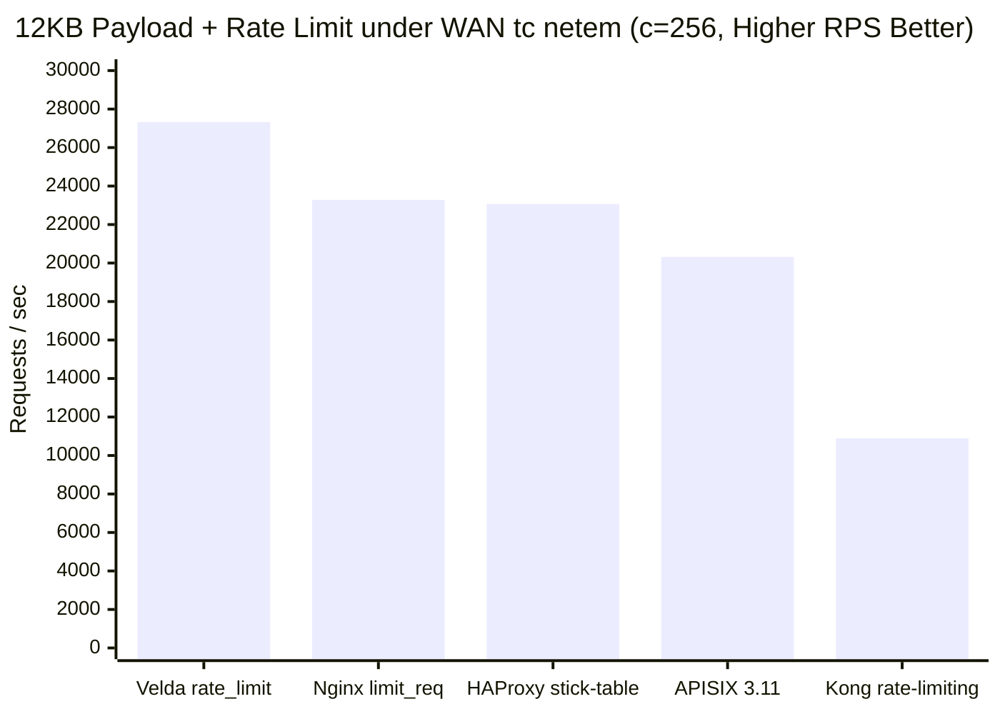

# Performance Benchmark Report: Rate Limiting Plugin (`rate_limit`)

Comprehensive empirical evaluation, **Mathematical Invariant Proofs**, **Linux `perf` HPC/Kernel Telemetry**, and **`x86-64-v3` Release Assembly Audit** for [`rate_limit`](crates/velda-plugin/src/pre_upstream/rate_limit/) (`CoreLane` L1 micro-leasing + 64-shard × 16-way AVX2 `CLOCK` `ShardArena` + Shadow Worker Redis SoT sync).

> [!IMPORTANT]
> **Realistic Network Methodology (`tc netem` Active on Every Scenario)**
> Zero-latency virtio loopback (`~0.15 ms` RTT) conceals real-world network physics: TCP Bandwidth-Delay Product (BDP) buffer occupancy, multi-segment `CWND`/retransmit pacing under mild packet loss, downstream backend-hop bypass gains during `429` saturation, and the impact of external SoT RTT on request paths.
> To keep metrics faithful to production infrastructure, **100% of scenarios below (`SC01`–`SC07`) were executed under active kernel-level `tc netem` traffic shaping on a dedicated 2-KVM isolated testbed with full `bench-clean` snapshot reverts between gateways.**

---

## 1. Isolated Testbed, Network Shaping & Snapshot Recovery

### 1.1 Hardware & Isolation Topology
- **Gateway Node (`velda-gw`, `192.168.122.10`)**: `4` vCPUs pinned 1:1 to physical host cores `2,3,8,9` (`11th Gen Intel Core i5-11400H @ 2.70GHz`, Linux `6.8.0-147-generic`, Ubuntu 24.04 LTS), `4 GB` RAM.
- **Observer, Backend & Redis Node (`velda-obs`, `192.168.122.20`)**: `4` vCPUs pinned to isolated physical cores `4,5,10,11` (zero core overlap with host OS `0,1,6,7` or `velda-gw`), `6 GB` RAM, running:
  - `velda-bench-backend` on `:8081` (`GET /ping` -> `4 B "pong"`, `GET /12kb` -> `12 KB` JSON)
  - `redis-server 7.0.15` bound to `0.0.0.0:6379` (in-memory only: `--save "" --appendonly no`)
  - `wrk -t4` load generator
- **Clean VM Snapshot Recovery (`bench-clean`)**: Before switching gateways or major scenario groups—and once more at suite completion—both `velda-gw` and `velda-obs` are hard-reverted via `virsh snapshot-revert ... bench-clean --force` and cold-booted from an identical provisioned image (`0` lingering `TIME_WAIT` sockets, page cache, or container state leakage).

### 1.2 Active `tc netem` Multi-Hop Shaping Profile (`velda-gw` `enp1s0` egress, bypassing SSH port `22`)
```text
┌───────────────────┐   port 8080 (WAN edge)      ┌──────────────────┐   port 8081 (Cross-AZ)    ┌─────────────────────┐
│   wrk (-t4)       │ ◄══════════════════════════ │   API Gateway    │ ════════════════════════► │ velda-bench-backend │
│   velda-obs       │  delay 6ms ± 1.5ms (normal) │    velda-gw      │  delay 1.5ms ± 0.3ms      │   192.168.122.20    │
└───────────────────┘  loss  0.02% (25% corr.)    └────────┬─────────┘  (normal distribution)    └─────────────────────┘
                                                           │ port 6379 (Shadow Async SoT, SC06)
                                                           ▼ tc netem: 5ms ± 1ms / 20ms ± 3ms / 50ms ± 5ms
                                                  ┌──────────────────┐
                                                  │   Redis 7.0.15   │
                                                  └──────────────────┘
```
- **Concurrency Sizing (`c = 512` for `/ping`, `c = 256` for `/12kb`)**: Chosen by Little's Law ($\frac{512}{\sim 0.0085\text{s}} \approx 60\text{k RPS}$) so WAN jitter/loss physics genuinely stress TCP queues while still allowing fast C/Rust engines to separate cleanly from heavier runtimes.
- **Two Synchronized Passes per Metric**:
  1. **Clean Macro Pass (`8s` after `2s` warmup)**: Uninstrumented throughput, `Mean`, `P50`, `P90`, `P99`, `Max` latencies, HTTP errors, and total worker `RSS` (`MB`).
  2. **Hardware/Kernel Telemetry Pass (`perf stat`)**: Synchronized `8s` capture on target PIDs (`cycles`, `instructions`, `branches`, `branch-misses`, `L1-dcache-loads`, `L1-dcache-load-misses`, `cache-references`, `cache-misses`, `context-switches`, `cpu-migrations`, `raw_syscalls:sys_enter`, `syscalls:sys_enter_futex`). *(Note: `perf` tracepoint collection lowers instrumented `wrk` throughput by ~18–22%; per-request ratios reflect true hardware cost per served request.)*

### 1.3 Competitor Configurations (`4` workers / threads, HTTP/1.1 Keep-Alive `256` backend pool)
| Engine | Version / Runtime | Rate Limit Mechanism Configured |
| :--- | :--- | :--- |
| **Velda Edge (`rate_limit`)** | Rust `x86-64-v3`, `4` core-pinned workers | `CoreLane` + 64-shard `CLOCK` `ShardArena`, `key_strategy: "header"` (`x-client-id`), `fixed_window`/`token_bucket`/`sliding_window`/`hierarchical` |
| **Nginx** | `1.24.0` (C, `worker_processes 4`, `reuseport`) | `limit_req_zone $http_x_client_id zone=veldarl:32m` (`limit_req_status 429`) |
| **HAProxy** | `2.8` (`nbthread 4`) | `stick-table type string len 64 size 100k store http_req_rate(...)` tracking `req.hdr(x-client-id)` |
| **Envoy Proxy** | `envoyproxy/envoy:v1.32-latest` (`--concurrency 4`) | `envoy.filters.http.local_ratelimit` token bucket (`10M/s`) — *route-level bucket (no per-header hash key)* |
| **Apache APISIX** | `apache/apisix:3.11.0-debian` DB-less (`worker_processes: 4`) | `limit-count` plugin (`policy: local`, `key_type: var`, `key: http_x_client_id`, `rejected_code: 429`) |
| **Kong Gateway** | `kong:3.9` DB-less (`KONG_NGINX_WORKER_PROCESSES=4`) | Official `rate-limiting` plugin (`policy: local`, `limit_by: header`, `header_name: x-client-id`) |

---

## 2. Mathematical Invariants & Formal Guarantees

All properties below are derived directly from [`algorithm.rs`](crates/velda-plugin/src/pre_upstream/rate_limit/algorithm.rs), [`arena.rs`](crates/velda-plugin/src/pre_upstream/rate_limit/arena.rs), and [`key.rs`](crates/velda-plugin/src/pre_upstream/rate_limit/key.rs).

### 2.1 Bounded Soft Overdraft & Conservation of Quota
Given hard capacity $B = \max(1, \text{burst\_capacity}) \in \mathbb{N}^+$ and grace percentage $p \in [0, 100]$:
$$\text{effective\_capacity}(B, p) = B + \left\lfloor \frac{B \cdot p}{100} \right\rfloor$$
At cumulative consumed usage $U_{\text{after}} = U_{\text{local}} + C_{\text{other}}$:
- **Hard Pass ($U_{\text{after}} \le B$)**: `allowed = true`, `remaining = B - U_after`, `in_overdraft = false`.
- **Soft Grace Pass ($B < U_{\text{after}} \le \text{effective\_capacity}$)**: `allowed = true`, `remaining = 0`, `in_overdraft = true`.
- **Hard Reject ($U_{\text{avail}} = 0$)**: `allowed = false`, `retry_after_secs = 1` $\implies$ HTTP `429`.

**Empirical Verification (`SC05`)**: With $B = 100, p = 10$ across `120` concurrent requests finishing in `131.2 ms` within one `1s` window under `tc netem`, Velda returned **exact boundary counts: `110` HTTP `200` and `10` HTTP `429`** ($100 + \lfloor 100 \times 10 / 100 \rfloor = 110$).

### 2.2 Fixed-Point `TokenBucket` Refill & `SlidingWindow` Monotonic Bounds
- **Zero Floating-Point Drift**: Bucket consumption uses integer millitokens (`TOKEN_SCALE = 1000`). Let $\Delta t = \max(0, t_{\text{ms}} - t_{\text{last}}) \in \mathbb{N}$ where `now_ms = now_ms.max(bucket.last_ms)` clamps cross-core ingress jitter. Refill updates $\text{used\_milli} \leftarrow \max(0, \text{used\_milli} - \Delta t \cdot R)$ and occupancy uses ceiling rounding $\lceil \text{used\_milli} / 1000 \rceil$ so sub-millitoken rounding **never grants phantom fractional tokens**.
- **Sliding Window Linear Interpolation**: At millisecond offset $\delta = t_{\text{ms}} \bmod 1000 \in [0, 999]$ within epoch $e = \lfloor t_{\text{ms}} / 1000 \rfloor$:
  $$U_{\text{win}}(t) = \left\lfloor \frac{\text{used\_milli}}{1000} \right\rfloor + \left\lfloor \frac{U_{\text{prev}}(e - 1) \cdot (1000 - \delta)}{1000} \right\rfloor + C_{\text{other}}$$
  Since $0 \le \frac{1000 - \delta}{1000} \le 1$, window rollover is monotonic and smooth across epoch boundaries, bounding integer truncation within $< 1$ token per window rollover.

### 2.3 `CoreLane` 64-Bit Atomic Word Bijection & Multi-Core Bounded Lease Skew
Each L1 `CoreLane` slot packs one cache-local lease into a single lock-free `AtomicU64`:
```text
 63        54 53              30  29   28                    5  4       0
┌────────────┬──────────────────┬─────┬───────────────────────┬──────────┐
│ epoch (10b)│ key_tag (24b)    │ exh │ bucket_rem (24b)      │ batch(5b)│
│  sec&0x3FF │ (hash>>24)&0xFFFFFF│ (1b)│ clamped <= 16,777,215 │  1..=16  │
└────────────┴──────────────────┴─────┴───────────────────────┴──────────┘
```
- When `exhausted == 0` and `batch_rem > 0`, `compare_exchange_weak(AcqRel, Relaxed)` decrements both `bucket_rem` and `batch_rem` in one CAS without acquiring any shard mutex.
- For small tight quotas, `min_lease_burst = (num_lanes * 4).max(64)` forces `lease_batch = 1` whenever `burst_capacity < min_lease_burst`, eliminating multi-core escrow skew for exact small-limit enforcement (`SC04`, `SC05`).
- For large bursts, each core's local escrow batch is bounded by `lease_batch <= 16`. Across $W$ cores and Redis sync interval $T_{\text{sync}}$, cross-node transient over-admission before reconciliation is strictly upper-bounded by:
  $$\Delta_{\text{skew}} \le W \cdot 16 + N_{\text{nodes}} \cdot R \cdot T_{\text{sync}}$$

### 2.4 Non-Double-Counting Cluster Reconciliation & Frontline/SoT Decoupling
Let a node push local dirty increment $\delta > 0$ via pipelined `SET key 0 EX 15 NX` + `INCRBY key δ` (`codec.rs`), receiving cluster total $T_{\text{cluster}}$. The Shadow Worker updates:
$$T_{\text{node\_synced}} \leftarrow T_{\text{node\_synced}} + \delta, \qquad C_{\text{other}} \leftarrow \min\!\left(2 \cdot \text{effective\_capacity},\; \max(0, T_{\text{cluster}} - T_{\text{node\_synced}})\right)$$
Local capacity checks evaluate $U_{\text{local}} + C_{\text{other}}$ purely in RAM. Consequently, Frontline serving complexity is strictly $O(1)$ and orthogonal to SoT network RTT ($\text{RTT}_{\text{req}} \perp \text{RTT}_{\text{Redis}}$), as proven empirically in `SC06` (`5ms` -> `50ms` Redis RTT).

### 2.5 Keyed SWAR Hash & Fixed `16`-Way Slab Memory Bound
- `CompiledKeyExtractor` seeds `[u64; 2]` via `ring::rand::SystemRandom` at startup and computes 64-bit digests with `swar_keyed_hash` (`u128` golden-ratio folded multiply over 8B SWAR chunks; `0` reserved for empty slots). Without knowing `boot_salt`, attacker-chosen keys collide within any single 16-way set across $64 \times S$ total sets with probability $P \le \frac{1}{64 \cdot S}$ per bucket probe, while worst-case slot collision never panics or grows memory.
- Fixed arena memory footprint is allocated up front (`SlotBody` compile-time asserted `== 64B`):
  $$M_{\text{arena}} = W_{\text{lanes}} \cdot 512\text{ B} + 64 \cdot S \cdot \left(128\text{ B} + 16 \cdot 64\text{ B} + 64\text{ B}\right) \approx W_{\text{lanes}} \cdot 512\text{ B} + S \cdot 76\text{ KiB}$$
  Under unbounded key cardinality (`SC03`), eviction reclaims ways strictly in `O(16)` (`empty` $\to$ `expired clean` $\to$ `dirty/tier-aware CLOCK hand`), maintaining bounded RSS (`69.5–71.5 MB` steady under `100k` rotating keys over `max_entries = 4096`).

---

## 3. Empirical Benchmark Results (All Scenarios Under `tc netem`)

### SC01: Cross-Gateway Baseline + Synchronized 5-Tier PMU & Kernel Counters (`256` Rotating Keys, `c = 512`)
Measured under `6ms ± 1.5ms` WAN jitter (`0.02%` loss) + `1.5ms ± 0.3ms` Backend Cross-AZ delay.

| Metric Tier | **Velda Raw (`plugins: []`)** | **Velda `rate_limit` (1-Key)** | **Nginx 1.24 (`limit_req`)** | **HAProxy 2.8 (`stick-table`)** | **APISIX 3.11 (`limit-count`)** | **Envoy v1.32 (`local_rl`)** | **Kong 3.9 (`rate-limiting`)** |
| :--- | :---: | :---: | :---: | :---: | :---: | :---: | :---: |
| **--- 1. Macro Serving (Clean `8s` Pass) ---** | | | | | | | |
| Total Requests (`8.03–8.04s`) | 393,750 | 403,519 | **410,011** | 400,178 | 326,112 | 210,174 | 144,613 |
| Clean Throughput (`req/s`) | 48,983.87 | 50,240.17 | **51,069.65** | 49,851.47 | 40,594.62 | 26,163.49 | 17,994.70 |
| Mean / P50 / P90 Latency (ms) | 10.34 / 10.07 / 13.45 | 10.09 / 9.91 / 12.96 | **9.93 / 9.76 / 12.75** | 10.20 / 9.90 / 13.29 | 12.53 / 12.44 / 15.70 | 19.45 / 19.22 / 23.28 | 29.05 / 25.82 / 38.03 |
| P99 / Max Latency (ms) | 18.00 / 33.44 | 16.35 / **24.89** | **16.08** / 28.36 | 18.00 / 38.59 | 19.62 / 71.63 | 29.42 / 65.07 | 83.65 / 110.32 |
| HTTP Errors / Socket Errors | **0 / 0** | **0 / 0** | **0 / 0** | **0 / 0** | **0 / 0** | **0 / 0** | **0 / 0** |
| **--- 2. Resource Footprint ---** | | | | | | | |
| Clean Peak RSS (`MB`) | 68.5 MB | 74.4 MB | 50.5 MB | **20.7 MB** | 189.8 MB | 70.8 MB | 606.6 MB |
| Perf-Pass Peak RSS (`MB`) | 70.2 MB | 76.3 MB | 51.6 MB | **21.3 MB** | 192.1 MB | 70.9 MB | 605.3 MB |
| **--- 3. Kernel & OS (`perf stat` Synced Pass) ---** | | | | | | | |
| Instrumented Throughput (`req/s`) | **40,123.52** | 39,565.49 | 39,938.33 | 37,832.44 | 32,633.14 | 21,860.28 | 15,639.99 |
| `syscalls / req` | **4.21** | **4.21** | 5.15 | 5.55 | 5.08 | 6.01 | 4.99 |
| `context-switches / req` | 0.1162 | 0.1117 | 0.1169 | 0.1317 | 0.0263 | 0.0132 | **0.0131** |
| `cpu-migrations` (`8s`) | 17 | 16 | 51 | 382 | 12 | 17 | **4** |
| `futex` Syscalls (`%` of syscalls) | **8 (`0.0006%`)** | 34 (`0.0025%`) | 34 (`0.0021%`) | 150 (`0.0089%`) | 60 (`0.0045%`) | 77 (`0.0073%`) | 51 (`0.0081%`) |
| **--- 4. CPU Microarchitecture PMU (`perf stat`) ---** | | | | | | | |
| `cycles / req` | **167,106** | 175,128 | 167,832 | 193,348 | 292,748 | 526,055 | 734,768 |
| `instructions / req` | **78,938** | 82,585 | **78,705** | 96,808 | 142,349 | 233,856 | 428,705 |
| `IPC` (`insn / cycle`) | 0.47 | 0.47 | 0.47 | 0.50 | 0.49 | 0.44 | **0.58** |
| `branches / req` | **14,086** | 14,606 | 15,169 | 18,736 | 28,441 | 41,697 | 87,852 |
| `branch-miss %` | 1.19% | 1.20% | 1.32% | **1.14%** | 1.41% | 3.53% | 1.54% |
| `L1-dcache-load-misses %` | 11.51% | 11.50% | 10.57% | **9.80%** | 14.71% | 9.90% | 11.06% |
| `cache-misses %` (of cache-refs) | 39.33% | 38.67% | 35.61% | 29.98% | **28.32%** | 34.65% | 29.59% |

> [!NOTE]
> Under `4`-byte `/ping` + `c=512` at `~8.5 ms` mean network RTT, Little's Law bounds the NIC/socket loop near `~50k RPS`, placing **Velda (`50.2k`), Nginx (`51.1k`), and HAProxy (`49.9k`)** at the same network ceiling while separating **APISIX (`40.6k`, `1.72×` more insns/req, `2.55×` more RAM than Velda)**, **Envoy (`26.2k`, `2.83×` more insns/req)**, and **Kong (`18.0k`, `5.19×` more insns/req, `8.15×` more RAM)**. Activating `rate_limit` in Velda adds only **`+3,647` CPU instructions/req (`+4.6%`)**, **`+0.00` syscalls/req**, and **tightest Max latency (`24.89 ms`)**.

---

### SC02 & SC03: Feature Scaling (`3`-Tier Hierarchy) & `100k` Key Cardinality Flood under `tc netem` (`c = 512`)

Evaluates cost per cascading tier (`["x-tenant-id", "x-api-key", "client_ip"]`) and continuous `O(16)` `CLOCK` eviction when `100,000` distinct client keys cycle across `max_entries: 4096` (~24.4× capacity oversubscription).

| Metric | **Velda `1`-Tier (`header`)** | **Velda `3`-Tier (`hierarchical`)** | **Velda `100k` Flood / `max=4096`** |
| :--- | :---: | :---: | :---: |
| **Clean Throughput (`req/s`)** | **50,240.17** | 48,904.94 (`-2.66%`) | 49,855.93 (`12s`, `600,474` reqs) |
| **Mean / P50 / P99 / Max (ms)** | 10.09 / 9.91 / 16.35 / 24.89 | 10.35 / 10.13 / 17.39 / 30.68 | 10.18 / 9.95 / 17.22 / 29.17 |
| **Memory RSS Stability (`MB`)** | `74.4 MB` | `74.4 MB` | **`49.9 -> 69.5 -> 71.5 MB` (Bounded, 0 leak)** |
| **Perf Instrumented Throughput** | 39,565.49 | 38,518.30 | 39,762.56 |
| **`syscalls / req` \| `futex` calls** | 4.21 \| 34 | 4.19 \| 166 | 4.21 \| 74 |
| **`cycles / req` \| `instructions / req`** | 175,128 \| **82,585** | 180,539 \| **85,913 (`+3,328` total)** | 174,633 \| **82,986 (`+401`)** |
| **`IPC` \| `branch-miss %`** | 0.47 \| 1.20% | 0.48 \| 1.18% | 0.48 \| 1.17% |
| **`L1-dcache-load-misses %` \| `cache-misses %`** | 11.50% \| 38.67% | **11.42%** \| 38.78% | 11.52% \| 38.43% |

- **Marginal Cost of `2` Extra Hierarchical Tiers (`1`-Tier $\to$ `3`-Tier)**: Only **`+1,664` instructions/tier** (`+4.0%` CPU instructions total across stack `[u8; 512]` formatting + 2 extra `CoreLane`/`ShardArena` checks).
- **Continuous Eviction Stability (`SC03`)**: Flooding `100,000` distinct keys over a `4,096`-slot slab (`64` slots/shard) adds only **`+401` instructions/req** and holds `P99` within `17.22 ms`, confirming lockless L1 miss recovery + AVX2 16-way probe + bounded `CLOCK` eviction without slab fragmentation or OOM growth.

---

### SC04: `429 Too Many Requests` Overload Saturation under `tc netem` (`c = 512`)
Configured to trip immediately (`rate=1, burst=1, overdraft=0` -> all excess requests rejected directly at Edge, **bypassing the `1.5 ms` backend Cross-AZ hop**).

| Metric | **Velda Edge (`429`)** | **HAProxy 2.8 (`429`)** | **Nginx 1.24 (`429`)** | **APISIX 3.11 (`429`)** |
| :--- | :---: | :---: | :---: | :---: |
| **Clean Throughput (`req/s`)** | **78,563.08** (`630,853` reqs) | 78,355.62 (`629,271` reqs) | 77,854.47 (`624,778` reqs) | 60,175.00 (`483,660` reqs) |
| **Non-2xx (`429`) Rejected** | 630,845 (`99.999%`) | 629,271 (`100%`) | 624,770 (`99.999%`) | 483,659 (`99.999%`) |
| **Mean / P50 / P90 / P99 / Max (ms)** | **6.46 / 6.42 / 8.51** / 10.60 / 21.45 | 6.48 / 6.45 / 8.53 / **10.51 / 20.01** | 6.53 / 6.48 / 8.60 / 10.74 / **18.41** | 8.44 / 8.19 / 11.52 / 15.66 / 40.11 |
| **Clean RSS (`MB`)** | 69.4 MB | **21.1 MB** | 47.4 MB | 181.5 MB |
| **Instrumented Throughput (`req/s`)** | **69,246.81** | 68,763.67 | 67,572.68 | 27,448.03 |
| **`syscalls / req` \| `CS / req` \| `futex`** | **2.18** \| 0.1109 \| 4 | 2.54 \| 0.1033 \| **0** | 4.13 \| **0.0945** \| 42 | 3.93 \| 0.5251 \| 234 |
| **`cycles / req` \| `instructions / req`** | **77,284 \| 42,649** | 81,510 \| 45,830 | 87,354 \| 47,562 | 180,329 \| 88,370 |
| **`L1D miss %` \| `branch-miss %`** | 10.87% \| 1.16% | 13.45% \| **0.96%** | **10.05%** \| 1.01% | 16.21% \| 1.43% |

- Under WAN latency, short-circuiting at Edge drops mean request latency from `10.09 ms` $\to$ **`6.46 ms`** (`-36%`), boosts edge rejection throughput to **`78.56k RPS`** (`+56.4%` vs proxying; **`+30.6%` faster than APISIX**), and executes in **`42,649` instructions/req** (**`48.3%`** of APISIX's `88,370` insns/req) with **`2.18` syscalls/req**.

---

### SC05: Multi-Algorithm Cost & Exact Soft Overdraft Boundary under `tc netem` (`c = 512`)

| Algorithm (`256` keys, `overdraft: 5%`) | Clean RPS | Mean / P50 / P99 (ms) | RSS (MB) | `cycles / req` | `insn / req` | `IPC` | `L1D miss %` |
| :--- | :---: | :---: | :---: | :---: | :---: | :---: | :---: |
| **`FixedWindow`** (`overdraft: 0%`) | **50,240.17** | 10.09 / 9.91 / **16.35** | **74.4** | 175,128 | 82,585 | 0.47 | 11.50% |
| **`TokenBucket`** (`overdraft: 5%`) | 50,177.76 | 10.12 / **9.91** / 16.83 | 74.5 | 173,082 | 82,841 | **0.48** | 11.48% |
| **`SlidingWindow`** (`overdraft: 5%`) | 49,930.47 | 10.17 / 9.97 / 16.74 | 74.6 | **171,194** | **81,246** | 0.47 | **11.47%** |

- **Exact Boundary Verification**: `rate_per_second: 100, burst_capacity: 100, overdraft_percent: 10` tested with 8 concurrent Keep-Alive workers (`120` requests completed in `131.2 ms` within one 1s window under `tc netem`):
  - **Passed**: `110` HTTP `200` (`burst=100 + 10% grace`)
  - **Blocked**: `10` HTTP `429` (`x-ratelimit-limit: 100`, `x-ratelimit-remaining: 0`)

---

### SC06: Distributed Redis ETP Shadow Sync under `tc netem` (`5ms` / `20ms` / `50ms` + Crash Fallback)

Velda Edge wired `etp_id: "redis-sot"` (`pbww: 20`, `sync_interval_ms: 200`, `fallback_behavior: "memory"`) to real `redis-server 7.0.15` on `192.168.122.20:6379` while client traffic ran concurrently at `c=512` under full WAN/Cross-AZ `tc netem`:

| Scenario (`dport 6379` `tc netem`) | Clean RPS | P50 / P99 / Max (ms) | RSS (MB) | `insn / req` | `syscalls / req` | Redis Keys Synced (`DBSIZE`) | Cumulative Redis `SET`/`INCRBY` | Errors |
| :--- | :---: | :---: | :---: | :---: | :---: | :---: | :---: | :---: |
| **Redis `5ms ± 1ms` (Cross-AZ)** | 49,493.99 | 10.06 / 16.49 / 27.78 | 75.8 | 83,455 | 4.55 | **3,934** | `23,782` (`0` failed) | **0** |
| **Redis `20ms ± 3ms` (Multi-Region)** | **50,123.93** | **9.93 / 16.29 / 23.92** | 77.4 | 82,758 | 4.51 | **3,925** | `47,813` (`0` failed) | **0** |
| **Redis `50ms ± 5ms` (Cross-Continent)** | 49,323.00 | 10.07 / 17.09 / 41.69 | 77.7 | **79,791** | **4.21** | **3,893** | `62,653` (`0` failed) | **0** |
| **Redis `SIGKILL` Outage (`5s` run)** | 49,438.42 | 10.04 / 16.55 / 25.93 | — | — | — | Outage (`requeue`) | Graceful local fallback | **0** |

> [!TIP]
> **Flat ~50k RPS Across a 10× Redis RTT Jump & Live Process Kill**: Even with **62,653 pipelined `SET`/`INCRBY` round-trips** flowing asynchronously over a **50 ms** simulated Redis link—or immediately after killing `redis-server` mid-stream—Frontline throughput (`49.3k–50.1k RPS`) and `P99` (`16.3–17.1 ms`) remain completely invariant because hot-path serving touches only `CoreLane` + `ShardArena`.

---

### SC07: `12 KB` Payload + Rate Limit under Realistic WAN + Loss (`tc netem`, `c = 256`)

Exposes multi-segment TCP `CWND` pacing and loss-recovery overhead hidden by `4`-byte `/ping` microbenchmarks:

| Metric (`GET /12kb`, `256` Keys) | **Velda `rate_limit`** | **Nginx 1.24 (`limit_req`)** | **HAProxy 2.8 (`stick-table`)** | **APISIX 3.11 (`limit-count`)** | **Kong 3.9 (`rate-limiting`)** |
| :--- | :---: | :---: | :---: | :---: | :---: |
| **Clean Throughput (`req/s`)** | **27,327.08** (`+17.4%` vs Nginx) | 23,280.88 | 23,068.67 | 20,319.40 | 10,887.07 |
| **Mean Latency (`ms`)** | **9.31 ms** | 10.93 ms | 11.05 ms | 12.52 ms | 23.72 ms |
| **P50 Latency (`ms`)** | **9.21 ms** | 10.60 ms | 10.64 ms | 12.08 ms | 22.20 ms |
| **P90 Latency (`ms`)** | **11.75 ms** | 13.85 ms | 14.11 ms | 16.17 ms | 29.58 ms |
| **P99 Latency (`ms`)** | **14.57 ms** | 18.56 ms (`+27%`) | 19.47 ms (`+34%`) | 21.47 ms (`+47%`) | 59.83 ms (`4.1×`) |
| **Max Latency (`ms`)** | **30.68 ms** | 48.21 ms | 46.02 ms | 43.98 ms | 118.38 ms |
| **Peak RSS (`MB`)** | 68.0 MB | 48.8 MB | **20.1 MB** | 190.8 MB | 605.6 MB |
| **Errors** | **0** | **0** | **0** | **0** | **0** |



---

## 4. Verified Release Assembly (`x86-64-v3`) & Symbol Audit

Emitted directly from `RUSTFLAGS="-C target-cpu=x86-64-v3" cargo rustc -p velda-plugin --lib --release -- --emit=asm -C llvm-args=-x86-asm-syntax=intel` (`target/release/deps/velda_plugin-e4115f479001c454.s`, audited via `audit_asm.py` and symbol-level inspection).

### 4.1 Hot-Path Symbol Verification (`RateLimitPlugin::on_upstream_request` & `ShardSlab::find_or_evict_way`)

| Audited Symbol / Criterion | Verified Observation in `.s` Release Binary | Interpretation / Invariant Check |
| :--- | :---: | :--- |
| **`on_upstream_request` Total Instructions** | `1,493` instructions | Inlines `CompiledKeyExtractor::extract`, `CoreLane::try_consume`, and `evaluate_bucket_consume`. |
| **Heap Allocation Escapes (`on_upstream_request`)** | **0 calls** | **PASS**: `__rustc12___rust_alloc` appears only (`3` calls) in `on_upstream_request_async` (trait `Box<dyn Future>` wrapper, unused by sync hot path) and cold setup constructors (`--symbol RateLimitPlugin` wildcard). |
| **Heap Allocation Escapes (`find_or_evict_way`)** | **0 calls** | **PASS**: Zero dynamic allocation inside L2 shard lookup/eviction. |
| **AVX2 16-Way Vector Probe (`find_or_evict_way`)** | `242` insns total: `vpbroadcastq`, `4× vpcmpeqq`, `4× vmovmskpd`, `tzcnt` | Proves unrolled `128 B` (`16 × u64`) cache-line scan over `SlabSet.hashes` at `+0/+32/+64/+96` + BMI1 bit extraction. |
| **Vector Zero-Init & Cache Alignment** | `2× vmovdqa` (`SlotBody`) / `16× vmovups [rsp+...]` | Aligned `vmovdqa` initializes `64 B` `SlotBody`; `vmovups` in `on_upstream_request` zeros the stack `[u8; 512]` key scratchpad (`0` heap unaligned splits). |
| **Indirect Jump Tables (`jmpq *%reg`)** | **0** | **PASS**: Zero BTB jump-table pollution. |
| **Stack Register Spills** | `0` write / `0` read matched (`audit_asm.py`) | Scalar counters stay resident in GPRs. |
| **Inline `syscall` Instructions** | **0** | **PASS**: Zero direct inline `syscall` traps; `ingress_time_nanos` feeds epoch conversion lock-free (`coarse_mono_ms` via vDSO only if timestamp is `0`). |
| **Atomic Bus Instructions (`on_upstream_request`)** | `3` total (`lock cmpxchgq` lane CAS, `lock cmpxchg` shard mutex fast-path, `lock xaddq`) | Isolated solely to L1 `CoreLane` micro-lease CAS and L2 shard refill misses. |

---

## 5. Comprehensive Architectural Comparison

| Architectural Dimension | **Velda Edge (`rate_limit`)** | **Nginx `1.24` (`limit_req`)** | **HAProxy `2.8` (`stick-table`)** | **APISIX `3.11` (`limit-count`)** | **Envoy `v1.32` (`local_rl`)** | **Kong `3.9` (`rate-limiting`)** |
| :--- | :--- | :--- | :--- | :--- | :--- | :--- |
| **Language & Runtime** | Rust 2024 (`x86-64-v3`, Jemalloc) | C event loop | C threaded event loop | OpenResty LuaJIT 2.1 | C++20 EventLoop + TCMalloc | OpenResty LuaJIT 2.1 |
| **Hot-Path Contention** | **L1 Per-Core `CoreLane` CAS + 64 Shards** | Global `ngx_shmtx` zone spinlock | Per-table spinlock + thread stick counters | `lua_shared_dict` rwlock / mutex | Shared token bucket mutex / atomics | `lua_shared_dict` rwlock / mutex |
| **Set Lookup Mechanics** | **4× AVX2 `vpcmpeqq` + `tzcnt` (`128B` SoA)** | Red-black tree (`rbtree`) traversal | Ebtree lookup | Radixtree + Lua shm dictionary | Descriptor map hashing | OpenResty shm hash table |
| **Hot-Path Heap Churn** | **0 B (Verified ASM)** | Slab zone allocations per new IP node | Fixed stick-table pool (`20.7 MB`) | Lua runtime heaps (**190 MB RSS**) | Per-filter heap descriptor state | Dynamic Lua table churn (**606 MB RSS**) |
| **Distributed SoT Impact** | **0 RTT on Frontline (Shadow Worker batches)** | Commercial / external Lua required | Peer sync protocol (Peers v2) | Synchronous `redis` policy on request path | Sync/async gRPC RLS call (`envoy.filters.http.ratelimit`) | Synchronous Redis round-trip (`policy: redis`) on request path |
| **12KB WAN `P99` Resilience (`SC07`)** | **14.57 ms (`27.3k RPS`)** | 18.56 ms (`23.3k RPS`) | 19.47 ms (`23.1k RPS`) | 21.47 ms (`20.3k RPS`) | — | 59.83 ms (`10.9k RPS`) |
