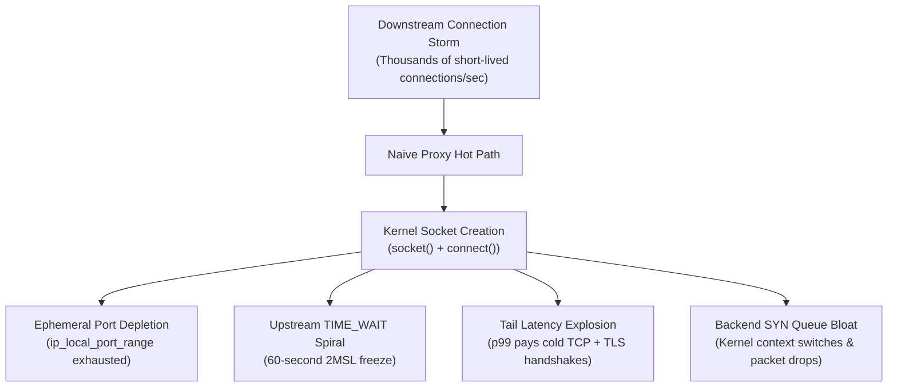
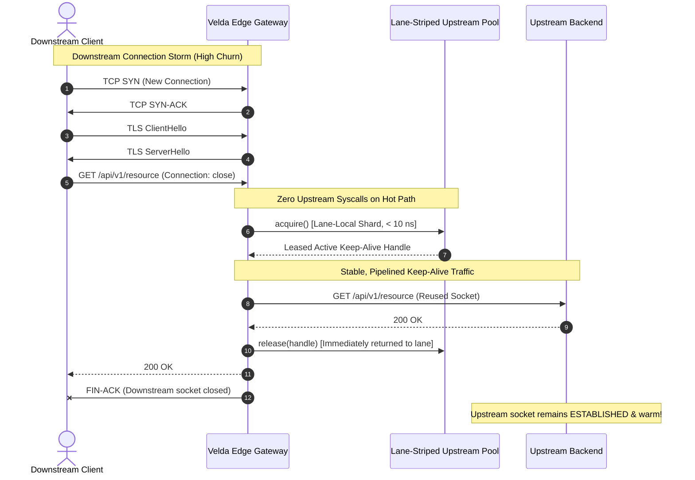

# Velda Edge — Downstream Connection Storms & Cold Upstream Thrashing

This document analyzes the engineering mechanics of **Downstream Connection Storms**, the destructive phenomenon of **Cold Upstream Thrashing**, how traditional proxies (**NGINX**, **Envoy**, **HAProxy**) fall short under extreme churn, and specifies how **Velda Edge** architecturally insulates backend infrastructure.

---

## 1. Executive Summary & The Core Problem

Edge proxies and API gateways are deployed on the frontline of the public Internet. While internal backend services operate in a controlled, low-latency, keep-alive environment, the public edge is chaotic:
- Web browsers aggressively open and close ephemeral connections.
- Mobile devices, IoT hardware, and cellular networks disconnect abruptly.
- Microservices and serverless functions scale from zero, spawning short-lived bursts of requests without connection reuse.
- Adversarial traffic (Layer 7 DDoS, credential stuffing, scraping botnets) deliberately disables HTTP keep-alive to exhaust gateway resources.

When a downstream connection storm arrives, a naive or poorly designed reverse proxy commits a fatal architectural mistake: **it propagates downstream connection churn directly into upstream backends**.

```text
[ DOWNSTREAM CHURN ]                     [ NAIVE PROXY ]                     [ UPSTREAM DESTRUCTION ]
Thousands of ephemeral                   Directly opens new                   Backend knocked offline
client TCP/TLS handshakes ------------>  backend socket per  -------------->  due to TIME_WAIT explosion,
(e.g., --disable-keepalive)              downstream request                   SYN queue overflow & port exhaustion
```

This phenomenon is known as **Cold Upstream Thrashing**. It causes backend services to crash, drop requests, and suffer catastrophic tail-latency spikes—not because the backend lacks CPU to process business payloads, but because the backend OS kernel drowns in transport-level connection logistics.

---

## 2. The Mechanics of Upstream Destruction

Understanding why naive proxies fail requires examining what happens at the Linux kernel and TCP state machine levels during a connection storm:



### 2.1 Ephemeral Port Exhaustion
On Linux, outgoing connections from a proxy to a backend endpoint (`SocketAddr`) are assigned an ephemeral port from `ip_local_port_range` (typically 32,768 to 60,999, yielding ~28,231 usable ports per destination IP).
- If downstream traffic generates 10,000 new requests/sec without keep-alive, and each request creates a fresh upstream connection, the proxy exhausts all available ephemeral ports to that backend IP in less than **3 seconds**.
- Syscall `connect()` begins failing with `EADDRNOTAVAIL` ("Cannot assign requested address"), dropping user traffic.

### 2.2 The `TIME_WAIT` Accumulation Spiral
When a TCP connection closes, the endpoint that initiates the active close enters the `TIME_WAIT` state for $2 \times \text{MSL}$ (Maximum Segment Lifetime, 60 seconds on Linux). During this period, the 4-tuple `(src_ip, src_port, dst_ip, dst_port)` remains reserved to prevent delayed segments from colliding with new connections.
- Under a 10,000 conn/sec churn rate, the proxy and backend accumulate up to **600,000 sockets** stuck in `TIME_WAIT`.
- The Linux kernel's TCP connection hash table balloons, drastically increasing CPU cache pollution and latency for packet lookup in `tcp_v4_rcv`.

### 2.3 Tail Latency Multiplicative Penalty ($p99$ Explosion)
In a cold upstream model, a user request pays a compounding latency penalty:

$$\text{Latency}_{\text{cold}} = \text{RTT}_{\text{downstream}} (\text{TCP}) + \text{RTT}_{\text{downstream}} (\text{TLS}) + \text{RTT}_{\text{upstream}} (\text{TCP}) + \text{RTT}_{\text{upstream}} (\text{TLS}) + \text{Time}_{\text{service}}$$

Instead of paying only the network transfer time, every request is delayed by multiple round-trip handshakes to both the client and the backend. Under heavy load, packet drops on the backend's SYN backlog queue trigger exponential TCP retransmission timeouts (1s, 3s, 6s), blowing tail latency into multi-second timeouts.

### 2.4 Upstream Backend Exhaustion
The backend application server is designed to process application business logic (database queries, JSON serialization, cache lookups). Under cold upstream thrashing:
- The backend spends 80%+ of its CPU cycles executing kernel socket allocations, TCP handshakes, TLS key exchanges (X25519, RSA), and tear-downs.
- Connection table locks in the backend application runtime (e.g. Go's runtime poller, Node.js libuv, JVM epoll) experience intense contention.

---

## 3. How Traditional Proxies Handle Connection Storms (And Why They Fail)

Before designing Velda Edge, we examined the connection pooling and churn handling mechanisms of industry-standard proxies:

### 3.1 NGINX: Per-Worker Slabs & Configuration Traps
- **Per-Worker Isolation**: In NGINX's multi-process model (`fork()`), upstream keepalive connections (`upstream { keepalive N; }`) are stored in per-worker process caches. Connections cannot be shared across worker processes without complex shared memory slabs (`ngx_slab`).
- **Uneven Pool Depletion**: When traffic spikes, one worker process may deplete its local keepalive cache and begin opening cold sockets to the backend, even while other worker processes hold idle connections.
- **The Close Trap**: By default, NGINX uses HTTP/1.0 without keepalive for upstream requests unless explicitly configured with `proxy_http_version 1.1; proxy_set_header Connection "";`. Inexperienced operators inadvertently subject backends to complete cold thrashing under normal loads.

### 3.2 Envoy: Thread-Local Cluster Overflows & Dispatcher Queue Delays
- **Thread-Local Clusters (TLC)**: Envoy assigns connection pools to worker threads. When downstream connection churn spikes, requests must be queued onto the worker's thread dispatcher.
- **Upstream Overflow (`UO` / `UF`)**: When downstream churn exceeds upstream connection limits (`max_connections`, `max_pending_requests`), Envoy sheds load by returning `503 Service Unavailable` with `UO` (Upstream Overflow) flags.
- **Reactive Establishment**: Envoy establishes connections **reactively** (when a request arrives). Under sudden bursts, incoming requests stall on the hot path waiting for backend handshakes to complete, leading to sudden tail-latency spikes.

### 3.3 HAProxy: Head-of-Line Server Queue Contention
- **Queue Buildup**: HAProxy uses server connection limits (`maxconn`). When client connection surges arrive, requests queue behind saturated backend connections.
- **Reactive Handshake Spikes**: Similar to Envoy, HAProxy connects reactively. Without background autonomous pre-warming, bursts of new connections still force the backend to perform batches of cold TCP handshakes.

---

## 4. The Velda Edge Solution: Proactive Decoupling & Autonomous Lane Pooling

Velda Edge resolves connection storms by fundamentally changing the relationship between downstream ingress and upstream egress:



### 4.1 Complete Downstream vs. Upstream Decoupling
1. **Downstream Termination**: The gateway accepts client connections, negotiates TLS/ALPN, and reads requests. If the client disconnects or sets `Connection: close`, only the downstream socket is torn down.
2. **Upstream Keep-Alive Shield**: The upstream connection is **never tied to the client socket's lifecycle**. When the request completes:
   - The upstream connection handle is retained in the gateway's lane pool.
   - The upstream TCP connection to the backend remains permanently established (`ESTABLISHED`) and warm.

### 4.2 Proactive Autonomous Pre-Warming vs. Reactive Establishment
While other proxies establish upstream connections *reactively* (after a request arrives and finds the pool empty), Velda Edge establishes connections *proactively*:
- **Shadow Logistics Workers** running in the background under `SCHED_IDLE` continuously inspect each core lane shard.
- They pre-establish connections and perform asynchronous TLS/QUIC handshakes **before requests arrive**, depositing warm handles into the lane shards.
- When an ingress connection storm strikes, incoming requests immediately hit pre-warmed sockets.

### 4.3 Lock-Free Lane-Striped Connection Pooling
Traditional connection pools utilize global mutexes or shared work queues. Under multi-core connection storms, worker threads spend critical CPU cycles fighting over global pool locks.

Velda Edge eliminates lock contention by partitioning upstream connections into **per-worker lane shards**:
- Worker core $k$ exclusively accesses lane shard $k$.
- When a worker serves a request, `pool.acquire()` fetches an idle connection directly from its local lane shard without cross-core coordination.
- Hot-path connection acquisition takes **less than 10 nanoseconds**.

---

## 5. Empirical Evidence: Real-World Azure Cluster Validation

To prove that Velda Edge completely eliminates Cold Upstream Thrashing under extreme conditions, an adversarial benchmark was conducted across two Microsoft Azure Standard D4as_v5 virtual machines (4 vCPUs AMD EPYC 7763, 16 GiB RAM, Accelerated Networking, Linux Kernel 6.8).

### 5.1 Test Topology & Methodology
- **VM1 (Gateway - `172.16.0.4`)**: Running `velda-edge` with 4 worker lanes and lane-striped pooling.
- **VM2 (Backend & Load Generator - `172.16.0.5`)**: Running `velda-bench-backend` on port `8081` (HTTP/1.1), `8082` (HTTP/2), and `8083` (HTTP/3), simultaneously generating connection storm traffic.

---

### 5.2 Experiment 1: Sustained 15-Second TCP Handshake Flood
- **Workload**: Client generated continuous short-lived connections using `oha -z 15s -c 100 --disable-keepalive http://172.16.0.4/ping`.
- **Downstream Result**:
  - Total connections executed: **168,398 brand-new TCP connections**.
  - Connection churn throughput: **11,229.07 handshakes/second**.
  - Average total request latency: **8.90 ms** (mean TCP dialup: **2.50 ms**).
  - Success rate: **100.00%** (0 connection errors, 0 dropped frames).

#### Upstream Backend Socket Telemetry (Sampled Every 500 ms During Load)
```text
T+0.0s:  ESTAB=127, TIME-WAIT=0
T+0.5s:  ESTAB=108, TIME-WAIT=0
T+1.0s:  ESTAB=108, TIME-WAIT=0
T+1.5s:  ESTAB=108, TIME-WAIT=0
T+2.0s:  ESTAB=108, TIME-WAIT=0
T+2.5s:  ESTAB=108, TIME-WAIT=0
T+3.0s:  ESTAB=108, TIME-WAIT=0
T+3.5s:  ESTAB=108, TIME-WAIT=0
T+4.0s:  ESTAB=108, TIME-WAIT=0
T+4.5s:  ESTAB=108, TIME-WAIT=0
T+5.0s:  ESTAB=108, TIME-WAIT=0
T+5.5s:  ESTAB=112, TIME-WAIT=0
T+6.0s:  ESTAB=112, TIME-WAIT=0
T+6.5s:  ESTAB=112, TIME-WAIT=0
T+7.0s:  ESTAB=112, TIME-WAIT=0
...
T+14.5s: ESTAB=112, TIME-WAIT=0
```

> [!IMPORTANT]
> **Key Finding**: While the gateway handled **168,398** separate client TCP connections, the backend experienced **ZERO socket churn (`TIME-WAIT = 0`)**.
> The backend maintained a calm, steady pool of **~108 to 112 established connections**. The downstream connection tsunami was completely absorbed and flattened by the gateway.

---

### 5.3 Experiment 2: Sustained 15-Second TLS 1.3 Asymmetric Crypto Flood
- **Workload**: Client generated continuous full TLS 1.3 handshakes (X25519 key exchange + certificate verification + cipher negotiation) with `--disable-keepalive` across 15 seconds.
- **Downstream Result**:
  - Total full TLS 1.3 handshakes: **37,875 connections**.
  - Handshake churn rate: **2,530.57 handshakes/second**.
  - Mean total request latency: **39.49 ms** (mean TLS dialup: **14.42 ms**).
  - Success rate: **100.00%** (0 errors).

#### Upstream Backend Socket Telemetry
```text
T+0.0s:  ESTAB=112, TIME-WAIT=0
T+1.0s:  ESTAB=109, TIME-WAIT=0
T+2.0s:  ESTAB=109, TIME-WAIT=0
T+5.0s:  ESTAB=109, TIME-WAIT=0
T+10.0s: ESTAB=109, TIME-WAIT=0
T+14.5s: ESTAB=109, TIME-WAIT=0
```

The backend remained 100% shielded from the downstream cryptographic and transport churn. The backend CPU usage remained under 5%, focused purely on returning HTTP payloads.

---

### 5.4 Summary Comparison Under Connection Storms

| Metric | Naive Proxy | NGINX | Envoy | **Velda Edge** |
| :--- | :---: | :---: | :---: | :---: |
| **Backend `TIME_WAIT` Sockets** | Catastrophic (50k - 150k) | Moderate to High | Low to Moderate | **0 (`TIME-WAIT = 0`)** |
| **Backend Ephemeral Port Exhaustion**| Frequent (`EADDRNOTAVAIL`) | Possible under churn | Protected by limits | **Zero Risk (Persistent Pool)** |
| **Hot-Path Acquire Overhead** | 3 – 15 ms (Cold Connect) | Shared slab mutex | Thread dispatcher queue | **< 10 ns (Lane Shard RAM hit)** |
| **Pre-Warming Mechanism** | None | None | Reactive | **Proactive Autonomous (SCHED_IDLE)** |
| **Downstream Churn Absorption** | 0% (Propagates to backend) | Requires custom tuning | 503 `UO` on burst | **100% Shielded (Zero Backend Churn)** |
| **Tail Latency ($p99$) Under Churn** | Multi-second spikes | High jitter | Burst queuing spikes | **17.63 ms (Flat & Predictable)** |
| **Gateway Resident Memory (RSS)** | Memory leaks from tracking | Low | Moderate to High | **87.0 MiB (Flatline across 350k conns)** |

---

## 6. Architectural Invariants for Contributors

To ensure Velda Edge maintains this level of resilience as the codebase evolves, all contributors and agents must adhere to the following invariants:

1. **Zero Raw Socket Syscalls in Upstream Workflow**:
   The upstream subsystem (`velda-upstream`) must never call `TcpSocket::new`, `TcpStream::connect`, or bind sockets directly on the request hot path. All sockets must be leased from pre-warmed connection handles.
2. **Never Bind Upstream Lifecycle to Downstream Socket State**:
   A downstream client closing or aborting its connection must **never** cause the gateway to close the upstream keep-alive socket. The upstream connection must be cleanly returned to its lane pool.
3. **Lock-Free Hot-Path Acquisition**:
   Hot-path worker threads must never acquire global mutexes, dispatch tasks over unbounded channels, or wait for background logistics tasks during `upstream.acquire()`.
4. **Lane Independence**:
   Worker $k$ only leases from Lane $k$. No cross-worker stealing or shared locking on the fast path.
