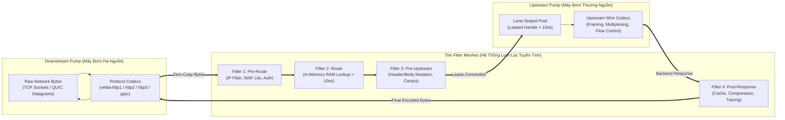

# Velda Edge — The Pump & Filter Pipeline Model (Mô hình Máy Bơm & Lưới Lọc)

This document specifies the core execution philosophy of **Velda Edge's Pipeline Subsystem**: **The Pump & Filter Architecture (Mô hình Máy Bơm & Lưới Lọc)**. It defines how data streams are pumped across protocol boundaries and filtered through non-allocating, zero-copy plugin hooks without inducing latency bottlenecks.

---

## 1. Core Mental Model: The Pump & The Filter

Traditional reverse proxies treat request processing either as an **object-oriented middleware onion** (where every layer wraps the next in deeply nested futures and heap-allocated trait objects) or as an **unstructured socket pipe** (where protocol logic and filtering rules bleed together).

Velda Edge conceptualizes request execution through a mechanical metaphor: **The High-Pressure Pump and the Razor-Thin Filter Meshes**.



### 1.1 The Pump (Máy Bơm)
- **Role**: Continuous, high-velocity movement of raw network bytes across hardware interfaces and wire protocols.
- **Components**: The protocol engines (`velda-transport`, `velda-http1`, `velda-http2`, `velda-http3`, `velda-grpc`).
- **Mechanics**:
  - Direct socket event loops running on core-pinned frontline worker threads (`velda-worker-{k}`).
  - Low-level kernel acceleration (`TCP_NODELAY`, `TCP_QUICKACK`, socket buffer sizing).
  - Protocol framing (HTTP/1.1 chunked framing, HTTP/2 binary DATA frames, HTTP/3 QUIC datagrams, gRPC length-prefixed messages).
  - Native transport backpressure: If the downstream pump stalls (slow consumer), backpressure propagates immediately upstream without unbounded memory buffering.

### 1.2 The Filter (Lưới Lọc)
- **Role**: Precision inspection, authentication, transformation, and security gating of requests as they flow through the pump.
- **Components**: The 23 modular plugins organized into 4 standardized execution tiers.
- **Mechanics**:
  - **Non-Allocating Inspection**: Filters inspect contiguous byte slices (`&[u8]`) and header maps without cloning strings or deserializing payloads into heap structures.
  - **Constrained Authority**: A filter hook can return only three canonical actions:
    - `Action::Continue`: Pass data transparently through the mesh to the next stage.
    - `Action::Respond(Response)`: Synthesize an immediate response (e.g., Cache Hit) and reverse flow directly to the downstream pump.
    - `Action::Reject(Reason)`: Fast-fail abort (e.g., WAF 403, Rate Limit 429), bypassing all downstream hooks and firing a static error frame out the socket in $< 800\ \mu\text{s}$.

---

## 2. The 7-Phase Flat Workflow Lifecycle

Every single request entering Velda Edge travels sequentially through **7 discrete phases** from top to bottom. In strict adherence to the project invariants (`AGENTS.md §2.2`), **sequential workflows are contiguous and linear within a single function**, with zero arbitrary splitting or OOP getter/setter indirection.

$$\text{Phase 1: decode} \longrightarrow \text{Phase 2: pre\_route} \longrightarrow \text{Phase 3: route} \longrightarrow \text{Phase 4: pre\_upstream} \longrightarrow \text{Phase 5: upstream} \longrightarrow \text{Phase 6: post\_response} \longrightarrow \text{Phase 7: encode}$$

```text
┌──────────────────────────────────────────────────────────────────────────────────┐
│                             7-PHASE FLAT WORKFLOW                                │
├───────────┬──────────────────────────────────────────────────────────────────────┤
│ Phase 1   │ decode: Extract request line, method, path, headers into slab buffer │
├───────────┼──────────────────────────────────────────────────────────────────────┤
│ Phase 2   │ pre_route: Tier 1 Security (IP Filter, Resource Limit, WAF Lite, Auth)│
├───────────┼──────────────────────────────────────────────────────────────────────┤
│ Phase 3   │ route: In-Memory Router projection (Method, Host, Path) -> UpstreamId│
├───────────┼──────────────────────────────────────────────────────────────────────┤
│ Phase 4   │ pre_upstream: Tier 2 Request Mutation, Canary Routing, Body Modifiers│
├───────────┼──────────────────────────────────────────────────────────────────────┤
│ Phase 5   │ upstream: Lock-free lane lease (<10ns), protocol bridging & pipe     │
├───────────┼──────────────────────────────────────────────────────────────────────┤
│ Phase 6   │ post_response: Tier 3 Optimization (Cache, Compression, OTel Tracing)│
├───────────┼──────────────────────────────────────────────────────────────────────┤
│ Phase 7   │ encode: Downstream wire serialization & return connection to lane    │
└───────────┴──────────────────────────────────────────────────────────────────────┘
```

---

## 3. The 48 Pipeline Strategies Matrix

Velda Edge supports 4 Downstream Ingress families, 3 Upstream Egress families, and 4 Streaming Strategy Modes, resulting in a comprehensive matrix of **48 specialized pipeline modules**:

```text
Downstream Ingress (4)  ×  Streaming Modes (4)  ×  Upstream Protocols (3)  =  48 Specialized Pipes
```

### 3.1 The 4 Streaming Modes
1. **`buffered`**: The entire request body is buffered into RAM before an upstream connection is leased. Completely protects the upstream connection pool from Slowloris attacks and slow client uploads.
2. **`server_stream`**: Request body is buffered or immediate; the backend response is streamed to downstream chunk-by-chunk with zero gateway memory buffering (e.g., SSE, Large File Downloads, AI LLM Token Streaming).
3. **`client_stream`**: Downstream client streams an upload chunk-by-chunk to the upstream backend in real time (e.g., S3 Multipart Uploads, Log Ingestion).
4. **`duplex`**: Full simultaneous bidirectional streaming (e.g., WebSockets, gRPC Bidi Streams, Real-time Collaborative APIs).

### 3.2 Strategy Matrix by Ingress Family

| Ingress Protocol | Target Documentation Directory | Total Specialized Pipes | Key Performance Profile |
| :--- | :--- | :---: | :--- |
| **HTTP/1.1** | `docs/pipe/http1/` | **12 Pipes** | 47,181 RPS (Baseline) / 110,954 RPS (WAF Fast-Abort) |
| **HTTP/2** | `docs/pipe/http2/` | **12 Pipes** | **46,691 RPS** (Micro-Ping) / **8,099 RPS** (64KB Stream, 507 MB/s) / **571 RPS** (1MB Bulk, 572 MB/s) |
| **HTTP/3 (QUIC)** | `docs/pipe/http3/` | **12 Pipes** | 27,000+ RPS (UDP 1-RTT connection, 0-RTT resumption) |
| **gRPC (TCP/UDP)** | `docs/pipe/grpc/` | **8 Pipes** | Length-prefixed framing, native trailer propagation |

---

## 4. Hardware, Micro-Architectural & Tri-Proxy Measurement Standards

Every pipeline documentation file in this directory includes empirical comparative measurements captured on a production Microsoft Azure HPC stress cluster:
- **Client / Load Generator (VM2 - `172.16.0.5`)**: `wrk` (2 threads, 100 concurrent persistent connections, 10s–60s sustained) and `h2load` / `k6`.
- **Target Gateway Under Test (VM1 - `172.16.0.4`)**: 4 vCPUs AMD EPYC 7763, 16 GiB RAM, Accelerated Networking (SR-IOV, Mellanox ConnectX-5, line rate 30 Gbps), Ubuntu Linux 6.8.0.
  - **Velda Edge**: v0.4.0 (Core-pinned frontline traffic workers `velda-worker-{0..3}` + shadow companion logistics threads).
  - **NGINX**: v1.26.1 (4 worker processes, `epoll`, `reuseport`, keepalive pool 1024, `worker_cpu_affinity`).
  - **Envoy Proxy**: v1.30.2 (4 worker threads, TCMalloc, `concurrency: 4`, keepalive pool 1024).
- **Upstream Backend (VM2 - `172.16.0.5`)**: `velda-bench-backend` serving target protocol backends (`:8081` H1, `:8082` H2, `:8443` H3).

### 4.1 The Three Telemetry Tiers

1. **Macro / Line-Rate Metrics**:
   - **Throughput (Requests / Second)**: Sustained transaction throughput.
   - **Latency Spectrum**: Arithmetic mean, $p50$, $p90$, $p99$, and extreme tail $p99.9$ jitter.
   - **Time-To-First-Byte (TTFB)**: Exact duration from downstream request completion to first response byte delivery.
   - **Goodput / Wire Bandwidth (MB/s)**: Net payload throughput delivered without protocol framing waste.
   - **Error Rate**: Ratio of non-2xx failures, TCP drops, and gateway timeouts under saturation.

2. **Micro-Architectural Hardware Counters (`perf stat` on VM1)**:
   - **Instructions Per Cycle (IPC)**: CPU pipeline efficiency ($\text{IPC} = \frac{\text{instructions}}{\text{cycles}}$).
   - **L1 Data Cache Miss Rate**: Measure of CPU data cache locality.
   - **LLC (L3) Cache Miss Rate**: Verification of memory traffic isolation across NUMA/core boundaries.
   - **Branch Misprediction Rate**: Branch predictor penalty in tight protocol loops.
   - **Context Switches (Voluntary vs Involuntary)**: OS scheduler preemption overhead.
   - **CPU Migrations**: Must strictly equal **0** (thread-per-core affinity invariant).
   - **Page Faults (Minor vs Major)**: Must strictly equal **0** on the request serving hot path.

3. **Operating System & Resource Footprint Metrics**:
   - **Resident Set Size (RSS)**: Cold-start vs Peak saturation memory residency.
   - **Memory Drift Rate ($\Delta\text{RSS}$)**: Memory growth over 2.3+ million transactions (zero-leak invariant).
   - **CPU Time Distribution**: User-space compute (`%usr`) vs Kernel syscall overhead (`%sys`).
   - **Kernel Socket Buffer Allocation**: Downstream/upstream `sk_buff` buffer memory in kernel space (`rmem`/`wmem`).
   - **Socket Lifecycle States**: Upstream `TIME-WAIT` and `CLOSE-WAIT` sockets.

