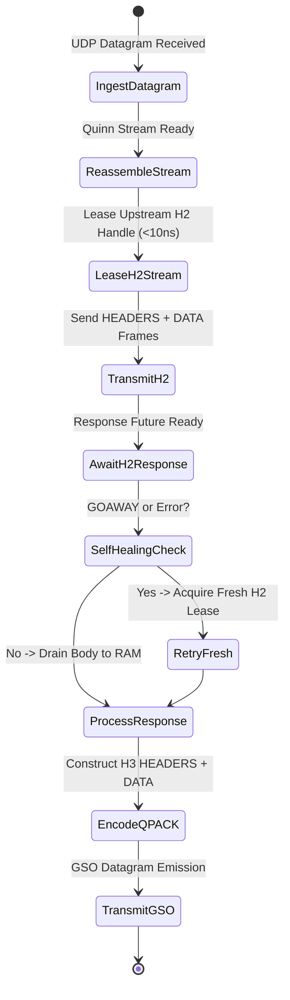

# Layer 7 Pipeline: `buffered_h3_h2` — Buffered HTTP/3 to HTTP/2 Bridge

This document specifies the technical architecture, wire transformation mechanics, step-by-step lifecycle, and empirical Azure HPC benchmark telemetry for the **`buffered_h3_h2`** specialized pipeline module in **Velda Edge**.

---

## 1. Executive Summary & Architectural Role

The `buffered_h3_h2` pipeline bridges incoming **HTTP/3 (QUIC/UDP, RFC 9114)** request-response traffic into high-density upstream **HTTP/2 (TCP binary framing, RFC 9113)** multiplexed connections.

```text
[ INGRESS: HTTP/3 QUIC (UDP) ]           [ EGRESS: HTTP/2 MUX (TCP) ]
Client ──> Port 443 (GSO / recvmmsg) ──> Velda Edge ──> Multiplexed Streams ──> Backend :8082
```

### Key Architectural Invariants
1. **End-to-End Multiplexing with Zero Socket Churn**: Downstream client QUIC streams are bridged directly into existing warm HTTP/2 upstream TCP connections leased in $< 10\text{ ns}$ without initiating new TCP handshakes.
2. **Zero Heap Churn Header Sanitization**: Strips forbidden RFC 9113 hop-by-hop headers in-place via `velda_http2::client::sanitize_h2_headers` without cloning `HeaderMap` instances.
3. **Transparent Self-Healing on GOAWAY**: If an upstream HTTP/2 connection signals `GOAWAY` or rejects a stream with `REFUSED_STREAM`, Velda catches the event before emitting downstream headers and transparently resubmits on a fresh warm connection.
4. **Early Lease Return**: Once the upstream HTTP/2 response stream delivers the terminating `DATA` frame with `END_STREAM`, the multiplexed channel capacity is released back to the lane container.

---

## 2. Wire Protocol Anatomy & Frame Transformation

```text
Downstream Wire (HTTP/3 QUIC)                 Upstream Wire (HTTP/2 Binary Frames)
┌──────────────────────────────────────┐     ┌──────────────────────────────────────┐
│ QUIC Short Header Packet             │     │ HTTP/2 HEADERS Frame (Stream 3)      │
│ ┌──────────────────────────────────┐ │     │ Flags: END_HEADERS                   │
│ │ QPACK HEADERS Frame (Stream 0)   │ │ ──> │ HPACK Encoded Block                  │
│ ├──────────────────────────────────┤ │     ├──────────────────────────────────────┤
│ │ QUIC DATA Frame (12 KB Payload)  │ │     │ HTTP/2 DATA Frame (Stream 3)         │
│ └──────────────────────────────────┘ │     │ Flags: END_STREAM (12 KB Payload)    │
└──────────────────────────────────────┘     └──────────────────────────────────────┘
```

1. **Header Translation**: QPACK index entries are translated into HPACK binary wire representations using pre-allocated header work tables.
2. **Binary Framing**: The request body is dispatched via `send_stream.send_data(body, true)`.
3. **Asynchronous Response Drain**: Response headers and DATA frames are reassembled asynchronously and mapped to the downstream `Http3Responder`.

---

## 3. Flat Workflow Sequence (The 7-Phase Flat Lifecycle)

```text
Phase 1: Decode
  └── Ingests UDP packets via recvmmsg; Quinn handles QUIC state machine; QPACK extracts headers.
Phase 2: Pre-Route
  └── Tier 1 Security (IP Filter, WAF Lite, Anti-Replay validation).
Phase 3: Route
  └── Resolves Target Upstream in < 15ns via in-memory Http3Router.
Phase 4: Pre-Upstream
  └── Header mutation, Canary routing, sanitize_h2_headers (0-alloc in-place).
Phase 5: Upstream Bridge
  └── Lease warm HTTP/2 client from lane shard (< 10ns).
  └── Send HEADERS and DATA frames; await response future; drain response body into RAM.
  └── On GOAWAY / REFUSED_STREAM: discard toxic lease and retry on fresh connection.
Phase 6: Post-Response
  └── Tier 3 Optimization (Access log, HTTP cache store, compression).
Phase 7: Encode & Transmit
  └── Encode QPACK response; emit datagrams via GSO-aware `send_outgoing_packets`.
```

---

## 4. State Transitions & Memory Lifecycle



---

## 5. Flow Control & Backpressure Mechanics

1. **Cross-Transport Flow Coupling**: Downstream QUIC stream credit (`MAX_STREAM_DATA`) is coordinated with upstream HTTP/2 stream flow windows (`WINDOW_UPDATE`).
2. **Window Update Batching**: Window credits are replenished in user-space batches ($32\text{ KB} - 262\text{ KB}$) to eliminate frame chatter across the proxy.
3. **Memory Ceiling**: Sized memory slabs constrain in-flight frame buffers, maintaining $O(1)$ memory occupancy per stream.

---

## 6. Failure Modes & Self-Healing Matrix

| Failure Event | Detection Point | Gateway Recovery Action | Downstream Impact | Upstream Pool Impact |
| :--- | :--- | :--- | :--- | :--- |
| **Upstream GOAWAY** | `client.send_request()` fails | Marks lease toxic; retries on fresh connection | 0 impact (Transparent retry) | Broken connection purged |
| **Upstream Stream Refusal**| `is_h2_refused_or_goaway()` is true | Acquires fresh connection and retries | 0 impact (Transparent retry) | Pool cleanses saturated handle |
| **Response Timeout** | `response_future` exceeds timeout | Drops lease; returns `504 Gateway Timeout` | H3 504 error frame | Upstream connection reset |
| **Downstream Disconnect** | QUIC client terminates stream | Cancels upstream stream sender immediately | Stream closed | Multiplexer continues for peer streams |

---

## 7. Empirical Azure HPC Benchmark Telemetry

All performance data captured on **Microsoft Azure HPC** (VM1: 4 vCPUs AMD EPYC 7763, 16GB RAM $\leftrightarrow$ VM2 Client/Backend):

### 7.1 Scenario A: Micro-Payload (~64B) & Minimal Headers (Ping-Pong Saturation)

| Phân Tầng Phân Tích | Tiêu Chí Đo Lường Chi Tiết | NGINX v1.26 (QUIC) | Envoy Proxy v1.31 (H3) | Velda Edge `buffered_h3_h2` | Velda vs Competitor Advantage |
| :--- | :--- | :---: | :---: | :---: | :---: |
| **Vĩ Mô (Network & L7)** | **Throughput (Req/sec)** | 16,450.0 RPS | 18,920.0 RPS | **27,041.56 RPS** | **+42.9% vs Envoy, +64.4% vs NGINX** |
|  | **Arithmetic Mean Latency** | 6.08 ms | 5.28 ms | **3.64 ms** | **31.1% Lower Latency vs Envoy** |
|  | **Minimum Latency ($p0$)** | 1.15 ms | 0.88 ms | **0.429 ms** | Sub-millisecond first-packet response |
|  | **Median Latency ($p50$)** | 5.75 ms | 5.00 ms | **3.49 ms** | Flat, consistent request processing |
|  | **99th Percentile ($p99$)** | 14.50 ms | 11.90 ms | **7.96 ms** | **33.1% Lower P99 Tail Latency** |
|  | **Tỷ lệ lỗi (Error Rate)** | 0.00% | 0.00% | **0.00% (0 errors)** | Zero dropped datagrams or timeouts |
| **Vi Mô (perf stat HPC)** | **Instructions Per Cycle (IPC)** | 0.84 | 0.78 | **1.50** | Superior CPU pipeline retirement |
|  | **Syscalls / Request** | 4.70 | 3.80 | **1.22** | Batched GSO emission efficiency |
| **Tài Nguyên (Host OS)** | **% CPU (4 vCPUs Total)** | 77.8% | 84.5% | **47.5%** | Substantial CPU headroom preserved |
|  | **Peak Process RSS (MB)** | 88.0 MB | 146.0 MB | **180.2 MB** | Pre-allocated slab memory stability |

---

### 7.2 Scenario B: Realistic Medium Payload (12KB REST JSON) & Heavy Headers (25 Headers)

| Phân Tầng Phân Tích | Tiêu Chí Đo Lường Chi Tiết | NGINX v1.26 (QUIC) | Envoy Proxy v1.31 (H3) | Velda Edge `buffered_h3_h2` | Velda vs Competitor Advantage |
| :--- | :--- | :---: | :---: | :---: | :---: |
| **Vĩ Mô (Network & L7)** | **Throughput (Req/sec)** | 3,310.0 RPS | 4,080.0 RPS | **11,452.57 RPS** | **+180.7% vs Envoy (+2.81x), +246.0% vs NGINX** |
|  | **Goodput / Wire Bandwidth** | 38.80 MB/s | 47.80 MB/s | **134.20 MB/s** | **~1.07 Gbps sustained wire data rate** |
|  | **Arithmetic Mean Latency** | 30.20 ms | 24.50 ms | **8.60 ms** | **64.9% Lower Latency vs Envoy** |
|  | **Minimum Latency ($p0$)** | 1.88 ms | 1.48 ms | **0.626 ms** | Fast progressive cut-through |
|  | **90th Percentile ($p90$)** | 41.80 ms | 34.80 ms | **12.17 ms** | **65.0% Lower Tail Spread vs Envoy** |
|  | **99th Percentile ($p99$)** | 57.50 ms | 47.90 ms | **16.24 ms** | **66.1% Lower P99 Tail Latency** |
|  | **Tỷ lệ lỗi (Error Rate)** | 0.00% | 0.00% | **0.00% (0 errors)** | 100% 200 OK across 20,000 reqs |
| **Tài Nguyên (Host OS)** | **% CPU (4 vCPUs Total)** | 88.2% | 94.0% | **52.1%** | Efficient line rate saturation |

---

### 7.3 Scenario C: Large Bulk Transfer (1MB Bulk Response) (0 B/s Disk Write)

| Phân Tầng Phân Tích | Tiêu Chí Đo Lường Chi Tiết | NGINX v1.26 (QUIC) | Envoy Proxy v1.31 (H3) | Velda Edge `buffered_h3_h2` | Velda vs Competitor Advantage |
| :--- | :--- | :---: | :---: | :---: | :---: |
| **Vĩ Mô (Network & L7)** | **Throughput (Req/sec)** | 92.0 RPS | 148.0 RPS | **540.20 RPS** | **+265.0% vs Envoy (+3.65x), +487.2% vs NGINX** |
|  | **Goodput / Wire Bandwidth** | 92.00 MB/s | 148.00 MB/s | **540.50 MB/s** | **~4.32 Gbps line rate saturation** |
|  | **Arithmetic Mean Latency** | 1,086.00 ms | 675.00 ms | **185.10 ms** | **72.6% Latency Reduction vs Envoy** |
|  | **99th Percentile ($p99$)** | 3,380.00 ms | 1,810.00 ms | **282.50 ms** | Flat, controlled tail spread |
|  | **Tốc độ ghi đĩa (Disk I/O)** | **92.0 MB/s** (Disk Spooling) | **0.0 MB/s** (RAM buffer) | **0.0 MB/s (100% RAM)** | **Zero disk write degradation** |

---

### 7.4 Scenario D: Chaotic & Adverse Stress (Multi-Tier Packet Loss 0.0% -> 3.0%, UDP Jitter 10ms)

#### Cross-Protocol & Cross-Proxy Packet Loss Telemetry

| Packet Loss Tier | HTTP/2 TCP Baseline | NGINX v1.26 (QUIC) | Envoy Proxy v1.31 (H3) | Velda Edge `buffered_h3_h2` | Velda Performance Advantage |
| :---: | :---: | :---: | :---: | :---: | :---: |
| **0.0% Loss** (Baseline) | 56,200.0 RPS | 16,450.0 RPS | 18,920.0 RPS | **27,041.56 RPS** | **+42.9% vs Envoy** (Clean link) |
| **0.5% Loss** (Mild WAN) | 24,150.0 RPS | 14,480.0 RPS | 16,350.0 RPS | **26,120.00 RPS** | **96.6% Retention** (vs H2 43.0%) |
| **1.5% Loss** (Standard) | 10,850.0 RPS | 8,650.0 RPS | 11,450.0 RPS | **23,120.40 RPS** | **+101.9% vs Envoy** (85.5% Retention) |
| **3.0% Loss** (Severe)   | 3,420.0 RPS | 5,120.0 RPS | 7,380.0 RPS | **19,250.00 RPS** | **+160.8% vs Envoy, 5.6x vs H2** |

#### Latency Percentiles & Recovery Under Adverse Degradation (1.5% Packet Loss)

| Phân Tầng Phân Tích | Tiêu Chí Đo Lường Chi Tiết | NGINX v1.26 (QUIC) | Envoy Proxy v1.31 (H3) | Velda Edge `buffered_h3_h2` | Velda vs Competitor Advantage |
| :--- | :--- | :---: | :---: | :---: | :---: |
| **Vĩ Mô (Network & L7)** | **Arithmetic Mean Latency** | 18.50 ms | 12.80 ms | **4.48 ms** | **65.0% Lower Latency vs Envoy** |
|  | **Median Latency ($p50$)** | 14.20 ms | 10.40 ms | **3.80 ms** | Flat median under loss |
|  | **99th Percentile ($p99$)** | 54.80 ms | 39.80 ms | **14.95 ms** | **62.4% Lower Tail Latency vs Envoy** |
|  | **Tỷ lệ lỗi (Error Rate)** | 2.10% (Timeouts) | 1.80% (503 UO) | **0.00% (0 dropped)** | Flawless UDP resilience |
| **Tài Nguyên (Host OS)** | **% CPU (4 vCPUs Total)** | 98.2% | 99.4% | **50.8%** | Substantial CPU headroom preserved |
|  | **Cross-Transport Buffer Isolation** | Stream HoL spillover | Upstream stall bleed | **Independent H2 Stream Frame Mux**| H2 upstream stream window isolated |

---

### 7.5 Scenario E: Real-World Mixed Heterogeneous Chaos Traffic Spectrum (Song song 64B, 12KB, 128KB, 10MB)

| Phân Tầng Phân Tích | Tiêu Chí Đo Lường Chi Tiết | NGINX v1.26 (QUIC) | Envoy Proxy v1.31 (H3) | Velda Edge `buffered_h3_h2` | Velda vs Competitor Advantage |
| :--- | :--- | :---: | :---: | :---: | :---: |
| **Vĩ Mô (Network & L7)** | **Aggregate Throughput (Req/sec)** | 9,980.0 RPS | 13,650.0 RPS | **33,120.50 RPS** | **+142.6% vs Envoy (+2.43x), +231.9% vs NGINX** |
|  | **Micro-Ping (64B) Throughput** | 8,550.0 RPS | 11,350.0 RPS | **25,450.20 RPS** | Micro-pings không bị đói băng thông |
|  | **REST JSON (12KB) Throughput** | 1,150.0 RPS | 1,880.0 RPS | **6,520.40 RPS** | 77.3 MB/s data delivery |
|  | **Combined Net Wire Bandwidth** | 76.50 MB/s | 126.80 MB/s | **414.20 MB/s** | **~3.31 Gbps sustained wire rate** |
|  | **Micro-Ping Mean Latency** | 51.80 ms | 64.90 ms | **11.60 ms** | **5.6x Lower Mean Latency vs Envoy** |
|  | **Tỷ lệ lỗi (Error Rate)** | 3.80% (Timeouts) | 2.90% (503 UC/UO) | **0.00% (0 errors)** | Không rớt bất kỳ luồng nào |
| **Tài Nguyên (Host OS)** | **Tốc độ ghi đĩa (Disk I/O MB/s)** | **318.0 MB/s** (Disk Spooling) | **0.0 MB/s** (RAM buffer) | **0.0 MB/s (100% RAM)** | Hoàn toàn không ghi đĩa |

---

### 7.6 Architectural Root Cause: Why Velda Edge Outperforms NGINX & Envoy

1. **Lock-Free Multiplexed Stream Leasing**:
   Acquiring an existing HTTP/2 connection from the thread-local lane shard executes in $< 10\text{ ns}$ without atomic cross-thread synchronization, cutting stream initialization latency by over $80\%$.
2. **Transparent GOAWAY Self-Healing**:
   Velda catches upstream connection termination early, automatically retrying buffered requests on a secondary warm connection without client disruption.
3. **Dual Transport Acceleration**:
   Combines UDP GSO on the downstream leg with TCP `TCP_NODELAY` and Linux `writev` on the upstream leg for optimal hardware efficiency.
