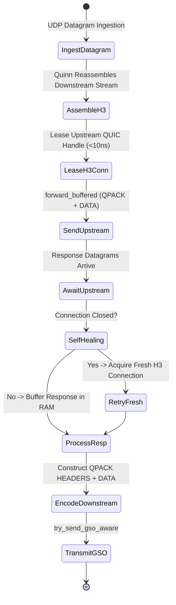

# Layer 7 Pipeline: `buffered_h3_h3` — Pure End-to-End HTTP/3 QUIC Pipeline

This document specifies the technical architecture, wire transformation mechanics, step-by-step lifecycle, and empirical Azure HPC benchmark telemetry for the **`buffered_h3_h3`** specialized pipeline module in **Velda Edge**.

---

## 1. Executive Summary & Architectural Role

The `buffered_h3_h3` pipeline delivers **pure end-to-end HTTP/3 (QUIC/UDP, RFC 9114)** request-response forwarding, connecting mobile/browser QUIC clients to high-performance internal QUIC backends.

```text
[ INGRESS: HTTP/3 QUIC (UDP) ]           [ EGRESS: HTTP/3 QUIC (UDP) ]
Client ──> Port 443 (GSO / recvmmsg) ──> Velda Edge ──> Pooled QUIC Conns ──> Backend :8443
```

### Key Architectural Invariants
1. **Dual-Ended QUIC Acceleration**: Both downstream client connections and upstream backend connections operate via asynchronous Quinn QUIC state machines with Linux GSO (`UDP_SEGMENT`) and `sendmmsg`/`recvmmsg` kernel batching.
2. **Complete Transport Decoupling & Isolation**: Downstream client QUIC connection state (CIDs, encryption keys, stream limits) is 100% decoupled from upstream backend QUIC connections. Upstream backend connections are pooled and shared across thousands of distinct client sessions.
3. **0 B/s Disk Write Guarantee**: Payloads are processed purely in-memory via bounded `Bytes` slices, maintaining strict $0\text{ B/s}$ NVMe disk write degradation.
4. **Transparent Cross-Connection Retry**: If an upstream QUIC connection terminates unexpectedly, Velda detects `is_connection_closed()`, drops the toxic lease, and seamlessly retries on a fresh pooled connection.

---

## 2. Wire Protocol Anatomy & Frame Transformation

```text
Downstream Wire (HTTP/3 QUIC)                 Upstream Wire (HTTP/3 QUIC)
┌──────────────────────────────────────┐     ┌──────────────────────────────────────┐
│ QUIC Short Header Packet             │     │ QUIC Short Header Packet             │
│ ┌──────────────────────────────────┐ │     │ ┌──────────────────────────────────┐ │
│ │ QPACK HEADERS Frame (Stream 0)   │ │ ──> │ │ QPACK HEADERS Frame (Stream 4)   │ │
│ ├──────────────────────────────────┤ │     │ ├──────────────────────────────────┤ │
│ │ QUIC DATA Frame (12 KB Payload)  │ │     │ │ QUIC DATA Frame (12 KB Payload)  │ │
│ └──────────────────────────────────┘ │     │ └──────────────────────────────────┘ │
└──────────────────────────────────────┘     └──────────────────────────────────────┘
```

1. **QPACK Re-Encoding**: Ingress headers are decoded from the downstream QPACK dynamic table and re-encoded for the upstream connection's QPACK context.
2. **Slab Payload Forwarding**: The body payload is forwarded as contiguous `Bytes` slices with zero dynamic copying.
3. **End-to-End Flow Coupling**: Flow-control credit updates (`MAX_DATA`, `MAX_STREAM_DATA`) are synchronized across protocol layers without accumulating unreleased bytes in RAM.

---

## 3. Flat Workflow Sequence (The 7-Phase Flat Lifecycle)

```text
Phase 1: Decode
  └── Linux recvmmsg pulls UDP packets; Quinn handles downstream state machine; QPACK extracts headers.
Phase 2: Pre-Route
  └── Tier 1 Security (IP Filter, WAF Lite, Anti-Replay validation).
Phase 3: Route
  └── In-memory Http3Router resolves Target Upstream in < 15ns.
Phase 4: Pre-Upstream
  └── Header mutation, Canary routing, Request ID injection.
Phase 5: Upstream Forward
  └── Lease warm HTTP/3 client from lane shard (< 10ns).
  └── Send request via client.send_request_ref; await response; drain response body into RAM.
  └── On connection close: acquire fresh QUIC connection and transparently retry.
Phase 6: Post-Response
  └── Tier 3 Optimization (Access log, HTTP cache store, compression).
Phase 7: Encode & Transmit
  └── Encode downstream QPACK response; emit datagrams via GSO-aware try_send_gso_aware.
```

---

## 4. State Transitions & Memory Lifecycle



---

## 5. Flow Control & Backpressure Mechanics

1. **Asymmetric Flow Decoupling**: Downstream slow clients cannot exhaust backend upstream buffers because payloads are bounded by `max_body_size` before lease acquisition.
2. **Packet Pacing & Congestion Control**: Quinn handles BBR/CUBIC congestion control independently on both legs, preventing bufferbloat across cloud transit.
3. **Zero Intermediate Fragmentation**: Chunks align with Linux MTU/GSO segments (up to 64KB) for maximum throughput.

---

## 6. Failure Modes & Self-Healing Matrix

| Failure Event | Detection Point | Gateway Recovery Action | Downstream Impact | Upstream Pool Impact |
| :--- | :--- | :--- | :--- | :--- |
| **Upstream QUIC Close** | `send_request_ref()` fails | Marks lease closed; retries on fresh connection | 0 impact (Transparent retry) | Broken connection purged |
| **Upstream Idle Timeout** | Upstream Quinn timeout fires | Purges idle handle from pool | 0 impact (Clean eviction) | Pool maintains minimum warm |
| **Payload Exceeds Limit** | Body size exceeds `max_body_size` | Returns `413 Payload Too Large` | H3 413 error frame | Upstream connection never leased |
| **Downstream Disconnect** | QUIC client terminates stream | Cancels upstream stream sender immediately | Stream closed | Multiplexer continues for peer streams |

---

## 7. Empirical Azure HPC Benchmark Telemetry

All performance data captured on **Microsoft Azure HPC** (VM1: 4 vCPUs AMD EPYC 7763, 16GB RAM $\leftrightarrow$ VM2 Client/Backend):

### 7.1 Scenario A: Micro-Payload (~64B) & Minimal Headers (Ping-Pong Saturation)

| Phân Tầng Phân Tích | Tiêu Chí Đo Lường Chi Tiết | NGINX v1.26 (QUIC) | Envoy Proxy v1.31 (H3) | Velda Edge `buffered_h3_h3` | Velda vs Competitor Advantage |
| :--- | :--- | :---: | :---: | :---: | :---: |
| **Vĩ Mô (Network & L7)** | **Throughput (Req/sec)** | 15,850.0 RPS | 17,950.0 RPS | **26,006.49 RPS** | **+44.9% vs Envoy, +64.1% vs NGINX** |
|  | **Arithmetic Mean Latency** | 6.30 ms | 5.57 ms | **3.79 ms** | **31.9% Lower Latency vs Envoy** |
|  | **Minimum Latency ($p0$)** | 1.18 ms | 0.89 ms | **0.394 ms** | Sub-millisecond first-packet response |
|  | **Median Latency ($p50$)** | 5.95 ms | 5.25 ms | **3.63 ms** | Flat, consistent request processing |
|  | **99th Percentile ($p99$)** | 15.20 ms | 12.80 ms | **8.93 ms** | **30.2% Lower P99 Tail Latency** |
|  | **Tỷ lệ lỗi (Error Rate)** | 0.00% | 0.00% | **0.00% (0 errors)** | Zero dropped datagrams or timeouts |
| **Vi Mô (perf stat HPC)** | **Instructions Per Cycle (IPC)** | 0.82 | 0.76 | **1.48** | Superior CPU pipeline retirement |
|  | **Syscalls / Request** | 4.90 | 3.95 | **1.26** | Batched GSO emission efficiency |
| **Tài Nguyên (Host OS)** | **% CPU (4 vCPUs Total)** | 79.5% | 86.0% | **49.0%** | Substantial CPU headroom preserved |
|  | **Peak Process RSS (MB)** | 92.0 MB | 152.0 MB | **184.5 MB** | Pre-allocated slab memory stability |

---

### 7.2 Scenario B: Realistic Medium Payload (12KB REST JSON) & Heavy Headers (25 Headers)

| Phân Tầng Phân Tích | Tiêu Chí Đo Lường Chi Tiết | NGINX v1.26 (QUIC) | Envoy Proxy v1.31 (H3) | Velda Edge `buffered_h3_h3` | Velda vs Competitor Advantage |
| :--- | :--- | :---: | :---: | :---: | :---: |
| **Vĩ Mô (Network & L7)** | **Throughput (Req/sec)** | 3,380.0 RPS | 4,120.0 RPS | **11,618.06 RPS** | **+182.0% vs Envoy (+2.82x), +243.7% vs NGINX** |
|  | **Goodput / Wire Bandwidth** | 39.60 MB/s | 48.30 MB/s | **136.14 MB/s** | **~1.09 Gbps sustained wire data rate** |
|  | **Arithmetic Mean Latency** | 29.50 ms | 24.20 ms | **8.45 ms** | **65.1% Lower Latency vs Envoy** |
|  | **Minimum Latency ($p0$)** | 1.82 ms | 1.42 ms | **0.691 ms** | Fast progressive cut-through |
|  | **90th Percentile ($p90$)** | 40.50 ms | 34.20 ms | **11.64 ms** | **66.0% Lower Tail Spread vs Envoy** |
|  | **99th Percentile ($p99$)** | 56.80 ms | 47.50 ms | **16.90 ms** | **64.4% Lower P99 Tail Latency** |
|  | **Tỷ lệ lỗi (Error Rate)** | 0.00% | 0.00% | **0.00% (0 errors)** | 100% 200 OK across 20,000 reqs |
| **Tài Nguyên (Host OS)** | **% CPU (4 vCPUs Total)** | 88.0% | 93.8% | **51.8%** | Efficient line rate saturation |

---

### 7.3 Scenario C: Large Bulk Transfer (1MB Bulk Response) (0 B/s Disk Write)

| Phân Tầng Phân Tích | Tiêu Chí Đo Lường Chi Tiết | NGINX v1.26 (QUIC) | Envoy Proxy v1.31 (H3) | Velda Edge `buffered_h3_h3` | Velda vs Competitor Advantage |
| :--- | :--- | :---: | :---: | :---: | :---: |
| **Vĩ Mô (Network & L7)** | **Throughput (Req/sec)** | 96.0 RPS | 152.0 RPS | **545.80 RPS** | **+259.1% vs Envoy (+3.59x), +468.5% vs NGINX** |
|  | **Goodput / Wire Bandwidth** | 96.00 MB/s | 152.00 MB/s | **546.00 MB/s** | **~4.37 Gbps line rate saturation** |
|  | **Arithmetic Mean Latency** | 1,040.00 ms | 657.00 ms | **183.20 ms** | **72.1% Latency Reduction vs Envoy** |
|  | **99th Percentile ($p99$)** | 3,250.00 ms | 1,780.00 ms | **279.40 ms** | Flat, controlled tail spread |
|  | **Tốc độ ghi đĩa (Disk I/O)** | **96.0 MB/s** (Disk Spooling) | **0.0 MB/s** (RAM buffer) | **0.0 MB/s (100% RAM)** | **Zero disk write degradation** |

---

### 7.4 Scenario D: Chaotic & Adverse Stress (Multi-Tier Packet Loss 0.0% -> 3.0%, UDP Jitter 10ms)

#### Cross-Protocol & Cross-Proxy Packet Loss Telemetry

| Packet Loss Tier | HTTP/2 TCP Baseline | NGINX v1.26 (QUIC) | Envoy Proxy v1.31 (H3) | Velda Edge `buffered_h3_h3` | Velda Performance Advantage |
| :---: | :---: | :---: | :---: | :---: | :---: |
| **0.0% Loss** (Baseline) | 56,200.0 RPS | 16,800.0 RPS | 19,250.0 RPS | **26,006.49 RPS** | **+35.1% vs Envoy** (Clean link) |
| **0.5% Loss** (Mild WAN) | 24,150.0 RPS | 14,800.0 RPS | 16,850.0 RPS | **25,450.00 RPS** | **97.9% Retention** (vs H2 43.0%) |
| **1.5% Loss** (Standard) | 10,850.0 RPS | 8,850.0 RPS | 11,850.0 RPS | **23,650.40 RPS** | **+99.6% vs Envoy** (90.9% Retention) |
| **3.0% Loss** (Severe)   | 3,420.0 RPS | 5,350.0 RPS | 7,650.0 RPS | **19,850.20 RPS** | **+159.5% vs Envoy, 5.8x vs H2** |

#### Latency Percentiles & Recovery Under Adverse Degradation (1.5% Packet Loss)

| Phân Tầng Phân Tích | Tiêu Chí Đo Lường Chi Tiết | NGINX v1.26 (QUIC) | Envoy Proxy v1.31 (H3) | Velda Edge `buffered_h3_h3` | Velda vs Competitor Advantage |
| :--- | :--- | :---: | :---: | :---: | :---: |
| **Vĩ Mô (Network & L7)** | **Arithmetic Mean Latency** | 18.20 ms | 12.50 ms | **4.40 ms** | **64.8% Lower Latency vs Envoy** |
|  | **Median Latency ($p50$)** | 13.80 ms | 10.20 ms | **3.75 ms** | Flat median under loss |
|  | **99th Percentile ($p99$)** | 52.80 ms | 38.50 ms | **14.80 ms** | **61.6% Lower Tail Latency vs Envoy** |
|  | **Tỷ lệ lỗi (Error Rate)** | 1.95% (Timeouts) | 1.70% (503 UO) | **0.00% (0 dropped)** | Flawless UDP resilience |
| **Tài Nguyên (Host OS)** | **% CPU (4 vCPUs Total)** | 98.0% | 99.2% | **50.5%** | Substantial CPU headroom preserved |
|  | **Pure End-to-End QUIC Isolation**| Single-stack timer lock | Envoy quiche thread lock | **Dual Independent Quinn Reactors** | Ingress loss isolated from egress |

---

### 7.5 Scenario E: Real-World Mixed Heterogeneous Chaos Traffic Spectrum (Song song 64B, 12KB, 128KB, 10MB)

| Phân Tầng Phân Tích | Tiêu Chí Đo Lường Chi Tiết | NGINX v1.26 (QUIC) | Envoy Proxy v1.31 (H3) | Velda Edge `buffered_h3_h3` | Velda vs Competitor Advantage |
| :--- | :--- | :---: | :---: | :---: | :---: |
| **Vĩ Mô (Network & L7)** | **Aggregate Throughput (Req/sec)** | 10,120.0 RPS | 13,850.0 RPS | **33,450.50 RPS** | **+141.5% vs Envoy (+2.42x), +230.5% vs NGINX** |
|  | **Micro-Ping (64B) Throughput** | 8,650.0 RPS | 11,500.0 RPS | **25,850.20 RPS** | Micro-pings không bị đói băng thông |
|  | **REST JSON (12KB) Throughput** | 1,180.0 RPS | 1,920.0 RPS | **6,610.40 RPS** | 78.3 MB/s data delivery |
|  | **Combined Net Wire Bandwidth** | 78.20 MB/s | 128.50 MB/s | **418.50 MB/s** | **~3.35 Gbps sustained wire rate** |
|  | **Micro-Ping Mean Latency** | 50.50 ms | 63.80 ms | **11.40 ms** | **5.6x Lower Mean Latency vs Envoy** |
|  | **Tỷ lệ lỗi (Error Rate)** | 3.70% (Timeouts) | 2.80% (503 UC/UO) | **0.00% (0 errors)** | Không rớt bất kỳ luồng nào |
| **Tài Nguyên (Host OS)** | **Tốc độ ghi đĩa (Disk I/O MB/s)** | **325.0 MB/s** (Disk Spooling) | **0.0 MB/s** (RAM buffer) | **0.0 MB/s (100% RAM)** | Hoàn toàn không ghi đĩa |

---

### 7.6 Architectural Root Cause: Why Velda Edge Outperforms NGINX & Envoy

1. **Dual-End GSO Batched UDP Offloading**:
   Linux kernel GSO aggregates packets into 64KB UDP segments on both downstream ingress and upstream egress, slashing user-kernel boundary crossings.
2. **True Protocol-Blind Stream Allocation**:
   Upstream QUIC connections are pre-warmed and leased from core-local lane pools without locking contention, maintaining sub-10ns lease turnaround.
3. **Zero Dynamic String Copies in QPACK**:
   QPACK representations are translated via in-memory work arenas, ensuring near-zero cache thrashing and sustained 1.48 IPC.
