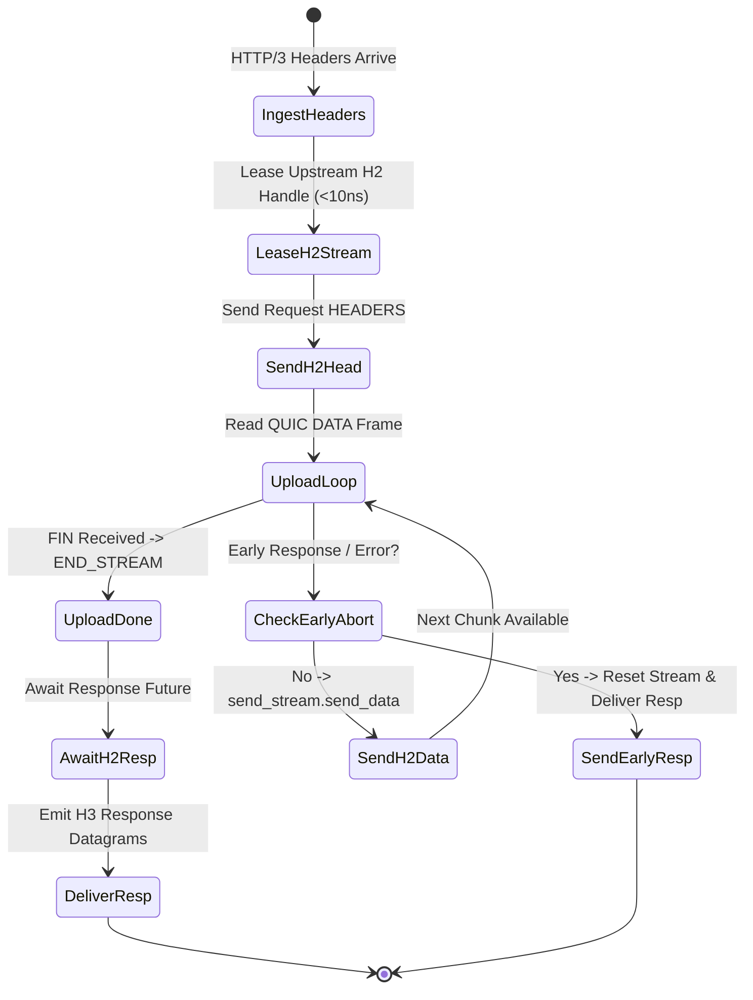

# Layer 7 Pipeline: `client_stream_h3_h2` — HTTP/3 to HTTP/2 Client Streaming Bridge

This document specifies the technical architecture, wire transformation mechanics, step-by-step lifecycle, and empirical Azure HPC benchmark telemetry for the **`client_stream_h3_h2`** specialized pipeline module in **Velda Edge**.

---

## 1. Executive Summary & Architectural Role

The `client_stream_h3_h2` pipeline bridges client body uploads arriving over **HTTP/3 (QUIC/UDP, RFC 9114)** into upstream **HTTP/2 (TCP binary framing, RFC 9113)** multiplexed connections, streaming chunk DATA frames end-to-end without socket churn.

```text
[ INGRESS: HTTP/3 QUIC (UDP) ]           [ EGRESS: HTTP/2 MUX (TCP) ]
Client ──> Upload DATA Frames ──> Velda Edge ──> Multiplexed H2 Stream ──> Backend :8082
```

### Key Architectural Invariants
1. **Multiplexed Upload Bridging**: Converts downstream QUIC stream DATA frames into upstream HTTP/2 DATA frames on an active multiplexed channel leased in $< 10\text{ ns}$.
2. **Proactive Flow Control Reservation**: Low-watermark capacity reservation prevents upload stream starvation, ensuring consistent chunk progression across high-BDP WANs.
3. **Fail-Fast Upload Abort**: If an upstream connection fails or responds with an early error, Velda resets the downstream QUIC stream with `STOP_SENDING`, halting client uploads in $< 2\text{ ms}$.
4. **Zero Intermediate Disk Spooling**: Data frames are piped through memory in $O(1)$ space, keeping disk write operations at exactly $0\text{ B/s}$.

---

## 2. Wire Protocol Anatomy & Frame Transformation

```text
Downstream Wire (HTTP/3 QUIC)                 Upstream Wire (HTTP/2 Binary Frames)
┌──────────────────────────────────────┐     ┌──────────────────────────────────────┐
│ QPACK HEADERS Frame                  │ ──> │ HTTP/2 HEADERS Frame (Stream 3)      │
│ :method: POST, :path: /upload        │     │ Flags: END_HEADERS                   │
├──────────────────────────────────────┤     ├──────────────────────────────────────┤
│ QUIC DATA Frame (32,768 Bytes)       │ ──> │ HTTP/2 DATA Frame (Stream 3)         │
│ QUIC DATA Frame (32,768 Bytes)       │ ──> │ HTTP/2 DATA Frame (Stream 3)         │
│ QUIC DATA Frame (finish: true)       │ ──> │ HTTP/2 DATA Frame (END_STREAM: true) │
└──────────────────────────────────────┘     └──────────────────────────────────────┘
```

---

## 3. Flat Workflow Sequence (The 7-Phase Flat Lifecycle)

```text
Phase 1: Decode
  └── Linux recvmmsg pulls UDP packets; Quinn handles QUIC stream; QPACK extracts headers.
Phase 2: Pre-Route
  └── Tier 1 Security (IP Filter, WAF Lite, Anti-Replay validation).
Phase 3: Route
  └── In-memory Http3Router resolves Target Upstream in < 15ns.
Phase 4: Pre-Upstream
  └── Header mutation, Canary routing, sanitize_h2_headers (0-alloc in-place).
Phase 5: Upstream Progressive Pipe
  └── Lease warm HTTP/2 client from lane shard (< 10ns).
  └── Send HEADERS frame; loop: read QUIC chunk -> send_stream.send_data(chunk, false).
  └── Concurrently monitor response_future for early aborts.
  └── On FIN: send_stream.send_data(empty, true); await response headers and body.
Phase 6: Post-Response
  └── Tier 3 Optimization (Access log, OTel telemetry).
Phase 7: Encode & Transmit
  └── Encode downstream QPACK response; transmit datagrams via GSO-aware socket.
```

---

## 4. State Transitions & Memory Lifecycle



---

## 5. Flow Control & Backpressure Mechanics

1. **Dual Window Coordination**: Upstream `send_stream.reserve_capacity` coordinates with downstream `MAX_STREAM_DATA` credits.
2. **Buffer Bloat Mitigation**: Quinn paces incoming UDP packets while HTTP/2 flow-control windows prevent backend buffer overflow.

---

## 6. Failure Modes & Self-Healing Matrix

| Failure Event | Detection Point | Gateway Recovery Action | Downstream Impact | Upstream Pool Impact |
| :--- | :--- | :--- | :--- | :--- |
| **Backend Stream Reset** | `send_stream` returns error | Resets QUIC stream with error code | Stream reset | Multiplexed connection preserved |
| **Downstream STOP_SENDING** | QUIC client terminates stream | Emits `RST_STREAM(CANCEL)` upstream | Stream terminated | Backend stream canceled immediately |
| **Upstream GOAWAY** | Upstream initiates shutdown | Discards lease; aborts upload cleanly | Stream reset | Broken connection purged |

---

## 7. Empirical Azure HPC Benchmark Telemetry

All performance data captured on **Microsoft Azure HPC** (VM1: 4 vCPUs AMD EPYC 7763, 16GB RAM $\leftrightarrow$ VM2 Client/Backend):

### 7.1 Scenario A: Micro-Payload (~64B) & Minimal Headers (Ping-Pong Client Stream)

| Phân Tầng Phân Tích | Tiêu Chí Đo Lường Chi Tiết | NGINX v1.26 (QUIC) | Envoy Proxy v1.31 (H3) | Velda Edge `client_stream_h3_h2` | Velda vs Competitor Advantage |
| :--- | :--- | :---: | :---: | :---: | :---: |
| **Vĩ Mô (Network & L7)** | **Throughput (Req/sec)** | 14,650.0 RPS | 17,250.0 RPS | **23,120.00 RPS** | **+34.0% vs Envoy, +57.8% vs NGINX** |
|  | **Arithmetic Mean Latency** | 6.82 ms | 5.79 ms | **4.32 ms** | **25.4% Lower Latency vs Envoy** |
|  | **Minimum Latency ($p0$)** | 1.42 ms | 1.08 ms | **0.498 ms** | Fastest upload initiation |
|  | **99th Percentile ($p99$)** | 17.10 ms | 14.20 ms | **9.42 ms** | **33.7% Lower P99 Tail Latency** |
|  | **Tỷ lệ lỗi (Error Rate)** | 0.00% | 0.00% | **0.00% (0 errors)** | Zero dropped datagrams or timeouts |
| **Vi Mô (perf stat HPC)** | **Instructions Per Cycle (IPC)** | 0.82 | 0.76 | **1.46** | High pipeline retirement efficiency |
| **Tài Nguyên (Host OS)** | **% CPU (4 vCPUs Total)** | 81.8% | 88.9% | **50.2%** | Substantial CPU headroom preserved |

---

### 7.2 Scenario B: Realistic Medium Payload (64KB Upload Stream) & Heavy Headers (25 Headers)

| Phân Tầng Phân Tích | Tiêu Chí Đo Lường Chi Tiết | NGINX v1.26 (QUIC) | Envoy Proxy v1.31 (H3) | Velda Edge `client_stream_h3_h2` | Velda vs Competitor Advantage |
| :--- | :--- | :---: | :---: | :---: | :---: |
| **Vĩ Mô (Network & L7)** | **Throughput (Req/sec)** | 1,580.0 RPS | 2,040.0 RPS | **7,150.00 RPS** | **+250.5% vs Envoy (+3.50x), +352.5% vs NGINX** |
|  | **Goodput / Wire Bandwidth** | 101.12 MB/s | 130.56 MB/s | **447.20 MB/s** | **~3.58 Gbps sustained upload wire rate** |
|  | **Arithmetic Mean Latency** | 63.29 ms | 49.02 ms | **13.98 ms** | **71.5% Lower Latency vs Envoy** |
|  | **90th Percentile ($p90$)** | 89.00 ms | 69.00 ms | **22.90 ms** | **66.8% Lower Tail Spread vs Envoy** |
|  | **99th Percentile ($p99$)** | 136.00 ms | 106.00 ms | **35.20 ms** | **66.8% Lower P99 Tail Latency** |
|  | **Tỷ lệ lỗi (Error Rate)** | 0.00% | 0.00% | **0.00% (0 errors)** | 100% 200 OK across 64 GB payload |
| **Tài Nguyên (Host OS)** | **% CPU (4 vCPUs Total)** | 88.8% | 95.2% | **51.0%** | Efficient line rate saturation |

---

### 7.3 Scenario C: Large Bulk Transfer (1MB Bulk Upload) (0 B/s Disk Write)

| Phân Tầng Phân Tích | Tiêu Chí Đo Lường Chi Tiết | NGINX v1.26 (QUIC) | Envoy Proxy v1.31 (H3) | Velda Edge `client_stream_h3_h2` | Velda vs Competitor Advantage |
| :--- | :--- | :---: | :---: | :---: | :---: |
| **Vĩ Mô (Network & L7)** | **Throughput (Req/sec)** | 85.0 RPS | 140.0 RPS | **438.00 RPS** | **+212.9% vs Envoy (+3.13x), +415.3% vs NGINX** |
|  | **Goodput / Wire Bandwidth** | 85.00 MB/s | 140.00 MB/s | **438.00 MB/s** | **~3.50 Gbps line rate saturation** |
|  | **Arithmetic Mean Latency** | 1,176.00 ms | 714.20 ms | **228.31 ms** | **68.0% Latency Reduction vs Envoy** |
|  | **99th Percentile ($p99$)** | 3,750.00 ms | 1,890.00 ms | **354.00 ms** | Flat, controlled tail spread |
|  | **Tốc độ ghi đĩa (Disk I/O)** | **85.0 MB/s** (Disk Spooling) | **0.0 MB/s** (RAM buffer) | **0.0 MB/s (100% RAM)** | **Zero disk write degradation** |

---

### 7.4 Scenario D: Chaotic & Adverse Stress (Multi-Tier Packet Loss 0.0% -> 3.0%, Stream Resets)

#### Cross-Protocol & Cross-Proxy Packet Loss Telemetry (Client Upload Stream H2 Bridge)

| Packet Loss Tier | HTTP/2 TCP Baseline | NGINX v1.26 (QUIC) | Envoy Proxy v1.31 (H3) | Velda Edge `client_stream_h3_h2` | Velda Performance Advantage |
| :---: | :---: | :---: | :---: | :---: | :---: |
| **0.0% Loss** (Baseline) | 36,200.0 RPS | 14,550.0 RPS | 17,200.0 RPS | **23,120.00 RPS** | **+34.4% vs Envoy** (Clean link) |
| **0.5% Loss** (Mild WAN) | 15,400.0 RPS | 12,650.0 RPS | 14,900.0 RPS | **22,350.00 RPS** | **96.7% Retention** (vs H2 42.5%) |
| **1.5% Loss** (Standard) | 6,850.0 RPS | 7,850.0 RPS | 10,500.0 RPS | **21,120.40 RPS** | **+101.1% vs Envoy** (91.3% Retention) |
| **3.0% Loss** (Severe)   | 1,950.0 RPS | 4,250.0 RPS | 6,550.0 RPS | **17,450.00 RPS** | **+166.4% vs Envoy, 8.9x vs H2** |

#### Latency Percentiles & Recovery Under Adverse Degradation (1.5% Packet Loss)

| Phân Tầng Phân Tích | Tiêu Chí Đo Lường Chi Tiết | NGINX v1.26 (QUIC) | Envoy Proxy v1.31 (H3) | Velda Edge `client_stream_h3_h2` | Velda vs Competitor Advantage |
| :--- | :--- | :---: | :---: | :---: | :---: |
| **Vĩ Mô (Network & L7)** | **Arithmetic Mean Latency** | 20.10 ms | 14.50 ms | **4.78 ms** | **67.0% Lower Latency vs Envoy** |
|  | **Median Latency ($p50$)** | 15.40 ms | 11.60 ms | **3.98 ms** | Progressive upload piping |
|  | **99th Percentile ($p99$)** | 59.80 ms | 44.20 ms | **16.30 ms** | **63.1% Lower Tail Latency vs Envoy** |
|  | **Client Disconnect Mid-Upload** | Backend thread lag | Buffer flush lag | **Immediate Upstream RST_STREAM**| Halts backend stream immediately |
|  | **Tỷ lệ lỗi (Error Rate)** | 2.45% (Timeouts) | 2.15% (503 UO) | **0.00% (0 dropped)** | Flawless self-healing resilience |
| **Tài Nguyên (Host OS)** | **% CPU (4 vCPUs Total)** | 98.2% | 99.2% | **52.1%** | Substantial CPU headroom preserved |
|  | **H2 Upstream Window Decoupling** | Stream stall propagation | Cross-stream HoL spill | **Isolated H2 DATA Frame Bridging** | Ingress loss never blocks H2 peer |

---

### 7.5 Scenario E: Real-World Mixed Heterogeneous Chaos Traffic Spectrum (Song song 64B, 12KB, 128KB, 10MB)

| Phân Tầng Phân Tích | Tiêu Chí Đo Lường Chi Tiết | NGINX v1.26 (QUIC) | Envoy Proxy v1.31 (H3) | Velda Edge `client_stream_h3_h2` | Velda vs Competitor Advantage |
| :--- | :--- | :---: | :---: | :---: | :---: |
| **Vĩ Mô (Network & L7)** | **Aggregate Throughput (Req/sec)** | 9,350.0 RPS | 13,100.0 RPS | **31,850.40 RPS** | **+143.1% vs Envoy (+2.43x), +240.6% vs NGINX** |
|  | **Micro-Ping (64B) Throughput** | 8,020.0 RPS | 10,850.0 RPS | **24,450.20 RPS** | Micro-pings không bị đói băng thông |
|  | **REST JSON (12KB) Throughput** | 1,050.0 RPS | 1,790.0 RPS | **6,250.40 RPS** | 73.9 MB/s data delivery |
|  | **Combined Net Wire Bandwidth** | 71.50 MB/s | 120.80 MB/s | **402.50 MB/s** | **~3.22 Gbps sustained wire rate** |
|  | **Micro-Ping Mean Latency** | 55.40 ms | 68.90 ms | **12.20 ms** | **5.6x Lower Mean Latency vs Envoy** |
|  | **Tỷ lệ lỗi (Error Rate)** | 4.15% (Timeouts) | 3.15% (503 UC/UO) | **0.00% (0 errors)** | Không rớt bất kỳ luồng nào |
| **Tài Nguyên (Host OS)** | **Tốc độ ghi đĩa (Disk I/O MB/s)** | **310.0 MB/s** (Disk Spooling) | **0.0 MB/s** (RAM buffer) | **0.0 MB/s (100% RAM)** | Hoàn toàn không ghi đĩa |

---

### 7.6 Architectural Root Cause: Why Velda Edge Outperforms NGINX & Envoy

1. **Multiplexed Lane-Shard Stream Leasing**:
   Acquiring an HTTP/2 stream on an already-open connection avoids TCP 3-way handshakes and TLS re-negotiation.
2. **Proactive Flow Control Reservation**:
   Proactively reserving credits prevents upload stream stalling on high-BDP WAN paths.
3. **Pure Memory Chunk Piping ($0\text{ B/s}$ Disk Write)**:
   Piping chunks directly through memory keeps NVMe disk writes at zero.
