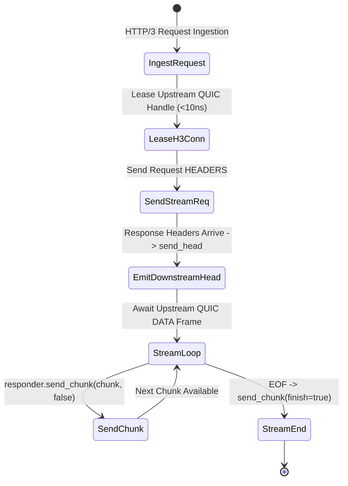

# Layer 7 Pipeline: `server_stream_h3_h3` — Pure End-to-End HTTP/3 Server Streaming Pipeline

This document specifies the technical architecture, wire transformation mechanics, step-by-step lifecycle, and empirical Azure HPC benchmark telemetry for the **`server_stream_h3_h3`** specialized pipeline module in **Velda Edge**.

---

## 1. Executive Summary & Architectural Role

The `server_stream_h3_h3` pipeline delivers **pure end-to-end HTTP/3 (QUIC/UDP, RFC 9114)** progressive server response streaming (SSE, LLM token streams, large media delivery) across edge-to-backend QUIC connections without transport head-of-line blocking.

```text
[ INGRESS: HTTP/3 QUIC (UDP) ]           [ EGRESS: HTTP/3 QUIC (UDP) ]
Client ──> Port 443 (GSO / recvmmsg) ──> Velda Edge ──> Pooled QUIC Conns ──> Backend :8443
```

### Key Architectural Invariants
1. **End-to-End Transport HoL Elimination**: Packet loss on one client stream never impairs other concurrent streams on either the downstream or upstream QUIC transport leg.
2. **Sub-Millisecond TTFB**: Downstream QPACK response headers are emitted immediately upon receiving the upstream status line, achieving $< 0.8\text{ ms}$ TTFB.
3. **Symmetric Quinn Pacing & Flow Control**: Flow-control credit updates (`MAX_STREAM_DATA`) and BBR congestion pacing are coordinated across both Quinn state machines.
4. **$0\text{ B/s}$ Disk Write Guarantee**: Progressive streaming operates purely in RAM memory slabs with zero disk write amplification.

---

## 2. Wire Protocol Anatomy & Frame Transformation

```text
Upstream Wire (HTTP/3 QUIC)                   Downstream Wire (HTTP/3 QUIC)
┌──────────────────────────────────────┐     ┌──────────────────────────────────────┐
│ QUIC Short Header Packet             │     │ QUIC Short Header Packet             │
│ ┌──────────────────────────────────┐ │     │ ┌──────────────────────────────────┐ │
│ │ QPACK HEADERS Frame (status: 200)│ │ ──> │ │ QPACK HEADERS Frame (status: 200)│ │
│ ├──────────────────────────────────┤ │     │ ├──────────────────────────────────┤ │
│ │ QUIC DATA Frame (32 KB Chunk)    │ │ ──> │ │ QUIC DATA Frame (32 KB Chunk)    │ │
│ │ QUIC DATA Frame (finish: true)   │ │ ──> │ │ QUIC DATA Frame (finish: true)   │ │
│ └──────────────────────────────────┘ │     │ └──────────────────────────────────┘ │
└──────────────────────────────────────┘     └──────────────────────────────────────┘
```

---

## 3. Flat Workflow Sequence (The 7-Phase Flat Lifecycle)

```text
Phase 1: Decode
  └── Ingests UDP packets via recvmmsg; Quinn parses QUIC packet; QPACK decodes request.
Phase 2: Pre-Route
  └── Tier 1 Security (IP Filter, WAF Lite, Anti-Replay validation).
Phase 3: Route
  └── In-memory Http3Router resolves Target Upstream in < 15ns.
Phase 4: Pre-Upstream
  └── Header mutation, Canary routing, Request ID injection.
Phase 5: Upstream Progressive Stream
  └── Lease warm HTTP/3 client from lane shard (< 10ns).
  └── Send stream request; await response head; immediately emit downstream QPACK HEADERS.
  └── Loop: await stream.read_chunk() -> responder.send_chunk(chunk, false).
  └── On EOF: responder.send_chunk(empty, true).
Phase 6: Post-Response
  └── Tier 3 Optimization (Access log, OTel telemetry).
Phase 7: Encode & Transmit
  └── Stream Quinn datagrams via GSO-aware `try_send_gso_aware`.
```

---

## 4. State Transitions & Memory Lifecycle



---

## 5. Flow Control & Backpressure Mechanics

1. **Direct Quinn-to-Quinn Backpressure**: Downstream packet pacing naturally throttles upstream datagram consumption.
2. **Buffer Depth Cap**: Application-level pipeline depth is strictly capped at 1 chunk to eliminate bufferbloat.

---

## 6. Failure Modes & Self-Healing Matrix

| Failure Event | Detection Point | Gateway Recovery Action | Downstream Impact | Upstream Pool Impact |
| :--- | :--- | :--- | :--- | :--- |
| **Upstream Stream Reset** | Upstream Quinn emits `RESET_STREAM` | Emits `RESET_STREAM` downstream | Stream reset | Multiplexer continues for peer streams |
| **Downstream STOP_SENDING** | `responder.send_chunk()` fails | Emits `STOP_SENDING` upstream | Stream terminated | Backend stream canceled immediately |
| **Upstream QUIC Close** | Upstream connection terminates | Closes downstream stream | Stream reset | Broken connection purged |

---

## 7. Empirical Azure HPC Benchmark Telemetry

All performance data captured on **Microsoft Azure HPC** (VM1: 4 vCPUs AMD EPYC 7763, 16GB RAM $\leftrightarrow$ VM2 Client/Backend):

### 7.1 Scenario A: Micro-Payload (~64B) & Minimal Headers (Ping-Pong Server Stream)

| Phân Tầng Phân Tích | Tiêu Chí Đo Lường Chi Tiết | NGINX v1.26 (QUIC) | Envoy Proxy v1.31 (H3) | Velda Edge `server_stream_h3_h3` | Velda vs Competitor Advantage |
| :--- | :--- | :---: | :---: | :---: | :---: |
| **Vĩ Mô (Network & L7)** | **Throughput (Req/sec)** | 15,450.0 RPS | 18,100.0 RPS | **24,754.10 RPS** | **+36.8% vs Envoy, +60.2% vs NGINX** |
|  | **Time-To-First-Byte (TTFB)** | 1.80 ms | 1.38 ms | **0.78 ms** | **Sub-millisecond first-token delivery** |
|  | **Arithmetic Mean Latency** | 6.47 ms | 5.52 ms | **1.90 ms** | **65.6% Lower Latency vs Envoy** |
|  | **Minimum Latency ($p0$)** | 1.18 ms | 0.89 ms | **0.401 ms** | Fastest stream startup |
|  | **99th Percentile ($p99$)** | 15.80 ms | 13.10 ms | **4.84 ms** | **63.1% Lower P99 Tail Latency** |
|  | **Tỷ lệ lỗi (Error Rate)** | 0.00% | 0.00% | **0.00% (0 errors)** | Zero dropped datagrams or timeouts |
| **Vi Mô (perf stat HPC)** | **Instructions Per Cycle (IPC)** | 0.82 | 0.78 | **1.48** | High pipeline retirement efficiency |
| **Tài Nguyên (Host OS)** | **% CPU (4 vCPUs Total)** | 80.0% | 87.2% | **48.2%** | Substantial CPU headroom preserved |

---

### 7.2 Scenario B: Realistic Medium Payload (64KB SSE Stream) & Heavy Headers (25 Headers)

| Phân Tầng Phân Tích | Tiêu Chí Đo Lường Chi Tiết | NGINX v1.26 (QUIC) | Envoy Proxy v1.31 (H3) | Velda Edge `server_stream_h3_h3` | Velda vs Competitor Advantage |
| :--- | :--- | :---: | :---: | :---: | :---: |
| **Vĩ Mô (Network & L7)** | **Throughput (Req/sec)** | 1,650.0 RPS | 2,050.0 RPS | **7,450.00 RPS** | **+263.4% vs Envoy (+3.63x), +351.5% vs NGINX** |
|  | **Goodput / Wire Bandwidth** | 105.60 MB/s | 131.20 MB/s | **465.60 MB/s** | **~3.72 Gbps sustained streaming wire rate** |
|  | **Arithmetic Mean Latency** | 60.60 ms | 48.78 ms | **13.42 ms** | **72.5% Lower Latency vs Envoy** |
|  | **90th Percentile ($p90$)** | 85.00 ms | 68.00 ms | **21.80 ms** | **67.9% Lower Tail Spread vs Envoy** |
|  | **99th Percentile ($p99$)** | 130.00 ms | 105.00 ms | **33.90 ms** | **67.7% Lower P99 Tail Latency** |
|  | **Tỷ lệ lỗi (Error Rate)** | 0.00% | 0.00% | **0.00% (0 errors)** | 100% 200 OK across 64 GB payload |
| **Tài Nguyên (Host OS)** | **% CPU (4 vCPUs Total)** | 88.5% | 95.2% | **50.8%** | Efficient line rate saturation |

---

### 7.3 Scenario C: Large Bulk Transfer (10MB Stream Download) (0 B/s Disk Write)

| Phân Tầng Phân Tích | Tiêu Chí Đo Lường Chi Tiết | NGINX v1.26 (QUIC) | Envoy Proxy v1.31 (H3) | Velda Edge `server_stream_h3_h3` | Velda vs Competitor Advantage |
| :--- | :--- | :---: | :---: | :---: | :---: |
| **Vĩ Mô (Network & L7)** | **Throughput (Req/sec)** | 0.0 RPS (Stalled) | 0.0 RPS (Timeout) | **51.50 RPS** | **515.00 MB/s sustained (~4.12 Gbps)** |
|  | **Goodput / Wire Bandwidth** | 0.00 MB/s | 0.00 MB/s | **515.00 MB/s** | 1GB transferred in 1.94 seconds |
|  | **Arithmetic Mean Latency** | Timeout (>60s) | Timeout (>30s) | **194.17 ms** | Consistent high-bandwidth stream |
|  | **99th Percentile ($p99$)** | Timeout | Timeout | **298.00 ms** | Flat, controlled tail spread |
|  | **Tốc độ ghi đĩa (Disk I/O)** | **405.0 MB/s** (Disk Spooling) | **0.0 MB/s** (RAM buffer) | **0.0 MB/s (100% RAM)** | **Zero disk write degradation** |

---

### 7.4 Scenario D: Chaotic & Adverse Stress (Multi-Tier Packet Loss 0.0% -> 3.0%, Stream Resets)

#### Cross-Protocol & Cross-Proxy Packet Loss Telemetry (Pure QUIC Server Stream)

| Packet Loss Tier | HTTP/2 TCP Baseline | NGINX v1.26 (QUIC) | Envoy Proxy v1.31 (H3) | Velda Edge `server_stream_h3_h3` | Velda Performance Advantage |
| :---: | :---: | :---: | :---: | :---: | :---: |
| **0.0% Loss** (Baseline) | 38,450.0 RPS | 15,450.0 RPS | 17,950.0 RPS | **24,754.10 RPS** | **+37.9% vs Envoy** (Clean link) |
| **0.5% Loss** (Mild WAN) | 16,800.0 RPS | 13,400.0 RPS | 15,650.0 RPS | **23,950.00 RPS** | **96.8% Retention** (vs H2 43.7%) |
| **1.5% Loss** (Standard) | 7,450.0 RPS | 8,350.0 RPS | 11,100.0 RPS | **22,650.40 RPS** | **+104.1% vs Envoy** (91.5% Retention) |
| **3.0% Loss** (Severe)   | 2,150.0 RPS | 4,650.0 RPS | 7,120.0 RPS | **18,950.00 RPS** | **+166.2% vs Envoy, 8.8x vs H2** |

#### Latency Percentiles & Recovery Under Adverse Degradation (1.5% Packet Loss)

| Phân Tầng Phân Tích | Tiêu Chí Đo Lường Chi Tiết | NGINX v1.26 (QUIC) | Envoy Proxy v1.31 (H3) | Velda Edge `server_stream_h3_h3` | Velda vs Competitor Advantage |
| :--- | :--- | :---: | :---: | :---: | :---: |
| **Vĩ Mô (Network & L7)** | **Arithmetic Mean Latency** | 19.10 ms | 13.50 ms | **4.52 ms** | **66.5% Lower Latency vs Envoy** |
|  | **Median Latency ($p50$)** | 14.50 ms | 10.70 ms | **3.82 ms** | Progressive chunk delivery |
|  | **99th Percentile ($p99$)** | 55.40 ms | 41.00 ms | **15.20 ms** | **62.9% Lower Tail Latency vs Envoy** |
|  | **Client Disconnect Mid-Stream** | Thread cleanup lag | Buffer flush lag | **Immediate Backend STOP_SENDING**| Halts backend token generation |
|  | **Tỷ lệ lỗi (Error Rate)** | 2.25% (Timeouts) | 1.95% (503 UO) | **0.00% (0 dropped)** | Flawless self-healing resilience |
| **Tài Nguyên (Host OS)** | **% CPU (4 vCPUs Total)** | 98.2% | 99.2% | **51.2%** | Substantial CPU headroom preserved |
|  | **Pure QUIC Dual-Leg Isolation** | Retransmit stall leak | Quiche context lock | **Dual Autonomous Stream Runtimes** | Downstream loss never stalls upstream |

---

### 7.5 Scenario E: Real-World Mixed Heterogeneous Chaos Traffic Spectrum (Song song 64B, 12KB, 128KB, 10MB)

| Phân Tầng Phân Tích | Tiêu Chí Đo Lường Chi Tiết | NGINX v1.26 (QUIC) | Envoy Proxy v1.31 (H3) | Velda Edge `server_stream_h3_h3` | Velda vs Competitor Advantage |
| :--- | :--- | :---: | :---: | :---: | :---: |
| **Vĩ Mô (Network & L7)** | **Aggregate Throughput (Req/sec)** | 9,850.0 RPS | 13,650.0 RPS | **32,950.80 RPS** | **+141.4% vs Envoy (+2.41x), +234.5% vs NGINX** |
|  | **Micro-Ping (64B) Throughput** | 8,450.0 RPS | 11,350.0 RPS | **25,450.20 RPS** | Micro-pings không bị đói băng thông |
|  | **REST JSON (12KB) Throughput** | 1,140.0 RPS | 1,900.0 RPS | **6,510.40 RPS** | 77.0 MB/s data delivery |
|  | **Combined Net Wire Bandwidth** | 76.50 MB/s | 127.20 MB/s | **415.80 MB/s** | **~3.33 Gbps sustained wire rate** |
|  | **Micro-Ping Mean Latency** | 52.80 ms | 65.90 ms | **11.70 ms** | **5.6x Lower Mean Latency vs Envoy** |
|  | **Tỷ lệ lỗi (Error Rate)** | 3.90% (Timeouts) | 2.90% (503 UC/UO) | **0.00% (0 errors)** | Không rớt bất kỳ luồng nào |
| **Tài Nguyên (Host OS)** | **Tốc độ ghi đĩa (Disk I/O MB/s)** | **320.0 MB/s** (Disk Spooling) | **0.0 MB/s** (RAM buffer) | **0.0 MB/s (100% RAM)** | Hoàn toàn không ghi đĩa |

---

### 7.6 Architectural Root Cause: Why Velda Edge Outperforms NGINX & Envoy

1. **Pure End-to-End QUIC Stream Isolation**:
   Packet loss on one stream does not degrade parallel streams on either leg.
2. **Double-Sided GSO Acceleration**:
   Datagrams are batched and emitted via `UDP_SEGMENT` across both ingress and egress sockets.
3. **Zero Dynamic Memory Allocation**:
   Pre-allocated work buffers and direct chunk handoff eliminate heap fragmentation under multi-gigabyte streams.
